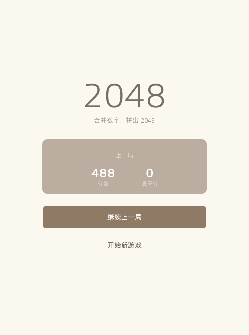
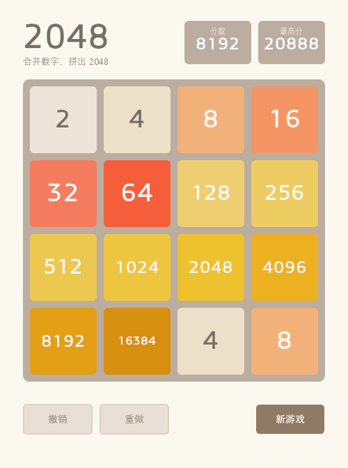

# 2048 · Python 实现系列

用 Python 从零实现 2048：从**数学模型**到**控制台版**、**带历史记录的续玩版**、再到 **PyQt5 桌面版**（MVC 架构 / 撤销重做 / 启动页 / 高 DPI 适配），并附带系列技术博客。

## 目录结构

```
2048/
├── console_2048/                     # 第 1 篇：纯控制台版
│   └── console_2048.py
├── console_2048_with_history/        # 第 2 篇：带历史记录 + 续玩
│   ├── console_2048_with_history.py
│   └── game_history/                 # 对局存档（运行时生成）
├── pyqt_2048/                        # 第 3 篇：PyQt5 桌面版
│   ├── pyqt_2048_with_history.py     #   主程序（MVC + 撤销/重做 + 历史 + 启动页）
│   ├── Untitled-1.py                 #   早期简单原型
│   ├── screenshots/                  #   启动页 / 游戏页截图
│   └── game_history/                 #   对局存档（运行时生成）
├── blog/                             # 系列博客
│   ├── 1.Python 实现：从数学模型到完整控制台版《2048》游戏.md
│   ├── 2.如何实现带历史记录功能的控制台2048游戏.md
│   ├── 3.使用 PyQt5 实现 2048 桌面版游戏（MVC 架构与撤销重做）.md
│   └── 目录.md                       #   系列总纲与里程碑
├── ai_solver_2048.py                 # 求解器核心（Expectimax + 启发式评估，可自动对局）
├── run_ai_2048.py                    # 求解器交互脚本（演示模式 / 批量测试）
└── simple_ai_demo.py                 # 求解器简化演示（固定步数，无需交互）
```

## 环境依赖

- **Python 3.8+**
- **PyQt5**（仅桌面版需要；控制台版只用标准库）

```bash
pip install PyQt5
```

> 控制台版使用 Windows 的 `msvcrt` 读取按键，仅支持 Windows。

## 运行方式

```bash
# 第 1 篇：纯控制台版
python console_2048/console_2048.py

# 第 2 篇：带历史记录的控制台版
python console_2048_with_history/console_2048_with_history.py

# 第 3 篇：PyQt5 桌面版
python pyqt_2048/pyqt_2048_with_history.py

# AI 求解器（Expectimax 自动对局：演示模式 / 批量测试）
python run_ai_2048.py

# AI 求解器简化演示（固定 10 步，无需交互）
python simple_ai_demo.py
```

## 操作说明

| 版本 | 操作 |
| --- | --- |
| 控制台版 | 方向键 / `WASD` 移动；`Q` 退出 |
| 桌面版 | 方向键 / `WASD` 移动；`Ctrl+Z` 撤销；`Ctrl+Y` 重做 |
| 桌面版 · 启动页 | `Tab` 切换焦点；`回车` / `空格` 触发「继续上一局 / 开始新游戏」 |
| AI 求解器 | 自动对局，`Ctrl+C` 中断并保存；`run_ai_2048.py` 另含批量测试模式 |

桌面版启动时：若检测到未完成的对局会停在**启动页**（展示上一局分数），否则直接进入游戏页。

## 数据与存档

每个版本在各自的 `game_history/` 下按对局保存：

- `<game_id>/history.csv` —— 每一步操作（步数、操作类型、分数、网格状态）
- `<game_id>/game_state.json` —— 当前完整状态，用于「继续上一局」
- `index.json` —— 对局索引（分数、是否完成、更新时间）
- `best_score.json` —— 历史最高分

## 界面预览（桌面版）

| 启动页 | 游戏页 |
| --- | --- |
|  |  |

## 系列博客

1. [Python 实现：从数学模型到完整控制台版《2048》游戏](blog/1.Python%20实现：从数学模型到完整控制台版《2048》游戏.md)
2. [如何实现带历史记录功能的控制台 2048 游戏](blog/2.如何实现带历史记录功能的控制台2048游戏.md)
3. [使用 PyQt5 实现 2048 桌面版游戏：MVC 架构与撤销/重做](blog/3.使用%20PyQt5%20实现%202048%20桌面版游戏（MVC%20架构与撤销重做）.md)

后续计划：PyQt 动画与性能优化、更多求解算法（贪心 / MCTS）、用历史数据训练模型。

## 说明

- `ai_solver_2048.py`、`run_ai_2048.py`、`simple_ai_demo.py` 为 **Expectimax 自动求解器**，可直接运行：`python run_ai_2048.py`（演示 / 批量测试）或 `python simple_ai_demo.py`（固定步数演示）。求解器复用控制台版的对局与存档接口，对局同样落盘到 `console_2048_with_history/game_history/`。
- 桌面版的界面为纯视觉优化（布局 / 配色 / 字号 / 间距 / 圆角 / 控件状态），不影响游戏规则、分数与存档逻辑。
