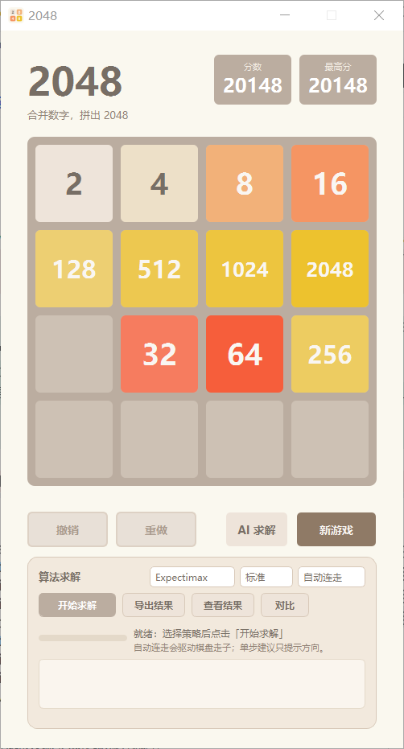
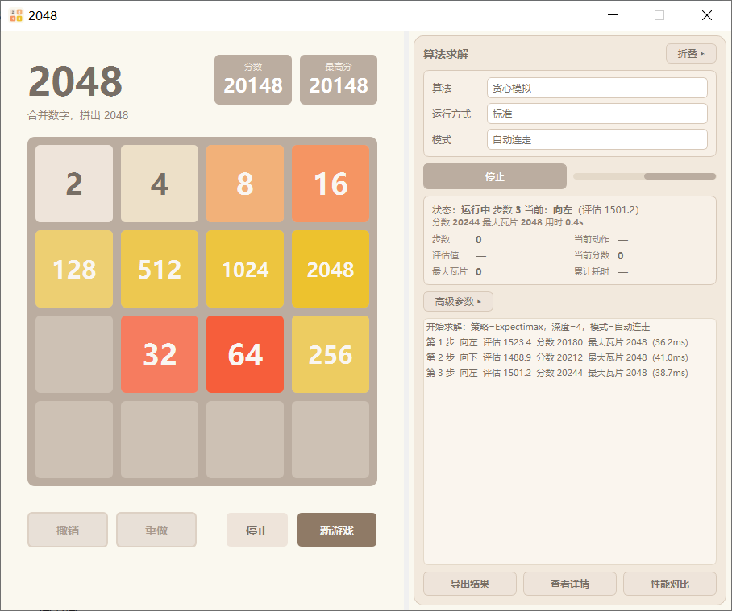
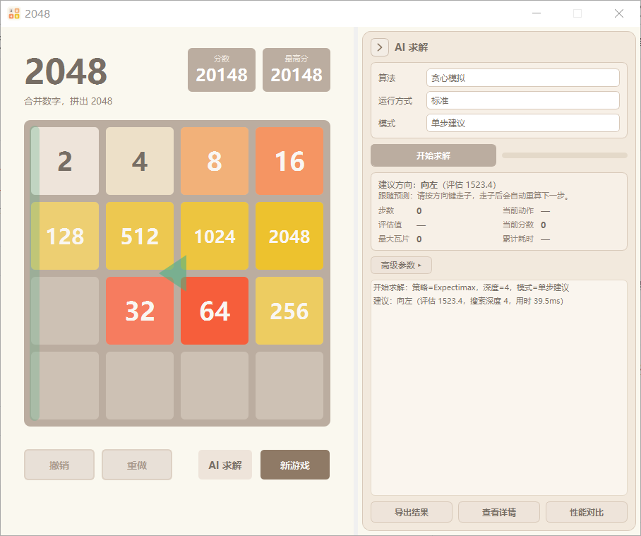

# 2048 · Python 实现系列

用 Python 从零实现 2048：从**数学模型**到**控制台版**、**带历史记录的续玩版**、再到 **PyQt5 桌面版**（MVC 架构 / 撤销重做 / 启动页 / 高 DPI 适配）、**平滑动画版**，最后是**算法求解版**（启发式 / Expectimax 接入现有界面），并附带系列技术博客。

## 目录结构

```
2048/
├── v1_console_2048/                  # 第 1 篇：纯控制台版
│   └── v1_console_2048.py
├── v2_console_2048_with_history/     # 第 2 篇：带历史记录 + 续玩
│   ├── v2_console_2048_with_history.py
│   └── game_history/                 # 对局存档（运行时生成）
├── v3_pyqt_2048/                     # 第 3 篇：PyQt5 桌面版
│   ├── v3_pyqt_2048_with_history.py  #   主程序（MVC + 撤销/重做 + 历史 + 启动页）
│   ├── screenshots/                  #   启动页 / 游戏页整窗截图
│   └── game_history/                 #   对局存档（运行时生成）
├── v4_pyqt_2048_animated/            # 第 4 篇：PyQt5 动画版（复用第 3 篇 GameCore）
│   ├── v4_pyqt_2048_animated.py      #   主程序（分层渲染 + 定时器插值动画）
│   ├── screenshots/                  #   启动页 / 悬停与合并粒子 / 游戏页整窗截图
│   └── game_history/                 #   对局存档（运行时生成）
├── v5_pyqt_2048_solver/              # 第 6 篇：算法求解版（复用第 4 篇界面，增量扩展）
│   ├── v5_pyqt_2048_solver.py        #   主程序（继承第 4 版 MainWindow + 底部求解面板）
│   ├── solver_2048.py                #   求解算法核心（启发式 / Expectimax，可独立测试）
│   ├── test_solver.py                #   测试用例（算法核心 + 界面集成，20 条）
│   ├── 功能说明.md                    #   第 5 版功能说明文档
│   ├── screenshots/                  #   启动页 / 游戏页 / 求解中 / 单步建议整窗截图
│   ├── solver_results/               #   求解会话与导出文件（运行时生成）
│   └── game_history/                 #   对局存档（运行时生成）
├── tools/capture_gui.py              # 统一 GUI 截图入口（见 docs/GUI_SCREENSHOT_STANDARD.md）
├── docs/GUI_SCREENSHOT_STANDARD.md   # GUI 截图与视觉验收规范（强制）
├── safe_store.py                     # 跨版本安全存档工具（原子写入/校验/备份/单实例锁，v2–v5 共用）
├── ui_theme.py                       # 跨版本主题化弹窗组件（暖棕配色，v4/v5 共用）
├── tests/                            # 跨版本测试
│   ├── test_cross_version.py         #   v2–v5 异常退出存档恢复测试（真实 taskkill /F）
│   ├── test_popups.py                #   v4/v5 主题化弹窗回归测试
│   └── _driver.py                    #   测试驱动（子进程内构造各版本模型）
├── AGENTS.md / .trae/rules/          # 项目级 Agent 规则（含截图强制规范）
├── blog/                             # 系列博客
│   ├── 1.Python 实现：从数学模型到完整控制台版《2048》游戏.md
│   ├── 2.如何实现带历史记录功能的控制台2048游戏.md
│   ├── 3.使用 PyQt5 实现 2048 桌面版游戏（MVC 架构与撤销重做）.md
│   ├── 4.使用 PyQt5 实现 2048 平滑动画与性能优化.md
│   └── 目录.md                       #   系列总纲与里程碑
├── ai_solver_2048.py                 # 求解器核心（Expectimax + 启发式评估，可自动对局）
├── run_ai_2048.py                    # 求解器交互脚本（演示模式 / 批量测试）
└── simple_ai_demo.py                 # 求解器简化演示（固定步数，无需交互）
```

## 版本对照

| 版本号 | 目录 | 入口脚本 | 对应博客 | 形态 |
| --- | --- | --- | --- | --- |
| **v1** | `v1_console_2048/` | `v1_console_2048.py` | 第 1 篇 | 控制台版（数学模型） |
| **v2** | `v2_console_2048_with_history/` | `v2_console_2048_with_history.py` | 第 2 篇 | 控制台版 + 历史记录/续玩 |
| **v3** | `v3_pyqt_2048/` | `v3_pyqt_2048_with_history.py` | 第 3 篇 | PyQt5 桌面版（MVC + 撤销/重做） |
| **v4** | `v4_pyqt_2048_animated/` | `v4_pyqt_2048_animated.py` | 第 4 篇 | PyQt5 动画版（复用 v3 的 GameCore） |
| **v5** | `v5_pyqt_2048_solver/` | `v5_pyqt_2048_solver.py` | 第 6 篇 | PyQt5 算法求解版（复用 v4 界面 + 求解面板） |

> 版本号顺序与系列博客一致；v4 通过 `sys.path` 复用 v3 的 `GameCore`（`from v3_pyqt_2048_with_history import GameCore`），v5 复用 v4 的界面与模型（`import v4_pyqt_2048_animated`）。

## 环境依赖

- **Python 3.8+**
- **PyQt5**（仅桌面版需要；控制台版只用标准库）

```bash
pip install PyQt5
```

> 控制台版使用 Windows 的 `msvcrt` 读取按键，仅支持 Windows。

## 运行方式

```bash
# 第 1 篇：纯控制台版
python v1_console_2048/v1_console_2048.py

# 第 2 篇：带历史记录的控制台版
python v2_console_2048_with_history/v2_console_2048_with_history.py

# 第 3 篇：PyQt5 桌面版
python v3_pyqt_2048/v3_pyqt_2048_with_history.py

# 第 4 篇：PyQt5 动画版
python v4_pyqt_2048_animated/v4_pyqt_2048_animated.py

# 第 6 篇：PyQt5 算法求解版（第 5 版）
python v5_pyqt_2048_solver/v5_pyqt_2048_solver.py

# 第 5 版测试用例（算法核心 + 界面集成）
python v5_pyqt_2048_solver/test_solver.py

# AI 求解器（Expectimax 自动对局：演示模式 / 批量测试）
python run_ai_2048.py

# AI 求解器简化演示（固定 10 步，无需交互）
python simple_ai_demo.py
```

## 操作说明

| 版本 | 操作 |
| --- | --- |
| 控制台版 | 方向键 / `WASD` 移动；`Q` 退出 |
| 桌面版 | 方向键 / `WASD` 移动；`Ctrl+Z` 撤销；`Ctrl+Y` 重做 |
| 桌面版 · 启动页 | `Tab` 切换焦点；`回车` / `空格` 触发「继续上一局 / 开始新游戏」 |
| 桌面版 · 动画版 | 操作同桌面版；移动带平滑动画（滑行 / 合并回弹 / 新生放大），撤销 / 重做带反向 / 正向滑行动画 |
| 桌面版 · 算法求解版（v5） | 操作同上；游戏页点 `AI 求解`（或面板 `开始求解`）触发算法求解，支持 `启发式 / Expectimax`、`单步建议 / 自动连走`，并实时展示进度与逐步结果 |
| AI 求解器 | 自动对局，`Ctrl+C` 中断并保存；`run_ai_2048.py` 另含批量测试模式 |

桌面版启动时：若检测到未完成的对局会停在**启动页**（展示上一局分数），否则直接进入游戏页。

## 数据与存档

每个版本在各自的 `game_history/` 下按对局保存：

- `<game_id>/history.csv` —— 每一步操作（步数、操作类型、分数、网格状态）
- `<game_id>/game_state.json` —— 当前完整状态，用于「继续上一局」
- `<game_id>/game_state.json.bak` —— 上一份**有效**存档的备份（主档损坏时自动回退）
- `index.json` —— 对局索引（分数、是否完成、更新时间）
- `best_score.json` —— 历史最高分
- `.instance.lock` —— 单实例锁（同版本已有活动进程时，新进程只读运行，避免互相覆盖）

存档写入统一走 [safe_store.py](safe_store.py)：**原子写入**（同目录临时文件 + fsync + `os.replace`）、
**加载校验**（4×4 棋盘 / 方块值 / 分数 / 布尔字段）、**版本标记**（`schema`/`version`）、
**异常退出恢复**（崩溃/`taskkill /F` 后能恢复最后一次成功保存的完整对局）。存档目录可用环境变量
`2048_HISTORY_DIR` 覆盖（按版本隔离到子目录），便于测试与多环境部署。

第 5 版另在 `v5_pyqt_2048_solver/solver_results/` 下保存求解结果：

- `sessions.json` —— 历史求解会话（策略、深度、模式、逐步结果、最终分数等）
- `exports/<id>.json` / `<id>.csv` —— 单次会话的结构化导出
- `exports/comparison_*.csv` —— 多会话对比导出

## 界面预览（桌面版 · 动画版）

| 启动页 | 合并粒子 | 游戏页 |
| --- | --- | --- |
|  |  |  |

## 界面预览（第 5 版 · 算法求解版）

| 游戏页（含求解面板） | 求解中（实时状态） | 单步建议 |
| --- | --- | --- |
|  |  |  |

## 开发规范（强制）

- **GUI 截图规范**：[docs/GUI_SCREENSHOT_STANDARD.md](docs/GUI_SCREENSHOT_STANDARD.md) —— 正式截图必须是含 Windows 原生标题栏的完整窗口、不得丢失任何文字，并通过 `CAPTURE/STRUCTURE/TEXT/VISUAL` 门禁；未验证标记 `UNVERIFIED`，不合格不得交付。项目级 Agent 规则见 [AGENTS.md](AGENTS.md) 与 [.trae/rules/project_rules.md](.trae/rules/project_rules.md)。
- **统一截图入口**：`python tools/capture_gui.py --version v5|v4|v3 --scene <scene>`，正式图输出到各版本 `screenshots/full_<scene>.png`。

```bash
python tools/capture_gui.py --version v5 --scene game       # v5: start|game|solver|suggest|gameover|export|results|recover
python tools/capture_gui.py --version v4 --scene start      # v4: start|game|hover|merge|gameover|won|recover
python tools/capture_gui.py --version v3 --scene game       # v3: start|game|recover
```

## 测试

```bash
python tests/test_cross_version.py     # v2–v5 异常退出存档恢复（真实 taskkill /F 强杀后重载校验）
python tests/test_popups.py            # v4/v5 主题化弹窗回归（外观/返回值/键盘/焦点/高 DPI）
python v5_pyqt_2048_solver/test_solver.py   # 第 5 版求解器与界面测试
```

> 恢复测试全程使用隔离的临时存档目录（`2048_HISTORY_DIR`），不会触碰真实用户存档。

## 系列博客

1. [Python 实现：从数学模型到完整控制台版《2048》游戏](blog/1.Python%20实现：从数学模型到完整控制台版《2048》游戏.md)
2. [如何实现带历史记录功能的控制台 2048 游戏](blog/2.如何实现带历史记录功能的控制台2048游戏.md)
3. [使用 PyQt5 实现 2048 桌面版游戏：MVC 架构与撤销/重做](blog/3.使用%20PyQt5%20实现%202048%20桌面版游戏（MVC%20架构与撤销重做）.md)
4. [使用 PyQt5 实现 2048：平滑动画与性能优化](blog/4.使用%20PyQt5%20实现%202048%20平滑动画与性能优化.md)

后续计划：本地 / 网络双人对战、更多求解算法（贪心 / MCTS / Expectimax）、用历史数据训练模型。

## 说明

- `ai_solver_2048.py`、`run_ai_2048.py`、`simple_ai_demo.py` 为 **Expectimax 自动求解器**，可直接运行：`python run_ai_2048.py`（演示 / 批量测试）或 `python simple_ai_demo.py`（固定步数演示）。求解器复用控制台版的对局与存档接口，对局同样落盘到 `v2_console_2048_with_history/game_history/`。
- 桌面版的界面为纯视觉优化（布局 / 配色 / 字号 / 间距 / 圆角 / 控件状态），不影响游戏规则、分数与存档逻辑。
- 动画版（第 4 篇）直接复用第 3 篇的 `GameCore`，只替换 View 层并加入平滑动画；使用自己的 `v4_pyqt_2048_animated/game_history/` 存档目录。
- 算法求解版（v5）在第 4 版界面上**增量**接入求解能力：启动页与第 4 版逐像素一致，仅游戏页向下扩展一块求解面板；求解在后台线程执行（带时间预算与异常兜底），支持 `启发式 / Expectimax`、`单步建议 / 自动连走`，并提供结果导出、查看与对比。详见 [v5_pyqt_2048_solver/功能说明.md](v5_pyqt_2048_solver/功能说明.md)。
