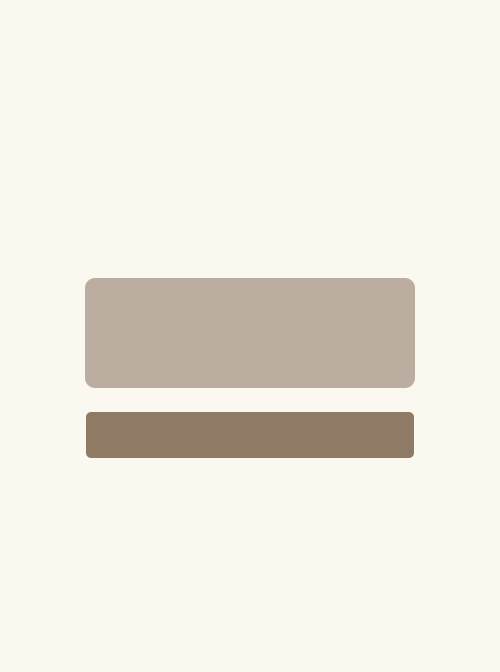
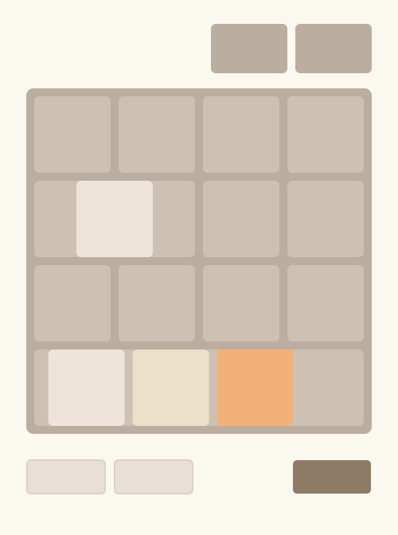
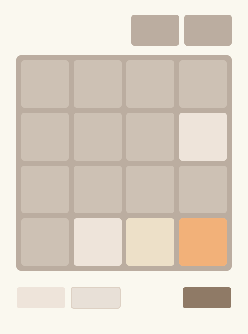

# 使用 PyQt5 实现 2048：平滑动画与性能优化

第 3 篇我们用 PyQt5 把 2048 搬上了桌面，但界面是"**整盘重绘、方块瞬移**"的：一次移动就是把新网格直接写进 16 个 `QLabel`，方块从 A 格"跳"到 B 格，中间没有过程。

这一篇做两件事：

1. 给移动加上**平滑动画**——滑行、合并回弹、新方块放大出现；
2. 顺手做一轮**渲染性能优化**——把棋盘拆成"静态背景层 + 动画层"。

本篇配套代码位于 `pyqt_2048_animated/pyqt_2048_animated.py`，可直接运行。


### 1. 总思路：Model 不动，换掉 View

要做动画，先要回答一个问题：**一次移动里，哪个方块从哪里来、到哪里去？**

- 靠"对比移动前后的两个棋盘"来反推是不可靠的——数字会重复。例如一行 `[2, 2, 2, 2]` 向左合并后是 `[4, 4, 0, 0]`，没有人能从一个静态网格里判断出"哪个 4 来自哪两个 2"。
- 正确做法是**在合并发生的那一刻就把过渡记下来**。

于是分层这样安排：

| 层 | 类 | 变化 |
| --- | --- | --- |
| **Model** | `GameCore`（第 3 篇，**一行不改**） + `AnimatedGameCore`（子类） | 只额外记录每块的"起点 → 终点"与新生方块位置 |
| **View** | `BoardView`（`QWidget` + `QPainter` 自绘） | 从 16 个 `QLabel` 换成"静态背景层（缓存）+ 动画层（逐帧插值）" |
| **Controller** | `MainWindow` | 动画进行中忽略输入；动画结束后再做胜负提示 |

Model 是直接复用第 3 篇的：`from pyqt_2048_with_history import GameCore`。也就是说，这一篇**没有改动任何一条合并规则、存档或撤销重做的逻辑**——又一次印证了 MVC 分层的价值。


### 2. Model：只补"过渡信息"

`AnimatedGameCore` 继承 `GameCore`，把两件事记下来：`last_transitions`（每块的去向）和 `last_spawn`（新方块坐标）。

#### 2.1 逐行合并时输出"去向"

```python
def _merge_line_tracked(self, line):
    """
    返回 (新行, ops)。
    ops: [(源下标, 目标下标, 该块当前显示的数值, 是否合并)]
    """
    size = len(line)
    items = [(v, p) for p, v in enumerate(line) if v != 0]   # (数值, 源下标)

    result = []          # (最终值, [源下标...], 是否合并, 滑动时显示的数值)
    i = 0
    while i < len(items):
        if i + 1 < len(items) and items[i][0] == items[i + 1][0]:
            v = items[i][0]
            self.score += v * 2
            result.append((v * 2, [items[i][1], items[i + 1][1]], True, v))
            i += 2
        else:
            result.append((items[i][0], [items[i][1]], False, items[i][0]))
            i += 1

    new_line = [r[0] for r in result] + [0] * (size - len(result))
    ops = []
    for dst_p, (_final, srcs, merged, tile_v) in enumerate(result):
        for sp in srcs:
            ops.append((sp, dst_p, tile_v, merged))
    return new_line, ops
```

> 关键细节：**合并时两块携带各自的原值**（比如两个 2）一起滑向同一格，落定后才显示合并结果 4。如果把两块都当成 4 来画，滑行过程中就会出现"凭空多出一个 4"的错觉。

#### 2.2 覆盖 `_slide`：行内下标 → 棋盘坐标

`_slide` 仍然沿用第 3 篇那套"上下先转置、左右按需翻转"的方向抽象，只是多记了一笔：

```python
def _slide(self, direction):
    size = self.grid_size
    self.last_transitions = []
    moved = False

    if direction in ('up', 'down'):
        self.grid = [list(row) for row in zip(*self.grid)]

    for i in range(size):
        original = self.grid[i]
        row = original[::-1] if direction in ('right', 'down') else original
        new_row, ops = self._merge_line_tracked(row)
        if direction in ('right', 'down'):
            new_row = new_row[::-1]
        if new_row != original:          # 与原行（而非翻转后的行）比较
            moved = True
        self.grid[i] = new_row

        for src_p, dst_p, value, merged in ops:
            # 行内下标 -> 棋盘坐标（注意翻转与转置）
            if direction in ('right', 'down'):
                src_p, dst_p = size - 1 - src_p, size - 1 - dst_p
            if direction in ('up', 'down'):
                src, dst = (src_p, i), (dst_p, i)
            else:
                src, dst = (i, src_p), (i, dst_p)
            self.last_transitions.append((src, dst, value, merged))

    if direction in ('up', 'down'):
        self.grid = [list(row) for row in zip(*self.grid)]
    return moved
```

再把新生方块的位置记下来，动画就能知道"哪个格子要放大出现"：

```python
def add_new_tile(self):
    empty = [(i, j) for i in range(self.grid_size)
             for j in range(self.grid_size) if self.grid[i][j] == 0]
    if not empty:
        self.last_spawn = None
        return False
    i, j = random.choice(empty)
    self.grid[i][j] = 2 if random.random() < 0.9 else 4
    self.last_spawn = (i, j)
    return True
```

> **踩过的坑**：`moved` 一定要和**翻转前**的原行比较。我第一版写成和翻转后的 `row` 比，结果"向右/向下"方向在其实没动时也返回 `True`——空按一次方向键就会冒出一个新方块。后来用随机盘面把 `AnimatedGameCore._slide` 和第 3 篇的 `GameCore._slide` 逐一对拍，才把这个偏差抓出来。


### 3. View：分层渲染 + 逐帧插值

`BoardView` 不再用 `QLabel`，而是继承 `QWidget` 自己用 `QPainter` 画。帧结构很简单：**先贴背景，再画方块**。

#### 3.1 静态背景层：只画一次，缓存成 pixmap

背景（棋盘底板 + 16 个空格）是永远不变的，没必要每帧重画、重做一次圆角抗锯齿。构造时"烘焙"成一张 `QPixmap`：

```python
def _build_background(self):
    pm = QPixmap(BOARD_SIDE, BOARD_SIDE)
    pm.fill(Qt.transparent)
    p = QPainter(pm)
    p.setRenderHint(QPainter.Antialiasing, True)
    p.setPen(Qt.NoPen)
    p.setBrush(QColor(COLOR_BOARD))
    p.drawRoundedRect(QRectF(0, 0, BOARD_SIDE, BOARD_SIDE), BOARD_RADIUS, BOARD_RADIUS)
    p.setBrush(QColor(COLOR_EMPTY))
    for i in range(self.grid_size):
        for j in range(self.grid_size):
            p.drawRoundedRect(self._cell_rect(i, j), TILE_RADIUS, TILE_RADIUS)
    p.end()
    return pm
```

`paintEvent` 里一句 `p.drawPixmap(0, 0, self._background)` 就把整块底板贴上去，剩下只画会动的方块。

#### 3.2 动画层：滑行 → 合并/新生

一次移动分两个阶段，用一个 ~60FPS 的 `QTimer` 推进：

- `move`：所有方块从起点插值滑到终点；
- `pop`：落定后，合并的格子做一次回弹，新生格子放大出现。

```python
def _tick(self):
    if self.anim is None:
        self.timer.stop()
        return
    self.anim["t"] += self.timer.interval() / 1000.0

    if self.anim["phase"] == "move":
        if self.anim["t"] >= MOVE_DURATION:
            self.anim["phase"] = "pop"
            self.anim["t"] = 0.0
    else:
        if self.anim["t"] >= POP_DURATION:
            self.grid = self.anim["final"]
            self.anim = None
            self.timer.stop()
            self.update()
            self.animationFinished.emit()
            return
    self.update()
```

滑行阶段按进度在起点/终点之间插值，缓动用 `ease_out_cubic`（起步快、收尾稳）：

```python
prog = ease_out_cubic(min(1.0, self.anim["t"] / MOVE_DURATION))
for value, sx, sy, tx, ty in self.anim["moving"]:
    x = sx + (tx - sx) * prog
    y = sy + (ty - sy) * prog
    self._draw_tile(p, value, x, y, 1.0)
```

pop 阶段只对两类格子做缩放：合并处来回弹一下、新生格从 0 放大：

```python
if (r, c) in pop_cells:
    scale = 1.0 + 0.16 * math.sin(math.pi * prog)   # 合并回弹
elif spawn is not None and (r, c) == spawn:
    scale = ease_out_back(prog)                     # 新生放大出现
```

`_draw_tile` 以格子中心为锚点缩放，字号也跟着 `scale` 一起放大，所以方块看起来是"从中心弹出来"的：

```python
def _draw_tile(self, p, value, x, y, scale):
    size = TILE_SIZE * scale
    cx, cy = x + TILE_SIZE / 2.0, y + TILE_SIZE / 2.0
    rect = QRectF(cx - size / 2.0, cy - size / 2.0, size, size)
    p.setPen(Qt.NoPen)
    p.setBrush(self._tile_color(value))
    p.drawRoundedRect(rect, TILE_RADIUS * scale, TILE_RADIUS * scale)
    # ... 居中绘制数字，字号 = 基准字号 * scale ...
```

在非动画状态下（新游戏 / 继续 / 撤销重做），`render(grid)` 直接把当前网格画出来即可。


### 4. Controller：输入节流与收尾

动画期间不能让玩家继续操作，否则"还没滑完就再走一步"会让状态错乱。所以 `on_move` 里有两道闸：

```python
def on_move(self, direction):
    if self.model.game_over or self.board_view.is_animating():
        return                       # 动画进行中忽略输入
    if not self.model.apply_move(direction):
        return                       # 非法移动（撞墙）不产生动画

    self._render_score(self.score_label, "分数", self.model.score)
    self._render_score(self.best_label, "最高分", self.model.best_score)
    self.undo_button.setEnabled(False)
    self.redo_button.setEnabled(False)
    self.board_view.animate_move(self.model.grid,
                                 self.model.last_transitions, self.model.last_spawn)
```

"动画结束"用信号通知 Controller，再统一刷新按钮、弹胜负框：

```python
self.board_view.animationFinished.connect(self._on_animation_finished)

def _on_animation_finished(self):
    self.refresh()
    if self.model.game_over:
        self.show_game_over()
    elif self.model.won and not self.win_announced:
        self.win_announced = True
        self.show_game_won()
```

撤销/重做不是"移动"，是状态的跳变，直接静止渲染：

```python
def on_undo(self):
    if self.board_view.is_animating():
        return
    if self.model.undo():
        self.refresh()
```


### 5. 性能要点

1. **背景层缓存**：静态背景只在构造时画一次，每帧只做一次 `drawPixmap` 的位图拷贝，省掉 16 个圆角矩形 + 抗锯齿的重复开销。
2. **只重绘棋盘**：动画只触发 `BoardView.update()`，分数卡与按钮不参与重绘，窗口也没有整窗重排。
3. **按帧推进**：`QTimer` 固定 16ms（≈60FPS），进度用 `t += interval` 累加；动画时长只有 0.12s / 0.14s，几乎不打断操作手感。
4. **合并两块一起滑、落定后一次出结果**，避免中间态闪烁。
5. 沿用第 3 篇的高 DPI 适配（`AA_EnableHighDpiScaling` / `AA_UseHighDpiPixmaps`）与配色常量，两个版本视觉完全一致。

> 更极致的做法是只重绘"脏矩形"（移动方块覆盖到的区域），或者用 `QGraphicsView` / Qt Quick 交给 GPU。但 4×4 只有 16 格，整块棋盘全量重绘已经完全够用，因此这里优先"简单可读"。


### 6. 运行与操作

```bash
pip install PyQt5
python pyqt_2048_animated/pyqt_2048_animated.py
```

- 方向键 / `WASD`：移动方块（带平滑动画）；
- `Ctrl+Z` / `Ctrl+Y`：撤销 / 重做；
- 底部按钮：撤销、重做、新游戏；
- 启动页：继续上一局 / 开始新游戏（`Tab` 切换焦点，`回车` / `空格` 触发）。

> 动画版复用第 3 篇的 `GameCore`，但使用自己的 `pyqt_2048_animated/game_history/` 存档目录，不与第 3 篇的对局混在一起。


### 7. 效果

启动页：



一次移动的滑行中途（方块正在从起点滑向终点）：



落定后的游戏页：




### 8. 总结

这一篇没有动游戏规则，只做了"看得见的流畅感"：

1. **Model 一行不改**：`GameCore` 被原样复用，`AnimatedGameCore` 只是补上"每块从哪来、到哪去"的过渡信息——MVC 分层让"换渲染方式"这件事几乎零成本。
2. **分层渲染**：静态背景层缓存成 `QPixmap`，动画层用 `QTimer` 逐帧插值，滑行 / 合并回弹 / 新生放大一气呵成。
3. **性能取舍**：背景烘焙 + 局部重绘 + 60FPS 定时器；在 4×4 的规模下，用最简单的方式拿到足够顺滑的效果。

**下一篇**我们换一条线：**本地/网络双人对战**——规则、同步方案与延迟处理，见 `blog/目录.md` 的系列规划。
