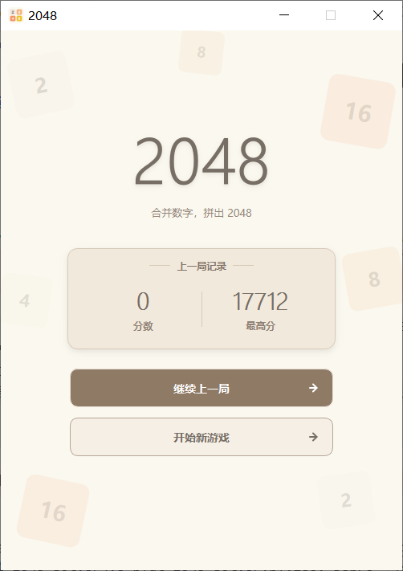
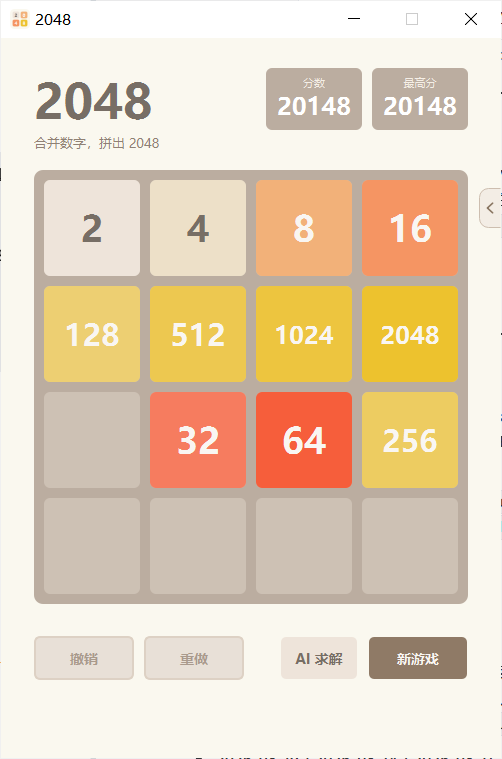
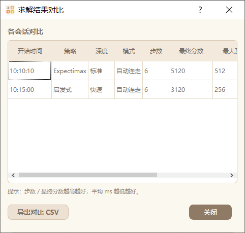

# 使用 PyQt5 实现 2048 算法求解版：五类搜索算法与左右双栏 AI 求解工作台

前三篇里，我们让 2048 **能玩**了：第 3 篇搭起 PyQt5 桌面版与 MVC 架构，第 4 篇补上平滑动画与渲染优化。

这一篇（系列第 5 篇）换一个方向——让 2048 **会算**：

1. 实现 **5 类求解策略**：启发式、贪心模拟、Expectimax、MCTS、强化学习；
2. 把求解做进一个 **可拖动、可折叠的左右双栏「AI 求解工作台」**，与棋盘并排；
3. 把"能玩的界面"和"会算的内核"彻底解耦——求解内核是纯逻辑，不依赖 PyQt。

沿用前几篇的做法：**界面零回归**。第 4 版的棋盘、动画、粒子、撤销重做一行不改，v5 通过 `sys.path` 复用它们，只做子类化扩展。

---

### 1. 整体架构：一个纯逻辑内核 + 一个双栏外壳

```
v5_pyqt_2048_solver/
├── v5_pyqt_2048_solver.py   # GUI 主程序：双栏工作台 + 求解面板 + 后台线程/并发安全
├── solver_2048.py           # 求解算法核心（纯逻辑，不依赖 PyQt，可独立运行）
├── rl_2048.py               # 强化学习：numpy 策略/价值网络 + 自对弈训练 / 独立门禁
├── rl_model.npz             # 正式模型（candidate / .prev.npz 为候选与备份；缺失时仅该策略提示未训练）
├── solver_results/          # 求解会话历史 sessions.json（原子保存 + .bak 回滚）
├── screenshots/             # 整窗截图（capture_gui.py 统一入口生成）
└── test_solver.py           # 测试：算法核心 + 界面集成 + 并发生命周期
```

分层沿用第 3、4 篇的 MVC 思路，但把"智能"单独抽成一层：

| 层 | 模块 | 职责 |
| --- | --- | --- |
| **Model** | `v4.AnimatedGameCore`（**一行不改**） | 棋盘、合并、得分、存档、撤销重做、动画过渡 |
| **Solver** | `solver_2048.py` | 只对 `list[list[int]]` 网格做纯函数运算：评估、搜索、决策 |
| **View** | 第 4 版 `BoardView` / `ParticleOverlay`（**一行不改**） | 棋盘渲染与粒子动画 |
| **Controller** | `SolverMainWindow`（继承第 4 版 `MainWindow`） | 组织双栏布局、启动后台求解、刷新状态与日志 |

关键约束：**`solver_2048.py` 不 import PyQt**。它可以像第 1、2 篇那样被单独导入、单独测试、单独跑基准实验。

```python
# 纯逻辑：给定局面与策略，返回一个决策结果
result = solver.solve(grid, strategy='expectimax', depth=4, time_limit=0.3)
print(result['best_direction'], result['evaluations'], result['elapsed_ms'])
```

---

### 2. 棋盘机制：先保证"算得对"

求解的第一步是**把规则写成可复用、可测的纯函数**，并且与游戏主体（第 3/4 版 `GameCore`）**完全一致**——一次移动中每个方块最多参与一次合并，`[2, 2, 2, 2] → [4, 4]` 而不是 `[8]`。

```python
def slide_line(line):
    """
    单行向左滑动 + 合并（核心规则）。
    返回 (新行, 合并得分, 是否变化)。
    """
    nums = [v for v in line if v != 0]      # 1) 压缩非零
    out, gained, i = [], 0, 0
    while i < len(nums):
        if i + 1 < len(nums) and nums[i] == nums[i + 1]:
            merged = nums[i] * 2            # 2) 相邻相同则合并，且一次只合并一对
            out.append(merged)
            gained += merged
            i += 2
        else:
            out.append(nums[i])
            i += 1
    out += [0] * (len(line) - len(out))     # 3) 右侧补零
    return out, gained, out != list(line)
```

`move_grid(grid, direction)` 用"转置 + 翻转"把四个方向统一到 `slide_line`；`legal_moves` / `is_game_over` 判断是否还有棋可走。这些函数是后面所有搜索算法的公共地基。

---

### 3. 启发式评估：把"局面好不好"变成分数

搜索算法的叶子节点需要一个**估值函数**。我们用一个经典的线性组合——**权重 · 特征**：

```python
DEFAULT_WEIGHTS = {
    'empty': 2.7,          # 空格数量：越多越安全
    'monotonicity': 1.0,   # 单调性：行/列越单调越好
    'smoothness': 0.10,    # 平滑度：相邻块 log2 差值越小越好（取负）
    'merge': 1.0,          # 合并潜力：相邻可合并对数
    'corner': 0.30,        # 最大块是否在四角
    'snake': 0.0,          # 蛇形路径权重（可选，默认关闭）
    'danger': 0.0,         # 危险度惩罚（可选，默认关闭）
}
```

| 特征 | 含义 |
| --- | --- |
| `empty` | 空格数量，直接对应"还有多少回旋余地" |
| `monotonicity` | 行/列方向上数值的单调程度 |
| `smoothness` | 相邻格 `log2` 差值之和（越平滑越好，取负号） |
| `merge` | 相邻相等对数，代表下一步可合并的潜力 |
| `corner` | 最大块落在四角时奖励 `log2(最大值)`——把大数字"钉"在角落 |

`evaluate_features()` 会返回每个分项，因此可以解释"为什么 AI 这么走"；`snake` / `danger` 是可选增强特征，默认权重为 0（不改变既有行为），只有消融实验证明有效时才建议开启。

---

### 4. 五类策略：从"一眼决策"到"长期规划"

| # | 策略（key） | 一句话 | 强度参数 | 单步代价 |
| --- | --- | --- | --- | --- |
| 1 | 启发式 `heuristic` | 对 4 个方向各走一步，取评估最高 | 无 | < 1ms |
| 2 | 贪心模拟 `rollout` | 每个方向做 N 次随机模拟，取平均收益 | 次数 / 深度 | 低 |
| 3 | Expectimax `expectimax` | 对随机新方块做**期望分支**的 minimax | 深度 / 时间 / 剪枝 | 中 |
| 4 | MCTS `mcts` | UCT 选择 + 渐进加宽 + rollout 截断 | 模拟次数 / 时间 | 中 |
| 5 | 强化学习 `rl` | numpy MLP 策略/价值网络，一次前向 | 无 | 极快 |

强度下拉框（快速 / 标准 / 强力）只对有参数的 2/3/4 生效，其余自动置灰。

#### 4.1 启发式：把评估函数当"一步贪心"

```python
def _heuristic_decision(grid, weights=None):
    best_dir, best_val = None, -float('inf')
    for d in legal_moves(grid):
        after, gained, _ = move_grid(grid, d)
        val = evaluate(after, weights) + gained
        if val > best_val:
            best_dir, best_val = d, val
    return best_dir, best_val
```

#### 4.2 贪心模拟（rollout）：用随机对局估"这一步的长远收益"

对每个候选方向，先走一步，再**随机走子到深度上限**，多次取平均。它简单但很有效，是理解"lookahead"的最小样本。

#### 4.3 Expectimax：对"随机出块"做期望

2048 的不确定性来自系统随机生成的新方块（90% 出 2 / 10% 出 4）。Expectimax 把搜索树显式分成两类节点：

- **MAX 节点**（玩家）：在所有方向上取最大；
- **CHANCE 节点**（系统）：在所有空的格子上、对 {2, 4} 取**概率加权期望**。

机会节点的期望写法很关键：

```python
# 空位集合 E；p2/p4 = 0.9/0.1；每个空位的概率 = 1/E
# child2 / child4 分别是"该空位生成 2 / 生成 4"后的局面
expected = 0.0
for cell in empty_cells:
    v = 0.9 * value(child2[cell]) + 0.1 * value(child4[cell])
    expected += (1.0 / len(empty_cells)) * v
```

为了把指数级分支拉回预算内，实现了四类机制，并**严格区分"精确"与"近似"**：

| 机制 | 分类 | 做法 |
| --- | --- | --- |
| `prune=False` | **精确（无损）** | 穷举"全部动作 × 全部空位 × {2,4}"，与独立参考实现逐位一致（容差 1e-9） |
| 转置表 TT | **无损**（可开关） | 键含 `(盘面, 剩余深度, 节点类型)`；启用概率截断时额外含路径概率 `p` |
| 空位采样 `sample_limit` | 近似 | 空位过多时用**无放回均匀子样**估计期望（无偏、有方差，固定种子可复现） |
| 概率截断 `prob_cutoff` | 近似 | 分支概率低于阈值时不再展开，直接用启发式外推（**概率权重 0.9/0.1 与 1/E 完整保留**，不丢概率质量） |
| 移动排序 `move_order` | 仅次序启发 | 时间预算下优先探索估值高的方向，**不改变完全搜索的结果** |

> 这里有两个容易踩的坑：路径概率在向下传递时是 `p_child = p · (1/E) · p_value`，**不能**在 MAX 节点被重置为 1；超时导致的未完成子树**不写入**转置表。

还有一个更隐蔽的一致性坑：**根节点必须与内部 MAX 节点同口径**。根动作的估值同样要计入 `score_weight × 本步合并分`：

```python
# 根节点（与内部 max_node 完全一致的目标函数）
value = score_weight * gain + chance_node(new_grid, depth - 1, 1.0)
```

默认 `score_weight = 0.0`（不含即时合并分，与经典 Expectimax 一致）；把它调大即可让搜索更"贪吃"眼前的合并收益。用一个**根处必然发生合并**的盘面 × `depth ∈ {1,2,3}` × `score_weight ∈ {0,0.5,1,2}`，与一份**独立穷举参考**（不调用任何被剪枝的搜索代码）逐位对照，最大绝对误差约 `8.5e-14`。TT 在启用/未启用概率截断两种情形下都保持透明（键用**精确**路径概率 `p`，不做四舍五入，避免把不同上下文误判为同一缓存项）。

#### 4.4 MCTS：把"模拟"组织成一棵树

节点显式区分 `PLAYER` / `CHANCE`：**先移动（拿到合并分）→ 再由机会节点按真实分布生成新块 → 进入下一玩家节点**。选择阶段用 UCT 平衡"利用"与"探索"，并用**渐进加宽**限制机会节点宽度、**rollout 截断**控制单次模拟成本。回报口径统一为 `根→叶累计合并分 + 截断处启发式`，保证所有候选动作在同一尺度下比较。

一个必须写对的细节是**回传路径**。早期实现里，机会节点触及宽度上限时会返回一个"无 parent 的临时节点"，导致这次模拟虽然计入了 `completed`，却**没有把回报累加到根**（`root_visits < completed`），估值就此产生偏差。修正后的 `descend()` 明确返回 **root→leaf 的显式路径**；触达宽度上限时不再造临时节点，而是直接对采样出的真实局面 rollout，再沿树内真实路径回传：

```python
def descend(root_node):
    """返回 (叶子盘面, 叶子类型, root→leaf 的显式路径, 累计合并分)。"""
    node, acc, path = root_node, 0.0, []
    while True:
        path.append(node)
        if node.kind == 'P':                       # 玩家节点：优先展开未尝试方向
            ...
        else:                                      # 机会节点：按真实分布采样新块
            child_grid, cell, value = sample_spawn(node.grid, rng)
            child = node.child_index.get(key_of(child_grid))
            if child is None:
                if len(node.children) >= chance_width(node):
                    # 宽度上限：不新增节点，直接对真实采样局面 rollout 后沿路径回传
                    return child_grid, 'P', path, acc
                ...
# 关键不变量：root_visits == completed == backpropagated == Σ(root_move_visits)
```

自检字段直接暴露在结果里：`completed_simulations / backpropagated_simulations / root_visits / root_move_visits / width_limit_rollouts / timed_out`。在 `width ∈ {1,2,4,8,16,32} × simulations ∈ {100,500,1000}` 的 18 组确定性测试中，上述等式全部成立。

**渐进加宽**（默认关闭，作为可选项）让机会节点的宽度随访问次数增长，而不是一开始就给死：

```python
K(N) = min(Kmax, max(1, ceil(cpw * N ** alpha)))   # N = 该机会节点已访问次数
```

它限制的只是"新增缓存子节点"的数量，**不改变采样的真实转移分布**（仍为空位均匀 `1/E` × `{2:0.9, 4:0.1}`）——在 14279 次采样中 `p(2)=0.8987、p(4)=0.1013`，与固定宽度完全一致。

#### 4.5 强化学习：用纯 numpy 写一个策略/价值网络

特征用 `4×4×16` 的 one-hot（通道 k = 该格指数的 log2，0 为空格）展平成 256 维，网络 `256 → 128 → {策略 logits(4), 价值 V(1)}` 共享隐藏层，**纯 numpy 实现，无深度学习框架依赖**。

算法是 **on-policy 策略梯度（REINFORCE + 价值基线 + 熵正则）**：训练时按 masked-softmax 分布**采样**（行为分布与策略梯度所用分布一致，无 off-policy 偏差），推理时用 masked argmax。

```bash
# 训练（周期验证 + 早停 + 独立 holdout 门禁）
python v5_pyqt_2048_solver/rl_2048.py --games 8000 --eval-every 1000 --patience 3
# 三个随机数家族必须互不相同：--seed(训练) / --eval-seed(验证) / --holdout-seed(门禁)
python v5_pyqt_2048_solver/rl_2048.py --games 2000 --resume   # warm start：读 .latest.npz 续训
python v5_pyqt_2048_solver/rl_2048.py --eval-only             # 仅评估
```

训练管理上做了几件"工程化"的事：

- **三个随机数家族隔离**：训练 `--seed=2048`、验证 `--eval-seed=12345`、独立门禁 `--holdout-seed=777777`，CLI 强制互异，避免"用验证集调参、又用验证集判优劣"的过拟合；
- **best / latest / candidate 三类检查点**：`best` 由固定验证集选出，`latest` 是最后一次迭代状态，`candidate` 是待准入模型；写入为**临时文件 → 校验 → 同盘原子替换**，覆盖前做**版本化备份**（`.bak.<时间戳>.npz`）并支持**回滚**；
- **独立 holdout 门禁**：候选先写 `rl_model.candidate.npz`；在**同一批独立 holdout 环境种子**上**配对**比较新旧模型，输出配对差值与 bootstrap 95% CI，**仅当 CI 下界 > 0（显著更优）才原子替换** `rl_model.npz`，否则保持现状；
- **schema 校验与旧版兼容**：加载时校验 `_schema`、权重 shape、dtype、NaN/Inf；旧版（V1，无 `_schema`）走专用兼容路径 `load_legacy_model()`，严格加载会明确拒绝；
- **训练诊断**：逐局记录 `episode_len / grad_norm / entropy / value_mse / grad_clip_ratio`，回报归一化 + ±5 截断 + 全局梯度裁剪 + 非有限梯度安全跳过；
- **`--resume` 是 warm start**：只恢复**权重与元数据**，**不**恢复 RNG/优化器状态，因此**不是**精确断点续训（这一点在帮助文本里如实标注，不夸大）。

> **推理热路径**：求解时不再每步重新读 `.npz`——以"规范化路径 + 文件身份 `(size, mtime_ns)`"为键缓存模型，模型被原子替换后自动失效重载；实测模型加载 cold≈2.75ms → warm≈0.10ms（仅指加载路径，不代表完整 solve 的加速比）。

> **能力边界（如实说明）**：这是一个**无经验回放、无超参自适应**的 on-policy 实现。本仓库的 `rl_model.npz` 在固定验证集（50 局，seed=12345，贪心）上平均分 2267.4 / 最大瓦片 512；作为参照，纯随机走子平均分约 1170–1200。要显著变强，需要补齐回放/自适应超参或更大的网络与更多自对弈。

---

### 5. 工程化：不卡界面、结果可复现、并发安全、出错不崩

搜索是"可能耗时"的操作，直接放在 UI 线程会冻结界面。v5 的做法：

- **后台线程 + 任务身份**：求解跑在 `QThread` 上的 `SolverWorker`；每次「开始求解」自增一个单调 `job_id`，请求与结果都携带同一个 `job_id`，并附带**棋盘快照签名**；
- **先校验、后改状态**：结果/失败信号到达时，**先**校验 `任务在运行 → job_id 匹配 → 棋盘快照未变`，全部通过才更新 `_solve_in_flight`、进度条与会话记录——过期结果**不得污染新任务状态**；
- **协作式取消**：用 `threading.Event` 取消令牌，`SolverWorker.solve` 在调用前后检查；配合 `MAX_TIME_LIMIT = 2.0s` 的**有界执行预算**。注意：算法内部（MCTS/Expectimax/Rollout）**不做取消轮询**，其可终止性来自预算，因此对外只说"**协作式取消 + 有界返回**"，**不宣称"即时中断"**；
- **线程生命周期**：按需创建、空闲即回收；交互「停止」只做**短等待**（`SOLVER_STOP_WAIT_MS=500`）以免阻塞主线程，未退出的线程转入**退休列表**保留引用、待 `finished` 后回收；关闭窗口时对"当前 + 全部退休线程"做**有界等待**（`SOLVER_CLOSE_WAIT_MS=3500`）。**全程不使用 `QThread.terminate()`**；
- **确定性与异常安全**：由"次数/深度"约束的配置在固定种子下**逐位可复现**；一旦引入墙钟时间预算则只保证同机同参稳定。`solve()` 内部 `try/except` 兜底返回带 `error` 的结构化结果，工作线程异常经 `failed` 信号上报，界面仅提示并停止，**不影响原有功能**。

```python
class SolverWorker(QObject):
    solved = pyqtSignal(int, dict)          # (job_id, result)
    failed = pyqtSignal(int, str)

    @pyqtSlot(int, list, dict, object)
    def solve(self, job_id, grid, config, cancel_event):
        if cancel_event is not None and cancel_event.is_set():
            return
        try:
            result = solver.solve(grid, **config)
            if cancel_event is not None and cancel_event.is_set():
                return                       # 求解期间被取消：丢弃结果，不 emit
            self.solved.emit(job_id, result)
        except Exception as exc:             # noqa: BLE001
            if cancel_event is None or not cancel_event.is_set():
                self.failed.emit(job_id, "%s: %s" % (type(exc).__name__, exc))
```

> **会话持久化也做了原子化**：求解会话历史写入 `solver_results/sessions.json` 时，采用"**临时文件 + fsync → 旧文件转存 `.bak` → 同盘原子替换**"。写入中断不会产生半截 JSON（旧实现直接覆盖主文件，中断即历史全丢）；主文件损坏时可从 `.bak` 回滚读取。

---

### 6. V5.1 界面：左右双栏「AI 求解工作台」

前几篇的棋盘是"单页游戏"，求解面板如果堆在下方会显得拥挤。V5.1 把游戏页改成**左右双栏**：左边是原封不动的第 4 版游戏台（棋盘 + 分数 + 四按钮），右边是「AI 求解」工作台，两者用水平 `QSplitter` 承载，可拖动中缝调宽。

```
┌──────────────────────────┬──────────────────────────────┐
│ 2048       [分数][最高分] │ [›] AI 求解                  │  ← 头部：细线箭头 + 标题
│ 合并数字，拼出 2048       ├──────────────────────────────┤
│ ┌──────────────────────┐ │ 算法     [Expectimax     ▾]  │
│ │   棋盘（平滑动画）    │ │ 运行方式 [标准           ▾]  │
│ └──────────────────────┘ │ 模式     [自动连走       ▾]  │
│ [撤销][重做][AI求解][新游戏]│ [开始求解]   ▓▓▓░（忙态）    │
│                          │ 步数 3 │ 当前动作 向左        │
│                          │ 评估值 …│ 当前分数 …          │
│                          │ ┌ 日志（随高度伸缩）─────────┐│
│                          │ └──────────────────────────┘│
│                          │ [导出结果][查看详情][性能对比] │
└──────────────────────────┴──────────────────────────────┘
        ↑ 水平 QSplitter：拖动中缝调整左右宽度
```

几个为了"像素级兼容第 4 版"而刻意做的取舍：

- **左栏固定 500 px 并左对齐**：窗口变宽时，多出来的空间落在左栏内部的留白里，而不是把棋盘和四个按钮"拉"到窗口两端；
- **窗口自适应屏幕**：进入游戏页时高度取 `clamp(下限, 720, 屏幕可用高度 − 标题栏预留)`，启动时自动居中；一旦用户手动拖动过窗口，之后只做越界校正、不再强制居中。

**状态与结果**：面板实时显示状态文案与 2 列指标（步数 / 当前动作 / 评估值 / 当前分数 / 最大瓦片 / 累计耗时）；步骤日志逐条追加（方向、评估分、分数、最大瓦片、耗时、是否超时），用户上滚查看历史时不会被强制拉回底部；每个会话可**导出 JSON + CSV**（UTF-8-BOM，Excel 直接打开不乱码）、**查看详情**、**多会话性能对比**。

---

### 7. 折叠与贴边把手：把"收起"做成一个侧边抽屉

V5.1 的折叠不是"留一条窄栏"，而是**整体隐藏右侧工作台**：主窗口同步收窄回纯游戏宽度（500 px），**不保留任何窄条或空白**；求解的业务对象（线程、会话、日志）全程保留，隐藏期间**不停止求解**。

重新展开有两个入口，且**共用同一个方法**、都只负责"打开面板"而**不启动算法**：

1. 左栏底部的 **`AI 求解`** 按钮；
2. 折叠态下出现在**窗口右侧边缘的贴边半胶囊把手**。

两个箭头也要"长得一样"：展开态标题栏是一个方形细线 Chevron 按钮，折叠态是一个**左侧圆角、右侧直边**的半胶囊把手。为了摆脱 Windows 默认图标的绿色圆点，两者都用 `QPainter` 自绘：

```python
class SolverEdgeHandle(QWidget):
    """折叠态右侧贴边半胶囊展开把手：左侧圆角 + 右侧直边 + 细线左向 Chevron。"""

    clicked = pyqtSignal()

    def _body_path(self):
        x0, y0 = 0.5, 0.5
        x1, y1 = self.width() - 0.5, self.height() - 0.5
        r = min(EDGE_HANDLE_RADIUS, (y1 - y0) / 2.0, (x1 - x0))
        path = QPainterPath()
        path.moveTo(x1, y0)                              # 右上
        path.lineTo(x0 + r, y0)
        path.arcTo(x0, y0, 2 * r, 2 * r, 90, 90)          # 左上圆角
        path.lineTo(x0, y1 - r)
        path.arcTo(x0, y1 - 2 * r, 2 * r, 2 * r, 180, 90) # 左下圆角
        path.lineTo(x1, y1)                              # 右侧直边
        path.closeSubpath()
        return path

    def paintEvent(self, event):
        painter = QPainter(self)
        painter.setRenderHint(QPainter.Antialiasing, True)
        painter.setPen(Qt.NoPen)
        painter.setBrush(self._palette()[0])             # hover / pressed / disabled 三态背景
        painter.drawPath(self._body_path())
        # 只描左 / 上 / 下边框，右侧直边不描边，紧贴窗口右缘
        ...
```

把手作为 **overlay** 挂在主窗口上，**不加入任何布局**，因此不占用 QSplitter 的宽度分配；定位用"宿主内容宽 − 把手宽"贴右缘、顶部固定锚点，既不依赖棋盘高度、也不遮挡棋盘 / 分数卡 / 按钮：

```python
def _position_solver_edge_handle(self):
    handle = self.solver_edge_handle
    handle.move(max(0, self.width() - EDGE_HANDLE_W), EDGE_HANDLE_TOP)
```

窗口 `resizeEvent` 时重新定位，最大化与窗口缩放时都保持贴边。

---

### 8. 测试与验收

算法核心、RL 工程化、GUI 集成与跨版本回归分开测，**共 187 条用例全部通过（失败 0、跳过 0）**：

| 套件 | 用例数 | 关注点 |
| --- | ---: | --- |
| `v5_pyqt_2048_solver/test_solver.py` | 80 | 算法核心（规则/评估/五策略）+ 界面集成（双栏/折叠/把手/生命周期/过期结果/会话原子保存） |
| `tests/test_mcts_chance.py` | 10 | MCTS 回传不变量、渐进加宽、spawn 分布 |
| `tests/test_expectimax_reference.py` | 10 | 与独立穷举参考对照、TT 透明、剪枝消融 |
| `tests/test_rl_gradients.py` | 8 | 梯度有限差分、价值头符号、采样 |
| `tests/test_rl_model_management.py` | 5 | schema/legacy、holdout 门禁、检查点/回滚、推理缓存、warm start |
| `tests/test_algorithm_benchmark_smoke.py` | 5 | 五算法冒烟 |
| `tests/test_cross_version.py` | 41 | v2–v5 存档隔离/强杀恢复/损坏恢复 |
| `tests/test_popups.py` | 17 | 统一主题弹窗、高 DPI 不裁切 |
| `tests/test_rl_selftrain.py` | 11 | 自对弈训练行为验证 |

```bash
python v5_pyqt_2048_solver/test_solver.py          # Ran 80 tests ... OK
python tests/test_mcts_chance.py                   # Ran 10 tests ... OK
python tests/test_expectimax_reference.py          # Ran 10 tests ... OK
python tests/test_rl_model_management.py           # Ran 5 tests ... OK
python tests/test_cross_version.py                 # 41/41 通过
```

覆盖包括：

- **算法核心**：合并规则、四方向移动、无效移动、胜负判定、评估偏好；**5 类策略**都返回合法方向且可复现；Expectimax **剪枝开关下均确定、转置表生效、超时仍返回合法方向**；MCTS **回传不变量与 spawn 分布**；RL 有/无模型行为；配置 API 与异常安全。
- **并发与生命周期（在途取消）**：用"进入计算 + 放行"同步屏障构造确定性时序，覆盖 **启动即停 / 停止→新任务→旧结果迟到 / 关闭窗口 / 连续 10 次在途取消 / 在途折叠拖动缩放**；断言旧结果不污染新任务、线程可回收、无 `QThread: Destroyed...` 告警、进程干净退出。
- **界面集成**：双栏布局与拖拽、折叠整体隐藏且无空白、贴边把手显隐/贴边/不遮挡、**两入口一致且都不启动算法**、**连续 20 次折叠展开无宽度漂移与重复信号**、运行中折叠不影响后台、状态指标与真实数据一致、导出/对比等。
- **会话持久化**：`sessions.json` 采用原子保存 + `.bak` 回滚，故障注入下（写坏主文件 / 写入失败）不丢历史、不产生坏文件。

跨版本回归另行覆盖 v2–v5 的存档隔离与异常退出恢复（见上表 41 条）。整窗截图走统一入口生成并做门禁校验：

```bash
python tools/capture_gui.py --version v5 --scene solver      # 展开态（运行中）
python tools/capture_gui.py --version v5 --scene collapsed    # 折叠态（贴边把手）
```

> 按项目规范，`CAPTURE / STRUCTURE / TEXT` 三道门禁可自动判定；`VISUAL_PASS` 必须人工核对图像后授予，未核验一律记为 `UNVERIFIED`。

---

### 9. 性能与复杂度

分支数随深度指数增长，所以统一用"时间预算 + 迭代加深（或模拟次数上限）+ 剪枝"把不确定性关进预算里。本机实测（标准强度）：

| 场景 | 参数 | 单步耗时 |
| --- | --- | --- |
| 启发式 | — | < 1ms |
| 贪心模拟 · 标准 | rollout×20，深度 16 | 约 40–60ms |
| Expectimax · 标准（含剪枝） | 深度 4，0.30s | 约 25–60ms |
| MCTS · 标准 | 200 次模拟 | 约 200ms（≤0.3s 预算） |
| 强化学习 | 一次前向（命中模型缓存） | < 1ms |

两个由 profiling 定位、并已修复的热点：

- **RL 推理**：早期每步都从磁盘 `load_model`，约占 RL 单步耗时 74%；改为按"路径 + 文件身份"缓存后，模型加载从 cold≈2.75ms 降到 warm≈0.10ms。
- **会话写盘**：求解停止会重写会话历史，历史较大（~3.1MB / 1.1 万步）时 `json.dump(indent=2)` 的流式小写入可达 ~0.9s，阻塞停止路径；改为"紧凑序列化 + 单次大写入"后降到 ~0.14s（输出仍是标准 JSON，读取兼容）。

---

### 10. 小结与下一步

这一篇做的事情可以概括成四句话：

- **把智能独立成一层**：`solver_2048.py` 纯逻辑、可单测、可跑基准，界面与算法互不绑架；
- **把搜索关进预算**：时间预算 + 迭代加深 + 剪枝 + 确定性种子 + 异常兜底，让"会算"不牺牲"好用"；
- **把正确性钉死**：MCTS 回传不变量、Expectimax 与独立穷举参考逐位对照、MCTS spawn 分布不变量——用确定性测试而不是"跑几局看起来还行"来证明算法对；
- **把并发与持久化做稳**：job_id + 棋盘快照 + 协作式取消 + 退休线程回收，旧结果不污染新任务；会话历史原子保存 + 回滚，写入中断不丢历史。

第 4 版的棋盘、动画、撤销重做、存档**一行没改**，却被扩展成了"会算的 2048"——这又一次说明 MVC 分层与纯逻辑内核的价值。

> **V5.1 发布收口**：这一版还做了一轮发布前验收——确定性正确性测试、在途取消与线程生命周期压力、成功/失败/关闭/重启的竞态用例、整窗截图门禁（`CAPTURE/STRUCTURE/TEXT` 自动判定，`VISUAL` 需人工核对），以及跨版本回归；正式 RL 模型在校验与独立 holdout 门禁下保持不变。

**下一篇**我们换一条线：**用历史数据训练模型**——数据采集与特征工程、监督/强化两条训练主线、自对弈与评估指标，见 `blog/目录.md` 的系列规划。

---

### 附：整窗截图








