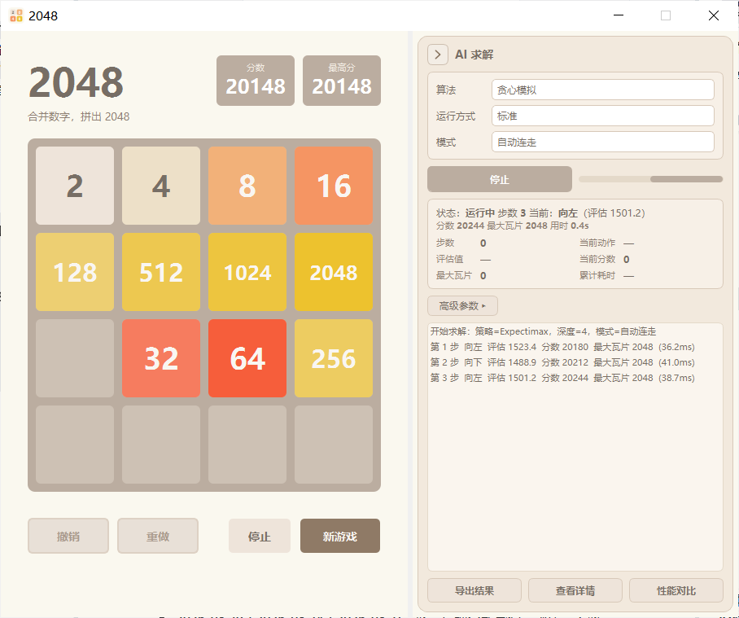
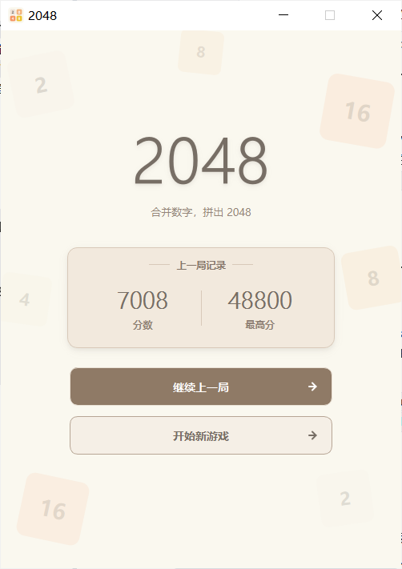
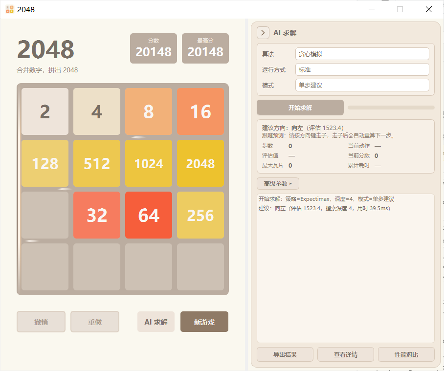
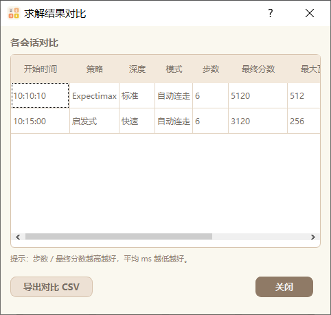

# 第5篇（下）· 使用 PyQt5 实现 2048 算法求解版：双栏 AI 求解工作台与交互

上篇（第 5 篇上）讨论了求解内核：棋盘机制、可解释的评估函数与五类搜索策略。本篇处理其互补部分，即把该内核嵌入一个可交互的工作台。

若求解阻塞界面、建议不可见，或方向键被下拉框截获，内核的算力便不可用。因此本层的目标是把可计算性转化为可用性：算法相当于决策者，工作台相当于棋盘、计时与读秒提示，两者须并行工作且互不打断。

实现上需满足三项约束。并发方面，搜索在后台线程执行，结果以任务身份与棋盘快照校验，过期结果不得污染新任务状态。布局方面，左栏保持第 4 版游戏台不变，右栏为可拖动、可折叠的求解面板，折叠不中断求解。交互方面，方向键只有单一分发入口，单步建议常驻跟随，求解进行中可切换算法，且建议须在棋盘上可见。

下文依次讨论并发模型与线程生命周期、双栏工作台、折叠与贴边把手、交互与工作流、AI 方向提示，以及测试、性能与复杂度。

与前述各篇一致，界面保持零回归：第 4 版的棋盘、动画、撤销与重做、存档均不修改。

---


## 1. 并发模型与线程生命周期

搜索耗时不确定，若在 UI 线程内同步执行会冻结界面。本节给出该层的定义、不变式与状态机。

任务身份为单调计数器 $\text{id}_{\text{job}}\in\mathbb{N}$，在每次「开始求解」以及求解中切换算法时自增，当前任务标识记为 $\text{id}_{\text{cur}}$。棋盘状态记为 $4\times4$ 整数矩阵 $s$，其快照签名定义为逐格取整的元组

$$\sigma(s)=\left(\lfloor s_{ij}\rfloor\right)_{1\le i,j\le 4}.$$

一次求解请求在派发时记录其快照 $\sigma(r)$，结果携带的任务身份为 $\text{id}(r)$。结果 $r$（或失败消息）被接纳并允许改写界面状态的充要条件为

$$\text{running}\;\wedge\;\text{id}(r)=\text{id}_{\text{cur}}\;\wedge\;\sigma(r)=\sigma(s_{\text{cur}}),$$

其中 $s_{\text{cur}}$ 为当前棋盘状态。三个合取项分别排除：任务已停止；结果属于已被作废的旧任务；结果所依据的棋盘快照已被后续操作改变。任一条件不满足，结果即被丢弃，且不得触碰在途标志与进度条。

| 符号 | 含义 |
| --- | --- |
| $\text{id}_{\text{job}}$ | 单调递增的任务身份 |
| $\text{id}_{\text{cur}}$ | 当前被允许改写界面的任务身份 |
| $s$ | 当前 $4\times4$ 棋盘矩阵 |
| $\sigma(s)$ | 逐格取整后的棋盘快照签名 |
| $R$ | `_solver_running`，是否存在活动会话 |
| $F$ | `_solve_in_flight`，是否存在在途请求 |


以二元组 $(R,F)=(\texttt{\_solver\_running},\texttt{\_solve\_in\_flight})$ 标记界面状态，取值与触发条件如下。

| 状态 | $(R,F)$ | 触发条件 |
| --- | --- | --- |
| 空闲 | $(0,0)$ | 初始态，无活动会话 |
| 计算中 | $(1,1)$ | 已派发请求，等待结果 |
| 待命 | $(1,0)$ | 单步模式下已给出建议并展示高亮，等待用户走子 |
| 停止 | $(0,\cdot)$ | `_stop_solver` / `_finish_solver` 后，会话已结算 |

状态转移为：空闲 $\to$ 计算中（`_start_solver` 执行 $\text{id}_{\text{cur}}{+}{+}$、新建取消令牌，随后 `_request_decision`）；计算中 $\to$ 待命（单步结果被接纳，展示高亮且保持 $R=1$）；计算中 $\to$ 计算中（自动连走，走子动画结束后再次 `_request_decision`）；待命 $\to$ 计算中（用户走子动画结束后重算）；计算中或待命 $\to$ 停止（停止或结束）。求解中切换算法不改变状态类别，但满足 $\text{id}_{\text{cur}}{+}{+}$ 并将取消令牌置位，随后重新进入计算中。

后台求解对象为运行在 `QThread` 上的 `SolverWorker`，其 `solve` 在调用前后各检查一次取消令牌，已取消则不返回任何结果。

```python
class SolverWorker(QObject):
    solved = pyqtSignal(int, dict)          # (job_id, result)
    failed = pyqtSignal(int, str)

    @pyqtSlot(int, list, dict, object)
    def solve(self, job_id, grid, config, cancel_event):
        if cancel_event is not None and cancel_event.is_set():
            return
        try:
            result = solver.solve(grid, **config)
            if cancel_event is not None and cancel_event.is_set():
                return                       # 求解期间被取消：丢弃结果，不 emit
            self.solved.emit(job_id, result)
        except Exception as exc:             # noqa: BLE001
            if cancel_event is None or not cancel_event.is_set():
                self.failed.emit(job_id, "%s: %s" % (type(exc).__name__, exc))
```

对结果的校验集中在 `_on_solver_result`，其判定顺序即上文充要条件的次序。

```python
def _on_solver_result(self, job_id, result):
    # 先校验：任务运行中 ∧ job_id 匹配 ∧ 棋盘快照未变；三者全通过才改写状态。
    if not self._solver_running:
        return
    if job_id != self._job_id:
        self._log_step("已忽略过期求解结果（job_id=%s ≠ %s）。" % (job_id, self._job_id))
        return
    if self._board_sig is not None and \
            self._board_signature(self.model.grid) != self._board_sig:
        self._log_step("已忽略过期求解结果（棋盘在求解期间已变化）。")
        return

    self._solve_in_flight = False          # 校验通过，才收尾在途标志与进度条
    self.solver_progress.setRange(0, 100)
    self.solver_progress.setValue(0)
    ...
```

`_on_solver_failed` 采用同一判定（`running ∧ job_id 匹配`），故过期失败同样不改变状态。由于算法内部的 MCTS、Expectimax、Rollout 不做取消轮询，其可终止性来自有界执行预算：`solver_2048` 中 `time_limit = max(0.001, min(option, MAX_TIME_LIMIT))`，而 `MAX_TIME_LIMIT = 2.0`。因此该机制提供的是协作式取消与有界返回，而非即时中断。

线程生命周期遵循按需创建、空闲回收的原则：交互「停止」仅做短等待 `SOLVER_STOP_WAIT_MS=500`，以免阻塞主线程，未在预算内退出的线程转入退休列表并保留引用，待 `finished` 信号到达后回收；关闭窗口时对当前线程与全部退休线程做有界等待 `SOLVER_CLOSE_WAIT_MS=3500`。全程不使用 `QThread.terminate()`。由次数或深度约束的配置在固定种子下逐位可复现，一旦引入墙钟时间预算则仅保证同机同参稳定。`solve()` 内部以 `try/except` 兜底返回带 `error` 的结构化结果，工作线程异常经 `failed` 信号上报，界面仅提示并停止，不影响原有功能。

三种“结束”路径的语义不同：

| 操作 | 状态改变 | 在途结果 | 线程处理 |
| --- | --- | --- | --- |
| 用户「停止」 | `running=False`，置取消令牌 | 到达后因 `running=False` 丢弃 | 短等待 500ms；未退出则转入退休列表 |
| 求解中切换算法 | `job_id++`，置取消令牌，重新请求 | 旧 `job_id` 的结果被拒绝 | 复用线程，不重建 |
| 关闭窗口 | 停止并回收 | 全部丢弃 | 对当前与退休线程做 3500ms 有界等待 |

V5 只有“停止”，没有“暂停/继续”；暂停是 V6 才引入的运行控制（见第 6 篇中/下）。

会话历史写入 `solver_results/sessions.json` 采用临时文件与 `fsync`、`.bak` 转存、同盘原子替换三步，写入中断不会产生半截 JSON，主文件损坏时可由 `.bak` 回滚。

```python
tmp = SESSIONS_FILE + ".tmp"; bak = SESSIONS_FILE + ".bak"
payload = json.dumps(self._sessions, ensure_ascii=False, separators=(",", ":"))
with open(tmp, "w", encoding="utf-8") as f:
    f.write(payload); f.flush(); os.fsync(f.fileno())   # 落盘临时文件
if os.path.exists(SESSIONS_FILE):
    os.replace(SESSIONS_FILE, bak)                      # 旧版转存为回滚点
os.replace(tmp, SESSIONS_FILE)                          # 同盘原子替换
```

**为什么结果必须带任务身份**

一次求解请求发出后，用户可能移动棋盘、切换算法或停止任务。工作线程随后返回的方向，即使本身合法，也可能已经不属于当前棋盘。接收端必须在修改“正在求解”、进度条或方向提示之前检查任务身份和棋盘签名；过期结果只能记录诊断信息，不能改写新会话的运行状态。

这也是本篇 QThread 实现中“取消不是强制中断”的原因：计算中的搜索可能继续到时间预算结束，但结果可以在接收处安全丢弃。

---


## 2. V5.1 界面：左右双栏「AI 求解工作台」



*V5.1 展开态：左侧游戏台 + 右侧 AI 求解工作台*

前几篇的棋盘为单页游戏，若将求解面板堆叠于下方会显拥挤。V5.1 将游戏页改为左右双栏：左侧为第 4 版游戏台，即棋盘、分数与四个按钮；右侧为 AI 求解工作台；二者由水平 `QSplitter` 承载，可拖动中缝调整宽度。

```
┌──────────────────────────┬──────────────────────────────┐
│ 2048       [分数][最高分] │ [›] AI 求解                  │  ← 头部：细线箭头 + 标题
│ 合并数字，拼出 2048       ├──────────────────────────────┤
│ ┌──────────────────────┐ │ 算法     [Expectimax     ▾]  │
│ │   棋盘（平滑动画）    │ │ 运行方式 [标准           ▾]  │
│ └──────────────────────┘ │ 模式     [自动连走       ▾]  │
│ [撤销][重做][AI求解][新游戏]│ [开始求解]   ▓▓▓░（忙态）    │
│                          │ 步数 3 │ 当前动作 向左        │
│                          │ 评估值 …│ 当前分数 …          │
│                          │ ┌ 日志（随高度伸缩）─────────┐│
│                          │ └──────────────────────────┘│
│                          │ [导出结果][查看详情][性能对比] │
└──────────────────────────┴──────────────────────────────┘
        ↑ 水平 QSplitter：拖动中缝调整左右宽度
```

布局只做一件事：把第 4 版游戏页原样放进左栏，并固定为 500 px；窗口变宽时多余空间成为左栏内部留白，而不是拉伸棋盘。右栏宽度由 `QSplitter` 调整，用户拖动后保留其选择。

面板实时显示状态文案与两列指标，即步数、当前动作、评估值、当前分数、最大瓦片与累计耗时。步骤日志逐条追加方向、评估分、分数、最大瓦片、耗时与是否超时；用户上滚查看历史时不会被强制拉回底部。每个会话可导出 JSON 与 CSV（UTF-8-BOM，便于 Excel 直接打开）、查看详情，并支持多会话性能对比。

`模式` 下拉提供「自动连走」与「单步建议」两种运行方式。自动连走由 AI 驱动真实棋盘，复用第 4 版的移动与动画路径；单步建议为常驻跟随预测（见 §4.2）。两者均在棋盘原生边框内高亮推荐方向（见 §5），且求解进行中可随时切换算法（见 §4.3）。

关键实现如下，`_restructure_two_columns` 在不重建棋盘与控件的前提下，把第 4 版页面整体作为左栏。

```python
def _restructure_two_columns(self):
    game_page = self.stack.widget(v4.GAME_PAGE)      # 复用第 4 版页面对象，不重建控件
    self.stack.removeWidget(game_page)               # 从堆叠页取出（对象保留，未销毁）
    self.splitter = QSplitter(Qt.Horizontal)
    self.splitter.setHandleWidth(SPLITTER_HANDLE)
    self.splitter.setChildrenCollapsible(False)
    game_page.setFixedWidth(WINDOW_WIDTH)            # 左栏固定 500px
    holder = QWidget(); hbox = QHBoxLayout(holder)
    hbox.addWidget(game_page); hbox.addStretch(1)    # 多余宽度在 holder 内吸收
    self.splitter.addWidget(holder)
    self._build_solver_panel()
    self.splitter.addWidget(self.solver_container)
    self.splitter.setStretchFactor(0, 0)             # 新增空间主要给右栏
    self.splitter.setStretchFactor(1, 1)
    self.splitter.setSizes([WINDOW_WIDTH, SOLVER_W_DEFAULT])
```

关键常量：`WINDOW_WIDTH=500`、`SOLVER_W_DEFAULT=400`、`SPLITTER_HANDLE=6`。

---


## 3. 折叠与贴边把手


*V5.1 折叠态：整体隐藏右栏，右侧贴边半胶囊把手*

V5.1 的折叠为整体隐藏右侧工作台：主窗口同步收窄回纯游戏宽度 500 px，不保留任何窄条或空白；求解的业务对象（线程、会话、日志）全程保留，隐藏期间不停止求解。

展开有两个入口，二者共用同一方法且只负责打开面板，不启动算法：左栏底部的 `AI 求解` 按钮，以及折叠态下出现于窗口右侧边缘的贴边半胶囊把手。

两个方向指示外观一致：展开态标题栏为方形细线 Chevron 按钮，折叠态为左侧圆角、右侧直边的半胶囊把手。为避开 Windows 默认图标的绿色圆点，两者均以 `QPainter` 自绘：

```python
class SolverEdgeHandle(QWidget):
    """折叠态右侧贴边半胶囊展开把手：左侧圆角 + 右侧直边 + 细线左向 Chevron。"""

    clicked = pyqtSignal()

    def _body_path(self):
        x0, y0 = 0.5, 0.5
        x1, y1 = self.width() - 0.5, self.height() - 0.5
        r = min(EDGE_HANDLE_RADIUS, (y1 - y0) / 2.0, (x1 - x0))
        path = QPainterPath()
        path.moveTo(x1, y0)                              # 右上
        path.lineTo(x0 + r, y0)
        path.arcTo(x0, y0, 2 * r, 2 * r, 90, 90)          # 左上圆角
        path.lineTo(x0, y1 - r)
        path.arcTo(x0, y1 - 2 * r, 2 * r, 2 * r, 180, 90) # 左下圆角
        path.lineTo(x1, y1)                              # 右侧直边
        path.closeSubpath()
        return path

    def paintEvent(self, event):
        painter = QPainter(self)
        painter.setRenderHint(QPainter.Antialiasing, True)
        painter.setPen(Qt.NoPen)
        painter.setBrush(self._palette()[0])             # hover / pressed / disabled 三态背景
        painter.drawPath(self._body_path())
        # 只描左 / 上 / 下边框，右侧直边不描边，紧贴窗口右缘
        ...
```

把手以 overlay 形式挂载于主窗口，不加入任何布局，故不占用 QSplitter 的宽度分配；其定位以宿主内容宽减去把手宽贴右缘、顶部取固定锚点，既不依赖棋盘高度，也不遮挡棋盘、分数卡与按钮：

```python
def _position_solver_edge_handle(self):
    handle = self.solver_edge_handle
    handle.move(max(0, self.width() - EDGE_HANDLE_W), EDGE_HANDLE_TOP)   # 贴右缘
```

相关常量为 `EDGE_HANDLE_W=22`、`EDGE_HANDLE_H=40`、`EDGE_HANDLE_RADIUS=9`、`EDGE_HANDLE_TOP=150`。窗口 `resizeEvent` 时重新定位，最大化与缩放时均保持贴边。

折叠与展开只改变可见性与窗口几何，不触碰求解状态，其防重入与几何处理由 `_set_solver_collapsed` 与 `_do_collapse` 完成。

```python
def _set_solver_collapsed(self, collapsed):
    if self._solver_transition or collapsed == self._solver_collapsed:
        return                                   # 防重入：过渡期间忽略重复调用
    self._solver_transition = True
    try:
        self._do_collapse() if collapsed else self._do_expand()
    finally:
        self._solver_transition = False

def _do_collapse(self):
    if self._is_normal_window():
        self._expanded_geometry = self.geometry()   # 备份折叠前整窗几何
    self._solver_collapsed = True
    self.solver_container.hide()                    # 整体隐藏右栏，不保留窄条
    self._set_splitter_handles_enabled(False)
    if self._is_normal_window() and self.width() > COLLAPSED_WIDTH:
        self.resize(COLLAPSED_WIDTH, self.height()) # 收窄回纯游戏宽度 500px
    self._show_solver_edge_handle()                 # 显示贴边把手
    QTimer.singleShot(0, self._apply_splitter_sizes)
```

`_solver_transition` 标志保证折叠与展开互斥，避免互相触发；`_do_collapse` 仅操作控件可见性、分隔条与整窗几何，不涉及 worker、会话与日志，故隐藏期间后台求解继续运行。`COLLAPSED_WIDTH=500`，即折叠态整窗宽度等于左栏宽度。`_do_expand` 先隐藏把手，再恢复几何与右栏并重新渲染指标；控件实例未销毁，配置、参数与日志随之保留。

---


## 4. 交互与工作流



*V5.1 启动页：继续上一局 / 开始新游戏*

### 4.1 方向键的统一路由

方向键原本仅在获得焦点的子控件忽略它时才到达 `MainWindow.keyPressEvent`；而 `QComboBox` 会消费 Up/Down 以改选项，`QAbstractButton` 会消费四方向键做 autoExclusive 导航。因此焦点一旦落在算法或模式下拉框、按钮上，棋盘即不响应方向键，甚至误改下拉选项。

做法是在应用内（而非系统级钩子）安装事件过滤器 `_ArrowKeyRouter`，在事件到达任何子控件之前，将四个方向键路由到游戏移动控制器并消费：

```python
class _ArrowKeyRouter(QObject):
    def eventFilter(self, obj, event):
        if event.type() == QEvent.KeyPress:
            if self._window._consume_arrow(event.key()):
                event.accept()
                return True          # 已处理：不再下传（一次 KeyPress 只走一步）
        return False
```

放行规则集中于 `_consume_arrow`，仅在确应由棋盘接管时拦截：

```python
def _consume_arrow(self, key):
    if key not in _ARROW_DIRECTIONS:
        return False
    if not self.isVisible():
        return False
    fw = QApplication.focusWidget()
    if fw is not None:
        if fw is not self and not self.isAncestorOf(fw):
            return False                      # 焦点不在本窗口：放行
        if self._is_keyboard_input(fw):
            return False                      # 输入控件：保持原生
    if QApplication.activeModalWidget() is not None:
        return False                          # 模态对话框：保持原生
    if self.game_page is not None and self.game_page.isVisible():
        self.on_move(_ARROW_DIRECTIONS[key])  # 游戏页：走子（内部自带状态门禁）
    return True
```

要点如下。过滤器只安装一次（由 V5 子类安装，V6 继承时不重复安装），窗口关闭时移除。欢迎页、模态对话框与输入控件上的方向键一律放行，`Ctrl+Z`、WASD、Tab 与鼠标等原行为不受影响。测试以连续按键与长按自动重复验证一次 KeyPress 至多走一步。

### 4.2 单步建议的常驻跟随



*单步建议：给出方向后保持待命，用户走子后自动重算*

早先的单步建议给出一次建议即结束。现将其改为常驻跟随：给出建议后保持待命，用户按方向键走子，走子动画结束后自动重算下一步并刷新高亮；仅当用户停止、游戏结束、无可行移动或切换模式时退出。实现复用同一套任务身份与棋盘快照校验：

```python
def _on_animation_finished(self):
    ...
    if self._solver_running and self._solver_mode == "single":
        self._clear_hint()                     # 用户已走子：清旧高亮
        if self.model.game_over:
            self._finish_solver("游戏结束")
        elif solver.legal_moves(self.model.grid):
            QTimer.singleShot(STEP_DELAY_MS, self._request_decision)
        else:
            self._finish_solver("无可行移动")
```

「新游戏 / 继续」后棋盘已变，跟随同样需要重新同步。

```python
def _resync_follow_after_board_reset(self):
    if (self._solver_running and self._solver_mode == "single"
            and not self._solve_in_flight):
        self._request_decision()
```

`_on_animation_finished` 的 single 分支在用户走子后清除旧高亮并异步发起下一次决策，延时取 `STEP_DELAY_MS=70`；`_resync_follow_after_board_reset` 在棋盘重置后以相同条件重算，使跟随不因一次重开局而中断。

### 4.3 求解进行中的算法热切换



*结果对比：不同算法/强度的求解结果*

搜索引擎可在运行中更换。改动算法或运行方式（强度）下拉会热更新求解配置，作废在途任务（$\text{id}_{\text{cur}}{+}{+}$ 并置位协作式取消令牌），随后立即按新算法重算：

```python
def _hot_update_solver_config(self):
    if not self._solver_running:
        return
    new_cfg = solver.build_config(self.solver_strategy.currentData(),
                                  self.solver_depth.currentData())
    if new_cfg == self._ui_solver_config:      # 界面产出的配置没变 → 不重算
        return
    self._ui_solver_config = dict(new_cfg)
    self._solver_config = new_cfg
    self._job_id += 1                          # 旧任务身份作废
    if self._solve_in_flight and self._solver_cancel is not None:
        self._solver_cancel.set()              # 协作式取消在途计算
    ...
    self._request_decision()                   # 按新配置立即重算
```

此处有一守卫：配置比较须使用界面直接产出的配置快照 `_ui_solver_config`，而非运行时的 `_solver_config`。子类（V6）会向 `_solver_config` 注入 `backend` 等运行时项，若直接比较，「配置未变即早退」将永久失效。

会话记录随之更新：每次切换写入 `strategy_changes`，导出的会话摘要按起始与后续展示（如 `启发式 → MCTS`），不把混用两种算法的会话记为单算法。

---


## 5. AI 方向提示：原生边框内的「内嵌明暗轮廓」+ 三通道流光

本节讨论 AI 建议在棋盘上的可见性实现。该提示历经三代迭代，下面说明前两代为何不成立以及最终如何修正，其过程恰好区分了绘制的正确性与可辨识性。

> **证据口径**：本节中的像素采样、ΔE/ΔL、逐通道计数与绘制耗时来自当时的渲染实验记录。对应的原始实验目录已在仓库清理中移除，本次评审无法重放这些测量，因此这些具体数值标记为 `HISTORICAL / UNVERIFIED`；可复核的是几何常量、裁剪路径与代码路径本身。

### 5.1 需求与几何约束

提示须满足三项约束：仅在棋盘原生边框内绘制，不越出外轮廓、不覆盖瓦片，且不新增外侧光轨或箭头等外围组件；只使用棋盘已有像素，高亮层鼠标透传，不阻挡点击；自动连走与单步建议共用同一渲染器，V6 继承 V5 而不分叉。

裁剪几何由第 4 版的只读常量导出。外轮廓记为 $R_{\text{out}}$，即边长 $BOARD\_SIDE=434$、圆角 $r_{out}=BOARD\_RADIUS=9$ 的圆角矩形；内部减去 16 个圆角瓦片 $R_k$，其边长 $TILE\_SIZE=96$、圆角 $r_t=TILE\_RADIUS=6$、间距 $TILE\_GAP=10$。着色域为

$$\Omega=R_{\text{out}}\setminus\bigcup_{k=1}^{16}R_k,$$

即外轮廓与 16 个瓦片之差，实际表现为宽 $BOARD\_PADDING=10$ 的边框带。该域由 `_background` 生成，并与后续绘制共享同一路径。

```python
def _background(self, w, h):
    path = QPainterPath()
    path.addRoundedRect(QRectF(0.0, 0.0, w, h), r, r)          # 外轮廓圆角矩形 R_out
    step = size + gap
    for rr in range(4):
        for cc in range(4):                                    # 减去 16 个圆角瓦片
            cell = QPainterPath()
            cell.addRoundedRect(QRectF(pad + cc * step, pad + rr * step, size, size),
                                tr, tr)
            path = path.subtracted(cell)
    return path
```

### 5.2 第一代方案：沿边暖白与背景的低对比

第一版在 10 px 边框带内铺设一层沿边渐变的暖白。对真实 Qt 渲染的像素采样如下。

| 采样 | 亮度 L | 说明 |
| --- | ---: | --- |
| 主亮面复合色 | 80.8 | 暖白叠在棋盘棕上 |
| 窗外围米白背景 | 93.7 | `#faf8ef` |
| 对侧普通边框 | 43.0 | 棋盘 `#bbada0` |

主亮面与外围米白背景的色差仅 $\Delta E\approx 5.9$，且其亮度更低；亮面与棋盘外沿之间不存在深色分隔，白边、棋盘棕边与米白背景三层亮度接近而缺少轮廓，方向识别不清。

### 5.3 第二代方案：三段式内嵌明暗轮廓

结构改为自外向内的深色隔离槽、奶油暖白主亮面与暖杏过渡：

| 段 | 颜色 | 厚度（逻辑像素） |
| --- | --- | ---: |
| ① 外侧深色隔离槽 | `#705B4C` | ≈1.8 |
| ② 中部奶油暖白主亮面 | `#FFF5E8` | ≈5.0 |
| ③ 内侧暖杏过渡 | `#E0C4A5` | ≈1.8 |

三段厚度由常量 `_GROOVE_PX=1.8`、`_FACE_PX=5.0`、`_TRANS_PX=1.8` 给定，合计不超过边框带宽度 10 px。横截面沿外到内方向以线性渐变绘制；沿边方向另用一条包络渐变做两端消隐，其 0.5 幅值位置分别位于 $11.5\%$ 与 $88.5\%$（`_EDGE_ENV_LO=0.115`、`_EDGE_ENV_HI=0.885`），两端为 0，故明亮识别区约占边长 77%。两条渐变以 `DestinationIn` 相乘：

```python
def _paint_edge(self, p, w, h, d):
    band, axis = self._edge_geom(w, h, d)
    p.setBrush(self._cross_section(w, h, d))      # ① 横截面：槽 / 亮面 / 过渡
    p.drawRect(band)
    p.setCompositionMode(QPainter.CompositionMode_DestinationIn)
    p.setBrush(self._along_envelope(axis))        # ② 沿边包络（DestinationIn 乘 alpha）
    p.drawRect(band)
    p.setCompositionMode(QPainter.CompositionMode_SourceOver)
```

同一采样下，隔离槽 $L\approx 12.5$、亮面 $L\approx 92.4$，即 $\Delta E(\text{槽}\leftrightarrow\text{亮面})\approx 55.4$、$\Delta L\approx -79.9$，明暗轮廓分离成立；识别区约占边长 77%，其余三边完全不变。

### 5.4 光栅化约束：DestinationIn 与抗锯齿裁剪不可同时使用

上述两步合成必须在无裁剪的画布上完成。若把 `CompositionMode_DestinationIn` 与 $\Omega$ 的抗锯齿裁剪路径置于同一 painter，Qt 光栅器在裁剪边界像素上的 alpha 相乘不正确，圆角处会残留若干高不透明度碎片（DPR 1.25 实测 6 个 $\alpha\in[8,64]$ 的像素），按像素中心是否位于外轮廓内的严格判定即判为越界。

修正方法是分两层绘制：先在无裁剪的临时层中完成横截面与沿边包络的合成，再以裁剪路径 $\Omega$ 经 `SourceOver` 贴至缓存位图，抗锯齿裁剪在 `SourceOver` 下行为正确：

```python
layer = QPixmap(Wd, Hd); layer.fill(Qt.transparent)
lp = QPainter(layer)                     # 无裁剪
self._paint_edge(lp, w, h, d)            # 槽 / 亮面 / 过渡 × 沿边消隐
lp.end()

pm = QPixmap(Wd, Hd); pm.fill(Qt.transparent)
pp = QPainter(pm)
pp.setClipPath(self._background(w, h))   # 外轮廓 ∖ 16 个圆角瓦片
pp.drawPixmap(0, 0, layer)               # SourceOver
pp.end()
```

修正后，在 3 档 DPR（1.0、1.25、1.5）与 V5/V6 组合下，越出外轮廓、覆盖瓦片与其他三边被改动三项计数均为 0。

### 5.5 流光层：三通道、短梭形与朝目标边汇聚

除静态亮边外，另有一层内向短梭形流光（B 层）：在 3 条内部缝隙中各绘制一个两端尖、中间最宽的梭形亮段，沿推荐方向汇聚并在临边收缩消隐。早期仅绘制 2 条（以 `centers[:2]` 截断），导致第 3 条通道长期为空；改为三条全参与后，真实渲染的逐通道计数由 `[…, …, 0]` 变为 `≈[87, 87, 87]`。

```python
def _gap_centers(self):
    """三条内部缝隙中心：仅由只读常量推导，无写死坐标。"""
    pad, size, gap = v4.BOARD_PADDING, v4.TILE_SIZE, v4.TILE_GAP
    step = size + gap
    return [pad + size + gap / 2.0 + k * step for k in range(3)]   # 111 / 217 / 323
```

工程细节如下。静态亮边缓存为 `QPixmap`，仅在尺寸、DPR 或方向变化时重建。动画按 26 FPS 采用单时钟，只刷新新旧两个梭形并集的脏矩形。几何不足或不可见时降级为 A-only 并停止计时；隐藏、停止、新游戏、继续与切换模式均会清除高亮并停表。

### 5.6 自动连走方向提示


*自动连走：当前决策方向在棋盘原生边框内高亮*

同一渲染器在自动连走中同样生效：AI 每决定一步即先高亮该方向，再由动画驱动棋盘走子，停止或结束时清除。实测在 26 FPS 下，A+B 绘制耗时的 mean/p95 约为 0.6/0.8 ms（DPR 1.0）与 1.1/1.7 ms（DPR 1.25），均在既有 2 ms 与 5 ms 预算之内。

---


## 6. 测试与验收

算法核心、RL 工程化、GUI 集成与跨版本回归分别测试，发布记录为 202 条用例。本次复核（2026-10-20，`PYTHONNOUSERSITE=1`）逐套件运行，全部退出码 0：

| 套件 | 用例数 | 本次复核结果 |
| --- | ---: | --- |
| `v5_pyqt_2048_solver.test_solver` | 95 | `Ran 95 tests` / OK / exit 0（82.6s） |
| `tests.test_mcts_chance` | 10 | 与下两项合并 `Ran 28 tests` / OK / exit 0 |
| `tests.test_expectimax_reference` | 10 | 同上 |
| `tests.test_rl_gradients` | 8 | 同上 |
| `tests.test_rl_model_management` | 5 | `Ran 5 tests` / OK / exit 0 |
| `tests.test_algorithm_benchmark_smoke` | 5 | `Ran 5 tests` / OK / exit 0 |
| `tests.test_cross_version` | 41 | `41/41 通过` / exit 0（脚本式） |
| `tests.test_popups` | 17 | `17/17 通过` / exit 0（脚本式） |
| `tests.test_rl_selftrain` | 11 | `11/11 通过` / exit 0（脚本式） |

合计 202 条。`test_popups`、`test_rl_selftrain`、`test_cross_version` 是脚本式自检（不是 `unittest.TestCase` 类），因此用直接运行脚本的方式复核；表中其余项用 `python -m unittest` 运行。覆盖范围如下。

```bash
python -m v5_pyqt_2048_solver.test_solver          # Ran 95 tests ... OK
python -m tests.test_mcts_chance                   # Ran 10 tests ... OK
python -m tests.test_expectimax_reference          # Ran 10 tests ... OK
python -m tests.test_rl_model_management           # Ran 5 tests ... OK
python -m tests.test_cross_version                 # 41/41 通过
```

覆盖范围如下。

算法核心方面，覆盖合并规则、四方向移动、无效移动、胜负判定与评估偏好；5 类策略均返回合法方向且可复现；Expectimax 在剪枝开关下均确定、转置表生效、超时仍返回合法方向；MCTS 回传不变量与 spawn 分布；RL 有模型与无模型行为；配置 API 与异常安全。

并发与生命周期方面，以「进入计算 + 放行」同步屏障构造确定性时序，覆盖启动即停、停止后启动新任务而旧结果迟到、关闭窗口、连续 10 次在途取消，以及在途折叠与拖动缩放；断言旧结果不污染新任务、线程可回收、无 `QThread: Destroyed...` 告警且进程干净退出。

界面集成方面，覆盖双栏布局与拖拽、折叠整体隐藏且无空白、贴边把手显隐与贴边不遮挡、两入口一致且均不启动算法、连续 20 次折叠展开无宽度漂移与重复信号、运行中折叠不影响后台、状态指标与真实数据一致，以及导出与对比。

会话持久化方面，`sessions.json` 采用原子保存与 `.bak` 回滚，在写坏主文件与写入失败的故障注入下不丢历史、不产生坏文件。

交互与方向提示方面，方向键在应用内统一路由（焦点落在下拉框或按钮上仍能走子、一次 KeyPress 至多走一步、欢迎页与模态与输入控件一律放行）；单步建议常驻跟随、走子动画结束自动重算；方向提示的边界不变量为不越出外轮廓、不覆盖瓦片、其他三边不变、亮区占边 72%–82%、外侧隔离槽与主亮面构成明暗分离，且 B 层三条通道无空通道；自动连走同样高亮；求解进行中切换算法（配置热更新、旧任务身份作废、会话记录 `strategy_changes`）。

上述不变量以确定性时序加以断言。例如「过期结果不得改写新任务状态」的判定直接对应 §1 的充要条件。

```python
# 旧 job_id 的结果到达 → 丢弃，且不得清零新任务的在途标志、不得改动进度条
self.w._on_solver_result(3, {"best_direction": "left", "best_name": "向左",
                             "evaluations": {"left": 1.0}, "elapsed_ms": 1.0})
self.assertTrue(self.w._solve_in_flight, "过期结果清零了新任务的在途标志")
self.assertEqual(self.w.solver_progress.maximum(), 0, "过期结果改动了进度条")

# 当前 job_id 的结果才允许收尾
self.w._on_solver_result(5, {"best_direction": "left", "best_name": "向左",
                             "evaluations": {"left": 1.0}, "elapsed_ms": 1.0})
self.assertFalse(self.w._solve_in_flight)
```

跨版本回归另行覆盖 v2–v5 的存档隔离与异常退出恢复（见上表 41 条）。整窗截图走统一入口生成并做门禁校验：

```bash
python -m tools.capture_gui --version v5 --scene solver      # 展开态（运行中）
python -m tools.capture_gui --version v5 --scene collapsed    # 折叠态（贴边把手）
```

按项目规范，`CAPTURE`、`STRUCTURE`、`TEXT` 三道门禁可自动判定，`VISUAL_PASS` 须人工核对图像后授予，未核验一律记为 `UNVERIFIED`。

---


## 7. 性能与复杂度

分支数随深度指数增长，故统一以时间预算、迭代加深（或模拟次数上限）与剪枝将不确定性纳入预算约束。标准强度下的实测单步耗时如下。

| 场景 | 参数 | 单步耗时 |
| --- | --- | --- |
| 启发式 | — | < 1ms |
| 贪心模拟 · 标准 | rollout×20，深度 16 | 约 40–60ms |
| Expectimax · 标准（含剪枝） | 深度 4，0.30s | 约 25–60ms |
| MCTS · 标准 | 200 次模拟 | 约 200ms（≤0.3s 预算） |
| 强化学习 | 一次前向（命中模型缓存） | < 1ms |

由性能剖析定位并修复的热点有两处。其一为 RL 推理：早期每步均从磁盘 `load_model`，约占 RL 单步耗时的 74%；改为按路径与文件身份缓存后，模型加载由 cold≈2.75ms 降至 warm≈0.10ms。其二为会话写盘：求解停止会重写会话历史，当历史较大（约 3.1MB、1.1 万步）时 `json.dump(indent=2)` 的流式小写入可达约 0.9s，阻塞停止路径；改为紧凑序列化与单次大写入后降至约 0.14s，输出仍为标准 JSON，读取兼容。

RL 推理热点的修复以文件身份作为缓存键，兼顾速度与不陈旧。

```python
def _rl_file_identity(path):
    st = os.stat(path)
    return (os.path.normcase(os.path.abspath(path)), int(st.st_size), int(st.st_mtime_ns))

_RL_MODEL_CACHE = {'key': None, 'net': None}

def _load_rl_model_cached(path, loader):
    ident = _rl_file_identity(path)          # 键 = 规范化路径 + (size, mtime_ns)
    if _RL_MODEL_CACHE['key'] == ident and _RL_MODEL_CACHE['net'] is not None:
        return _RL_MODEL_CACHE['net']
    net = loader(path)
    _RL_MODEL_CACHE['key'] = ident
    _RL_MODEL_CACHE['net'] = net
    return net
```

缓存键包含规范化路径与文件身份，模型被原子替换（`mtime_ns` 改变）时自动失效并重载，因而在避免每步读盘的同时不会返回陈旧模型。会话写盘的紧凑序列化与 §1 的原子保存共用同一实现。

---


## 8. 小结

本篇将求解内核嵌入一个可用的工作台，其要点为四项：逻辑独立、搜索有预算、并发一致、建议可见。

`solver_2048` 保持纯逻辑，可单独测试与运行基准，界面与算法互不耦合。搜索统一以时间预算、迭代加深、剪枝、确定性种子与异常兜底约束，使可计算性不以可用性为代价。并发方面以任务身份、棋盘快照、协作式取消与退休线程回收保证旧结果不污染新任务；会话历史原子保存且可回滚，写入中断不丢历史。交互方面将方向键收敛为单一入口，使单步建议常驻跟随，在棋盘原生边框内绘制方向提示，自动连走同样生效，并支持求解进行中切换算法。

第 4 版的棋盘、动画、撤销重做与存档均未修改，却被扩展为可求解的 2048，这体现了 MVC 分层与纯逻辑内核的价值。

V5.1 另外完成了一轮发布前验收，包括确定性正确性测试、在途取消与线程生命周期压力、成功与失败及关闭与重启的竞态用例、整窗截图门禁（`CAPTURE`、`STRUCTURE`、`TEXT` 自动判定，`VISUAL` 需人工核对），以及跨版本回归；正式 RL 模型在校验与独立 holdout 门禁下保持不变。

该并发骨架（后台线程、任务身份与快照校验）可迁移至其他长时间计算与实时界面并存的场景；它提供协作式取消与有界返回，而非即时中断，也不包含面向多用户的队列与鉴权。

---


**上一篇**：[第 5 篇（上）· 使用 PyQt5 实现 2048 算法求解版：五类搜索算法内核](第5篇（上）·%20使用%20PyQt5%20实现%202048%20算法求解版：五类搜索算法内核.md)

**下一篇**：[第 6 篇（上）· 使用 PyQt5 实现 2048 高性能计算版：四类计算后端与公平基准](第6篇（上）·%20使用%20PyQt5%20实现%202048%20高性能计算版：四类计算后端与公平基准.md)，换一条线让同样的算法算得更快，并且能证明算出来的是同一个决策：Reference / NumPy / Numba / C++(pybind11 Bitboard) 四类计算内核、统一后端协议与显式回退、严格等价测试与公平基准。V6 另有两篇续作，分别讲无头后台求解与跨运行方式安全交接。

> **CSDN 发布提示**：本文图片为仓库相对路径，发布前需上传并替换为真实 URL；逐图映射见 `csdn_2048_review/03_image_and_formula_audit.md`。`VISUAL_PASS` 需人工核对后授予，未核验记为 `UNVERIFIED`。
