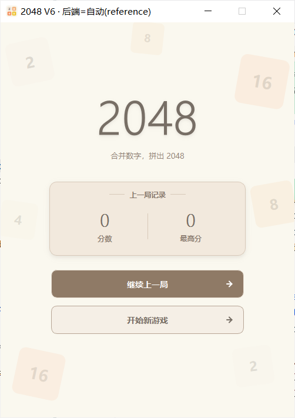
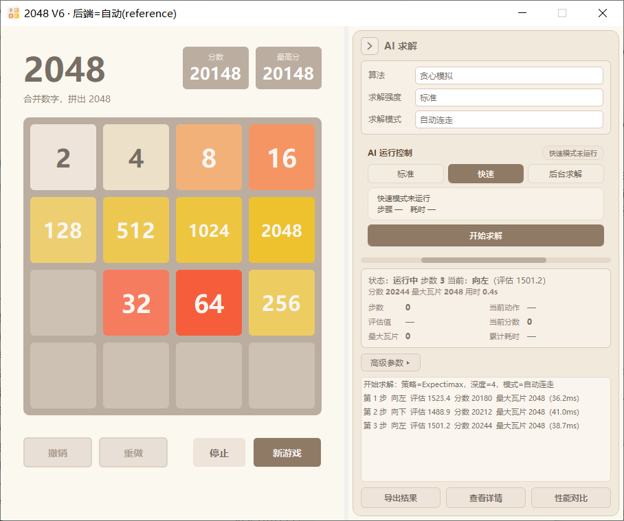
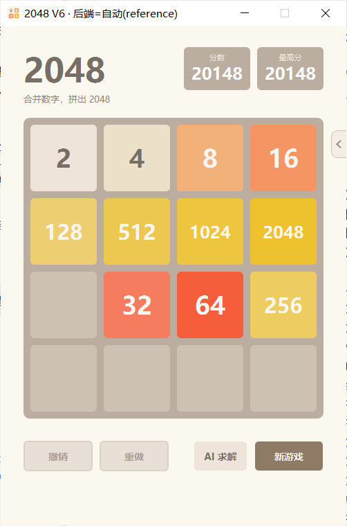
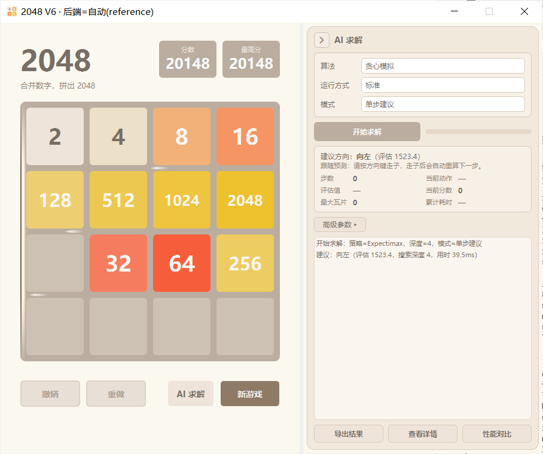

# 第6篇（上）· 使用 PyQt5 实现 2048 高性能计算版：四类计算后端与公平基准

上一篇（第 5 篇下）使 2048 **能够求解**：五类搜索策略 + 双栏 AI 求解工作台。这一篇关注另一件事：在相同算法下提升计算速度，并能证明"算出来的是同一个决策"。

V6 最终长成了三层能力，本文是其中的**计算层**：

| 篇目 | 主题 | 回答的问题 |
| --- | --- | --- |
| **第 6 篇（上）· 本文** | 四类计算后端与公平基准 | 同样的算法，怎样算得更快且逐位一致？ |
| 第 6 篇（中） | 无头后台求解与三档运行模式 | 怎样把长任务搬出 GUI，并能暂停、继续、恢复？ |
| 第 6 篇（下） | 统一运行控制与跨模式安全交接 | 三种执行模式并存时，怎样保证状态与数据只有一个真相？ |

后两层建立在本文的计算层之上：后台 Worker 直接复用本文的调度器与后端，跨模式交接则必须保证"换了执行位置，棋盘、RNG 与最高分不变"。因此先把"算得快且算得对"讲清楚。

与"更换更强的模型"不同，这一版不改变任何算法语义（规则、五类策略的定义、奖励、权重、随机分布全部沿用固定的 V5），只替换"计算"这一层。它类似于**为同一台车更换发动机**：车架、变速箱、驾驶逻辑均不变，更换的只是做功的部分，因此"新车更快"必须可被证明，更换后车辆仍需行驶同一条路线。

该工作有三处最易出问题，也构成本文的三条主线：**统一后端协议**（四个内核使用同一接口，入口严格校验、不修改入参）、严格等价（65536 行表 + 上万随机棋盘 + 搜索动作逐位一致）、公平基准（固定工作量与固定墙钟分开报告，禁止混合排名）。

本文将从**瓶颈定位、四后端架构、统一协议、溢出回退、等价性验证、公平基准、默认后端选型**等方面，系统讲解 V6 高性能计算版的实现。

---

## 1 为什么需要 V6：V5 的瓶颈在哪

V5 的求解内核是**纯 Python**。它正确、可读、可单测，但在"搜索密集型"策略中，时间大量消耗在两类原语上：

- `legal_moves()` / `evaluate()`：每个搜索节点都要反复调用；
- `rollout()`：一段"随机执行动作直至深度上限"的模拟，每一步又回到上述原语。

先用**内核微基准**把这件事量化（固定棋盘集，相同接口、相同调用频率，median 每单位耗时）：

| 内核 | reference（纯 Python） |
| --- | ---: |
| `move_all_dirs` | 22.99 µs |
| `legal_moves` | 105.71 µs |
| `evaluate` | 98.21 µs |
| `rollout_py_d40` | 6925.3 µs |

一次 40 步的 rollout 约需 6.9 ms，而 Expectimax / MCTS 在单步决策中会执行大量此类 rollout。这正是 V6 要解决的瓶颈：原语的单位成本过高，算法本身并无问题。

---

## 2 架构：一个调度器 + 四个后端

```
v6_pyqt_2048_accelerated/
├── v6_pyqt_2048_accelerated.py   # V6 GUI：继承 V5 主窗口，只加“数据隔离 + 计算后端选择”
├── solver_v6.py                  # 调度层：复用 V5 五策略，按请求后端解析/回退/注入
├── solver_backends/
│   ├── api.py                    # 统一协议 + 棋盘严格校验 + 错误类型
│   ├── reference.py              # 基准内核：冻结的 V5 纯 Python 实现
│   ├── numpy_core.py             # NumPy 内核
│   ├── numba_core.py             # Numba（nopython，cache=True）
│   ├── bitboard_cpp_backend.py   # C++ 扩展的 Python 侧包装
│   ├── events.py                 # 显式事件流（原生 rollout 的事件协议）
│   ├── bitboard_cpp/             # C++20 + pybind11 的 64-bit bitboard（源码 + 构建脚本）
│   └── dispatch.py               # 后端注册、能力探测、选择与回退
├── benchmarks/                   # run_micro / run_search / run_pilot + reports/
├── tests/                        # 行表 / 后端等价 / 搜索等价 / GUI / 存储隔离 / 方向键
└── screenshots/                  # 整窗截图（capture_gui.py --version v6）
```

| 层 | 模块 | 职责 |
| --- | --- | --- |
| **Scheduler** | `solver_v6.py` | 解析请求后端 → 取实例 → 注入策略搜索；结果里回报真实使用的后端与回退原因 |
| **Protocol** | `solver_backends/api.py` | 定义 `move / legal_moves / evaluate / evaluate_features / empty_cells / is_game_over / sample_spawn` 与校验、错误类型 |
| **Registry** | `solver_backends/dispatch.py` | 探测四个后端可用性、按需回退、给出明确原因 |
| **Kernels** | `reference / numpy_core / numba_core / bitboard_cpp` | 各自的内部表示与加速实现 |

关键约束可概括为一句话：**只替换计算，不替换算法**。因此"五类策略"的搜索结果必须与 V5 完全一致，这既是设计目标，也是第 6 节的验收标准。

---

## 3 统一后端协议：同一个棋盘，四种内部表示

对外接口只有一个约定：棋盘一律是 Python `list[list[int]]`（也接受 tuple / 只读 ndarray）。内部可以自由选择表示，NumPy 用 ndarray、Numba/C++ 用**行查找表**、位棋盘用 64-bit 整数，但穿越接口前后必须可校验、可复现。

校验作为"入口门禁"，实现比预期更严格（`api.py`）：

```python
def validate_board(board, size: int = 4):
    """校验外部棋盘并返回独立拷贝的 list[list[int]]。

    规则：恰好 size×size；每个取值 0 或 2 的整数次幂；拒绝 NaN / 布尔 / 负数 / 非整数。
    """
```

- 拒绝：非 4×4、非 2 的幂、布尔、负数、浮点、NaN；
- 返回**独立拷贝**，并保证公开 move API 不修改入参（避免"共享数组被就地改掉"这类隐蔽 bug）；
- 错误分三类：`BackendUnavailable`（后端不可用）、`InvalidBoardError`（棋盘不合法）、`BoardOverflowError`（位棋盘表示不了）。

所有公开 move API 统一返回 `(new_board, merge_score, changed)` 三元组，因此"更换后端"对上层完全透明。

---

## 4 位棋盘：4-bit 指数编码与"溢出必须显式拒绝"

C++ 内核用 64-bit 位棋盘，每格 4 bit 存**指数**：`0 = 空格`，`1..15` 对应 `2..32768`。

4 bit 的最大值为 15，即 32768；**65536（指数 16）无法表示**。此处存在一个容易出错的取舍：静默截断（把 65536 当作 0 或 32768）会改变棋盘语义。

V6 的选择是显式拒绝：

```python
MAX_EXP = 15
MAX_BITBOARD_TILE = 1 << MAX_EXP        # 32768：位棋盘可表示的最大方块
LIMIT_TILE = 1 << (MAX_EXP + 1)         # 65536：达到/超过即视为“超界”

class BoardOverflowError(BackendError):
    """棋盘出现位棋盘后端无法表示的方块（>= 65536），必须显式回退。"""
```

一旦触发，调度层**回退 reference 重算同一决策**，并把原因写入结果字段：宁可略慢，也不返回一个"看似正确、实则语义已变"的方向。

---

## 5 选择与回退：不静默换算法

后端可用性在运行时探测（未装 Numba、未编译 C++、平台不匹配……都可能发生）：

```python
def get_backend(name, allow_fallback=True):
    """解析并返回 (backend_instance, backend_used, fallback_reason)。"""
```

- 默认 `auto`：若存在可用的 C++ 则使用 C++，否则逐级回退到 reference；
- 回退**必须给出原因**（`backend_fallback_reason`），不允许静默替换；
- 请求的后端不可用时记 `BUILD_BLOCKED` + 原因，`solve()` 自动回退 reference，**手动游戏与五策略不受影响**。

结果结构在 V5 字段之上新增了几个"可审计"字段：

```python
res['backend_requested']        # 你请求的
res['backend_used']             # 实际用的（回退后可能不同）
res['backend_fallback_reason']  # 为什么回退（None 表示没回退）
res['native_rollout']           # 是否走了原生整段 rollout
```

---

## 6 等价性：逐位一致

后端替换最易出现的问题是"大部分棋盘状态一致，个别边界不一致"。V6 用三层测试加以约束：

**第一层：行表穷举。** 2048 的每一行只有 16 bit 的状态空间，共 `65536` 种。NumPy / Numba / C++ 三种行表与冻结的 V5 `slide_line` 逐项对比（结果行、得分、溢出标志），0 mismatch。

**第二层：随机棋盘。** 

| 对比 | 规模 |
| --- | --- |
| Reference vs Numba / C++ | 10,000 盘 × 4 方向 + legal |
| Reference vs NumPy | 10,000 盘（左移）+ 1,000 盘（4 方向） |
| 评估函数 Reference vs C++/Numba | 10,000 盘 |
| 评估函数 Reference vs NumPy | 2,000 盘 |

**第三层：搜索等价。** `heuristic / rollout(固定 seed) / expectimax(prune=False) / mcts(固定 seed)` 在四个后端下的 `best_direction` 一致，且与 V5 一致；MCTS 的回传不变量 `root_visits == completed == backpropagated` 依然成立。

**协议边界**同样覆盖：非 4×4 / 非 2 的幂 / 布尔 / 负数 / 浮点 / NaN 全部被拒绝；入参不被修改。

> 这一层测试也捕获了实际问题：早期版本在 rollout 触达 `65536` 时会**误退化为 heuristic**（方向仍合法，但语义已被替换）。修正方式为改为显式回退 reference 重算，这也正是第 4 节"溢出必须显式拒绝"规则的由来。

---

## 7 公平基准：把"同工作量"和"同墙钟"分开

性能数字最易产生误导之处在于"口径混用"。V6 的基准刻意分为两类，并分开排名：

- **固定棋盘集**：48 盘 `boards.jsonl`（sha256 校验），算法规则复用冻结 V5，种子固定；
- **内核微基准**（`run_micro.py`）= 相同接口、相同调用频率下的每单位耗时；
- **端到端搜索**（`run_search.py`）= 固定工作量（固定 rollouts / simulations / 关闭剪枝）；
- **同墙钟小样本**（`run_pilot.py --mode smoke`）= 固定每步时间预算，只作工程回归。

### 7.1 内核微基准（median 每单位耗时，µs，越小越好）

| 内核 | reference | numpy | numba | cpp | cpp vs ref |
| --- | ---: | ---: | ---: | ---: | ---: |
| move_all_dirs | 22.99 | 652.07 | 22.05 | 13.26 | 1.73× |
| legal_moves | 105.71 | 2673.76 | 70.29 | **6.20** | **17.0×** |
| evaluate | 98.21 | 860.70 | 12.80 | 13.60 | 7.2× |
| batch_move_left | 20.02 | 408.86 | 16.43 | 12.30 | 1.63× |
| rollout_py_d20 | 4831.9 | 36462.3 | 2966.7 | **362.1** | **13.3×** |
| rollout_py_d40 | 6925.3 | 86999.2 | 5987.8 | **493.3** | **14.0×** |

两个反直觉结论：

- **NumPy 在 4×4 单盘上净变慢（5–15×）**：棋盘太小，一次 NumPy 调用的开销就超过其节省的循环成本。它保留为等价对照与批量用途，不做默认。
- **Numba 只在"评估类"计算上受益明显**：单盘 move 因调用开销与 reference 持平。

还有一项常被忽略的成本，**冷启动**（首次编译/构建，ms）：

| reference | numpy | numba | cpp |
| ---: | ---: | ---: | ---: |
| 2.6 | 5.5 | 38.0 | 11.8 |

因此"内核更快"不等于"端到端更快"：若 JIT 编译或扩展加载抵消了收益，用户会感到"启动变慢"。因此下面的端到端数字**均包含转换与调用成本**。

### 7.2 同工作量搜索（median 每决策耗时）

| 算法 | reference | numpy | numba | cpp | cpp 加速 | 动作一致率 |
| --- | ---: | ---: | ---: | ---: | ---: | ---: |
| heuristic | ~0 | 2.13ms | ~0 | ~0 | — | 1.0 |
| rollout(20×16) | 107.68ms | 1140.54ms | 220.80ms | 34.80ms | **3.09×** | 1.0 |
| expectimax(prune=False, d3) | 16.14ms | 77.66ms | 11.28ms | 6.04ms | **2.67×** | 1.0 |
| mcts(60 sims) | 37.34ms | 655.92ms | 121.24ms | 20.32ms | **1.84×** | 1.0 |

**动作一致率 1.0** 是全表最重要的数据：加速有效，但决策未变。

### 7.3 同墙钟预算小样本（工程回归，不作为显著性结论）

Smoke 模式 2 局/算法、`max_moves=200`、单步预算 20ms：

| 策略 | 后端 | 均分 | 最大瓦片 | 结束 | 平均步耗时 |
| --- | --- | ---: | ---: | --- | ---: |
| heuristic | reference / cpp | 2566 / 2566 | 256 | TRUNCATED×2 | 1.92 / 1.92 ms |
| rollout | reference / cpp | 2530 / 2530 | 256 | TRUNCATED×2 | 79.85 / **29.08** ms |
| expectimax | reference / cpp | 2514 / 2636 | 256 | TRUNCATED×2 | 21.47 / 15.91 ms |
| mcts | reference / cpp | 2526 / 2558 | 256 | TRUNCATED×2 | 22.81 / 22.11 ms |
| rl | reference / cpp | 2356 / 2356 | 256 | TRUNCATED×2 | 3.70 / 3.29 ms |

几点需要说明的限定：

- 所有对局都在 200 步上限被 `TRUNCATED`，**分数不作自然终局比较**；
- expectimax 两个后端分数不同，正是"同墙钟 ≠ 同计算量"的**预期结果**（cpp 更快，在同样 20ms 内搜索更深）；
- `TRUNCATED` 与 `FINISHED` 不放在一起比较。

### 7.4 一个可选的原生 rollout

C++ 内核还提供了一个"原生整段 rollout"（消费**显式事件流**、并可批量 `rollout_batch`）：随机数与事件顺序完全由 Python 侧给定，因此在同一事件流下与 Python 驱动逐位一致。它默认关闭（`native_rollout=False`），作为可选加速项；批量 rollout 目前只提供并验证了内核，尚未接入算法主循环，该边界记录在 `future_roadmap.md` 中，本篇不将其描述为"已实现"。

---

## 8 默认后端：用证据选 `cpp`

结论是 **默认 `cpp`**（不可用或遇到 `>= 65536` 时回退 reference）。依据（`benchmarks/backend_default.json`）：

- 正确性门禁全 PASS；
- 含转换/调用成本的端到端延迟改善 **2.7–3.1×**；
- 构建可复现（MSVC 2022 + CMake + pybind11，产物 SHA256 固定）；
- 溢出可显式回退，语义不漂移；
- 内存可接受（~0.9MB 行表）。

NumPy / Numba 保留为**对照与可选加速器**，不做默认，因为证据不支持。

---

## 9 GUI 与数据：怎么在不动 V5 的前提下换心脏

这一层实现只有一句话，却支撑了整个"零回归"目标（`v6_pyqt_2048_accelerated.py`）：

```python
import v5_pyqt_2048_solver as _v5gui
# 运行时适配：让 V5 GUI（原样复用）调用 V6 的求解调度（含计算后端）。不修改 V5 源码。
_v5gui.solver = solver_v6
```

- V5 的 `SolverMainWindow` 里所有 `solver.solve(...)` 调用**原样保留**，只是指向了 V6 调度器；
- `V6MainWindow` 只覆写三件事：存档/会话/导出路径指向 V6 目录、窗口标题、在「高级参数」折叠区插入**计算后端**下拉（普通用户通常无需查看）；
- 数据隔离：V6 的 `game_history` / `solver_results` / `screenshots` 全部落在 V6 目录；并用 `2048_HISTORY_DIR` 把继承链（v3/v4/v5）的存档目录也重定向进来，构造期还会清掉继承链留下的**空**版本目录；
- 只读边界：V6 **不训练、不替换** `rl_model.npz`；V1–V5 源码与正式模型不改。

V5 侧后续新增的交互（方向键统一路由、单步建议常驻跟随、AI 方向提示的"内嵌明暗轮廓"、自动连走高亮、求解中热切换算法）**在 V6 中自动生效**，因为它继承的是同一份 V5 GUI，只在"计算"这一层替换了实现。V6 自身的测试也补充了这几条回归（见下节）。

---

## 10 门禁与验收边界

V6 的验收以 G0–G9 门禁表组织：**未达标即标记 PARTIAL_PASS / UNVERIFIED，不写 PASS**：

| 门禁 | 验证范围 | 结果 |
| --- | --- | --- |
| G0 SOURCE_AUDIT | 工作区隔离、V5 差异与哈希 | PASS |
| G1 RULE_EQUIVALENCE | 65536 行表、≥10,000 单盘、超界、生成事件 | PASS |
| G2 ALGORITHM_EQUIVALENCE | Expectimax 参考、MCTS 回传、RL、合法动作 | PASS |
| G3 NUMBA_BUILD | nopython 编译、正确性、冷/热态 | PASS |
| G4 CPP_BUILD | Windows C++20 / pybind11 编译、导入、规则一致 | PASS |
| G5 MICRO_BENCH | 相同接口/批量频率、初始化与转换成本 | PASS |
| G6 SEARCH_BENCH | 同工作量与同时间预算**区分报告** | PASS |
| G7 GUI_AND_ISOLATION | 双栏 GUI、QThread、数据路径、截图与隔离 | **PARTIAL_PASS**（自动门禁 PASS；`VISUAL` 待人工核对） |
| G8 REPORT | 原始输出、机器参数、统计限制、文档 | PASS |
| G9 RELEASE_CANDIDATE | 后端选择有证据；人工视觉独立透明 | **PARTIAL_PASS**（视觉待人工确认） |

测试侧（`v6_pyqt_2048_accelerated/tests/`）当前共 **136** 条，其中与本文直接相关的后端/等价/搜索测试 **39** 条（行表、后端等价、搜索等价、原生搜索），其余分布在 GUI 集成、存储隔离、方向键、无头 Worker、所有权、回传策略、运行状态与跨模式交接（见中/下两篇）。V6 立项时先在 V5 工作区重跑全部套件以确认基线干净，再仅新增 V6 目录。

被明确标记为 `UNVERIFIED` 的项（**不做通过标记**）：

- `GUI_VISUAL`：整窗截图的人工目视确认（自动门禁只能判 `CAPTURE / STRUCTURE / TEXT`）；
- `DPI_VISUAL`：真实系统 125% / 150% 缩放下的人工视觉验收；
- 每配置 100/300 局的大规模对局实验（本轮**非默认要求**，未执行）。

---

## 11 小结

这一篇的重点在于把"更快"变成可证明、可比、可回退的工程结论：

四个内核共用一套接口，`validate_board` 把守入口，公开 API 不修改入参。位棋盘无法表示 65536 时抛出 `BoardOverflowError` 并回退，而非静默截断。正确性先于速度：65536 行表逐项验证、上万个随机棋盘、四后端搜索动作一致率 1.0，先证明计算的是同一个决策，再讨论 3.09× / 2.67× / 1.84×。基准按内核微基准、同工作量搜索、同墙钟小样本分开报告，`TRUNCATED` 不与 `FINISHED` 混合比较，小样本也不下显著性结论。验收上 G7 / G9 为 `PARTIAL_PASS`，人工视觉与高 DPI 标记为 `UNVERIFIED`。

**下一步**（明确不在本轮）：MCTS / Expectimax 的原生整树搜索（树节点驻留 C++/Numba，减少 Python 往返）、批量 rollout 接入算法主循环、增量/持久化转置表；以及将多后端微基准纳入 CI 门禁。另有长期规划：用历史数据训练模型，见 `blog/目录.md` 的系列规划。

这套"同一接口 + 逐位等价 + 分开基准"的方法适合计算密集且正确性可验证的场景；4×4 单盘上 NumPy 反而更慢，`heuristic` 在微秒级，而超过 32768 的方块会让位棋盘回退到 reference。
---

**上一篇**：[第 5 篇（下）· 使用 PyQt5 实现 2048 算法求解版：双栏 AI 求解工作台与交互](第5篇（下）·%20使用%20PyQt5%20实现%202048%20算法求解版：双栏%20AI%20求解工作台与交互.md)

**下一篇**：[第 6 篇（中）· 使用 PyQt5 实现 2048 高性能计算版：无头后台求解与三档运行模式](第6篇（中）·%20使用%20PyQt5%20实现%202048%20高性能计算版：无头后台求解与三档运行模式.md)，把求解搬出 GUI：无 Qt Worker、进程协议、所有权与心跳、固定 500ms 回传、FINAL 正式历史回放与暂停/继续/恢复。

---

## 附：整窗截图










> 「计算后端」下拉位于右侧工作台的「高级参数」折叠区内（默认收起）。整窗截图统一走
> `python tools/capture_gui.py --version v6 --scene <scene>`，并按项目规范记录 `CAPTURE / STRUCTURE / TEXT` 三道自动门禁，
> `VISUAL_PASS` 需人工核对后授予，未核验一律记为 `UNVERIFIED`。
