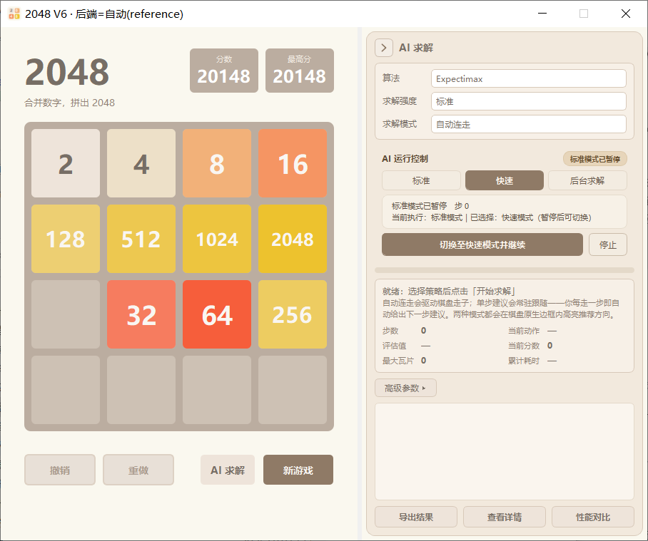
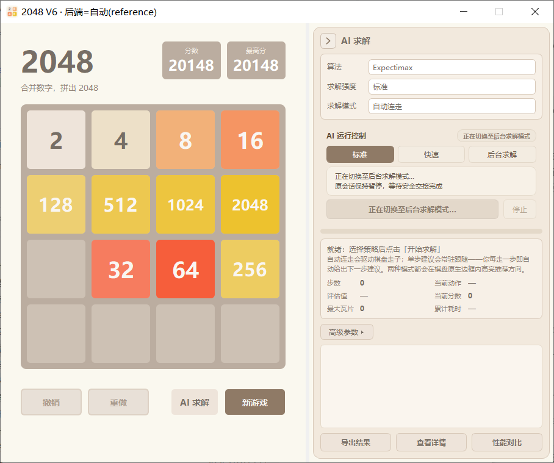
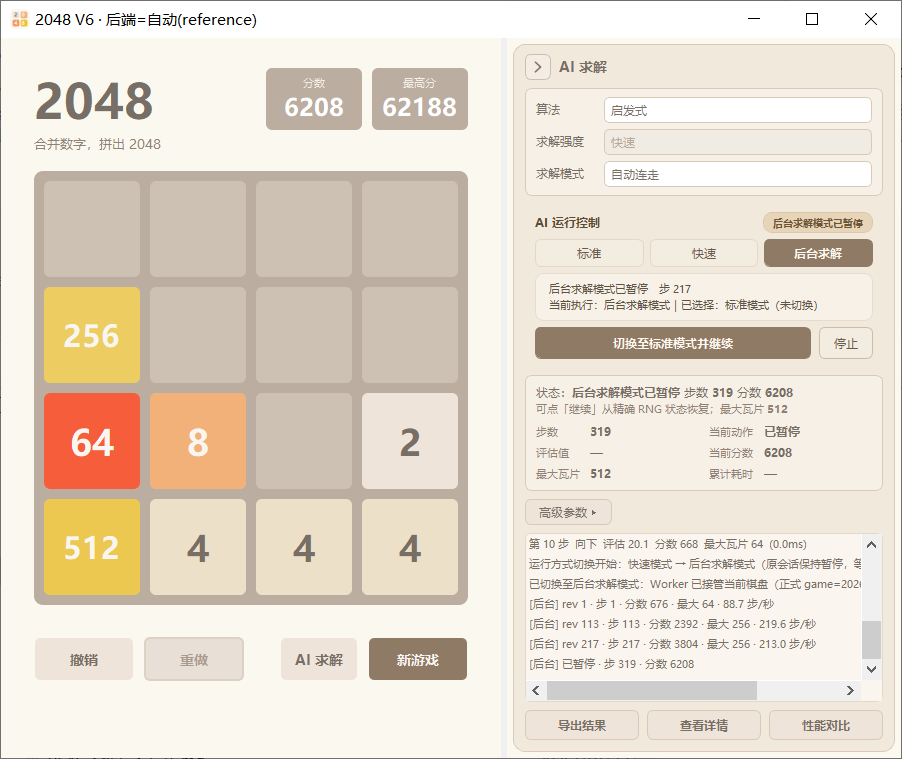
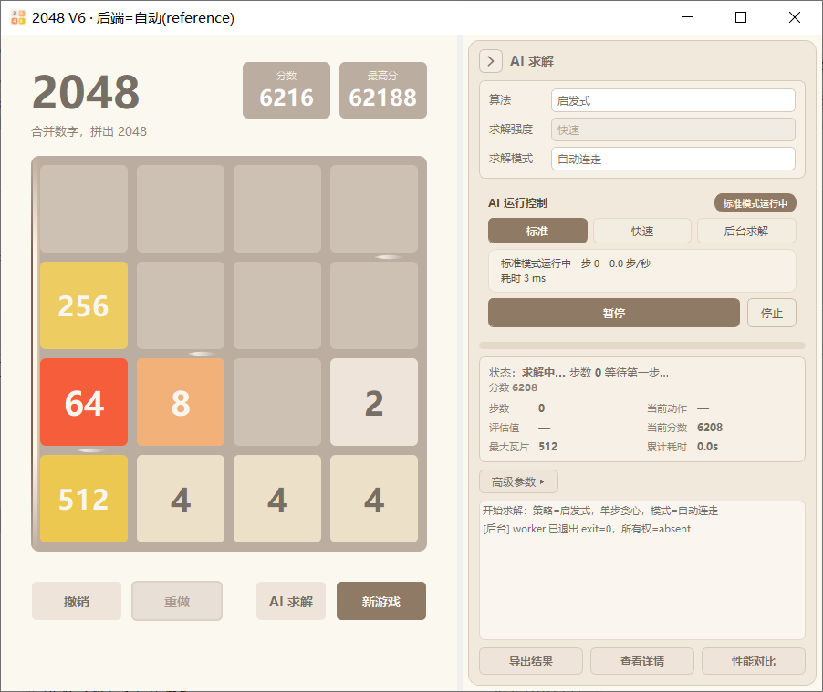

# 第6篇（下）· 使用 PyQt5 实现 2048 高性能计算版：统一运行控制与跨模式安全交接

第 6 篇（中）让求解可以跑在独立 Worker 里，并能暂停、继续、关窗恢复。但一旦"标准 / 快速 / 后台求解"三种执行方式同时存在，新的问题就出现了：**用户暂停后换了运行方式，点"继续"到底该恢复谁？**

这一篇是 V6 三层能力中的**状态层**：用一个状态机统一按钮、棋盘、RNG、最高分与历史，并让"暂停后跨模式继续"成为一次可校验的安全交接，而不是偷偷重启。

| 篇目 | 主题 | 回答的问题 |
| --- | --- | --- |
| 第 6 篇（上） | 四类计算后端与公平基准 | 同样的算法，怎样算得更快且逐位一致？ |
| 第 6 篇（中） | 无头后台求解与三档运行模式 | 怎样把长任务搬出 GUI，并能暂停、继续、恢复？ |
| **第 6 篇（下）· 本文** | 统一运行控制与跨模式安全交接 | 三种执行模式并存时，怎样保证状态与数据只有一个真相？ |

---


## 1. 问题：三种执行模式带来的"状态爆炸"

先看一个真实缺陷。旧版统一控制区里：

- 标准模式运行 → 暂停；
- 用户点"快速"选项卡（界面显示已选中快速）；
- 点"继续"。

结果恢复的是**标准模式**。新选择没有生效，只有等旧会话结束或用户停止后才会应用。

根因不是按钮文案，而是三处代码：

1. `_v6_on_run_primary()` 在暂停态无条件调用"恢复原会话"：后台 `BG_PAUSED → ctl.resume()`，本机 `_v6_local_paused → _v6_resume_local()`，**完全不看 `_v6_selected_mode`**；
2. `_v6_selected_mode` 只在 `_v6_apply_selected_if_idle()` 里被消费，而这个函数只在"无活动会话"时调用；暂停仍属于活动会话，所以选择永远等不到生效；
3. 根本不存在跨引擎交接路径：本机暂停态没有"把正式对局交给 Worker"的流程，后台暂停态也没有"Worker 退出后再由本机继续"的流程。

于是"切换运行方式"在暂停态退化成"改了一个没人读的变量"。

**按钮为何不能只依据选中项显示**

当标准模式进入**真正的已暂停状态**后，用户点击“后台求解”，此时只改变目标选择，尚未将棋盘交给 Worker。主按钮应显示“切换至后台求解模式并继续”；点击后需要等待状态验证和所有权交接成功，才可以显示“后台求解模式运行中”。如果只是把状态文字改成“后台运行中”，却继续调用标准求解器，就会重现本篇讨论的缺陷。


## 2. 三个状态变量与"真实执行模式"

V6 把状态拆成三个明确的变量（`v6_speed`）：

| 变量 | 含义 | 空闲 | 运行中 | 已暂停并改选 |
| --- | --- | --- | --- | --- |
| `_v6_speed` | 当前生效/已选择的运行方式 | 等于选择 | 等于执行模式 | 仍等于**执行模式** |
| `_v6_selected_mode` | 运行中/暂停中用户点选的目标 | `None` | 目标或 `None` | 目标 |
| `_v6_active_mode` | 真正在执行的模式 | `None` | `standard/fast/background` | 原模式 |

但外部测试、启动期恢复、旧代码可能只设置其中一部分，所以还需要一个**推导函数**：

```python
def _v6_effective_active(self):
    active = getattr(self, '_v6_active_mode', None)
    if active in MODES:
        return active
    if getattr(self, '_solver_running', False):
        sp = getattr(self, '_v6_speed', 'standard')
        return sp if sp in ('standard', 'fast') else 'standard'
    ctl = getattr(self, '_v6_bg_controller', None)
    if ctl is not None and ctl.state in (
            'HANDOFF_PREPARE', 'BG_RUNNING', 'BG_PAUSING', 'BG_PAUSED', 'BG_STOPPING'):
        return 'background'
    return None
```

优先级是：显式活动模式 → 本机求解器运行态 → 后台控制器活动状态。

"是否真的暂停"也必须由执行模式自己回答：

```python
def _v6_is_paused(self, active=None):
    active = active or self._v6_effective_active()
    ctl = getattr(self, '_v6_bg_controller', None)
    if active == 'background':
        return ctl is not None and ctl.state == 'BG_PAUSED'
    return (self._solver_running and self._v6_local_paused
            and not self._v6_local_pausing)
```

本机的"已请求暂停但还在等结果"（`_v6_local_pausing`）**不算暂停**；后台的 `BG_PAUSING` 同样不算。否则就会在数据尚未收敛时提前切换，制造两个写者。

---


## 3. 交互语义：一张矩阵说清



*已暂停并选择快速：主按钮变为“切换至快速模式并继续”*

统一控制区只有两个按钮（主操作 + 停止），状态全部由矩阵推导：

| 运行状态 | 主按钮 | 停止 | 徽标 |
| --- | --- | --- | --- |
| 运行中 | 暂停 | 可用 | `XX模式运行中` |
| 正在暂停 | 正在暂停…（禁用） | 禁用 | `XX模式正在暂停` |
| 已暂停，未变更模式 | 继续 | 可用 | `XX模式已暂停` |
| 已暂停，已变更模式 | 切换至XX并继续 | 可用 | `XX模式已暂停` |
| 交接中 | 正在切换至XX…（禁用） | 禁用 | `正在切换至XX` |
| 交接成功 | 暂停 | 可用 | `XX模式运行中` |
| 交接失败 | 恢复原模式“继续” | 可用 | 原模式已暂停 + 状态区失败原因 |

三条硬规则：

1. **徽标永远标识真实执行模式**，不按选项卡显示"运行中"；
2. **选项卡只表达"已选择"**，不直接改变执行模式；
3. **交接中禁用一切入口**（主按钮、停止、三个选项卡），防止重复点击与并发创建 Worker。

另外，禁用态主按钮的文字也必须可读。旧配色是浅底浅字，截图文字门禁直接判 0 对比度；现改为 `#e3d8ca / #8a7b6c`，保证"正在切换至…"能被看清。

---


## 4. 运行中切选项卡：非破坏性

运行中点击其它选项卡，唯一允许的动作是记录选择：

```python
def _v6_on_speed_clicked(self, key):
    if self._v6_handoff is not None:
        return                      # 交接中禁止再次切换
    if self._v6_session_active():
        self._v6_selected_mode = key
        self._v6_sync_run_controls()
        return
    self._v6_selected_mode = None
    self._v6_apply_tier(key)        # 空闲时才直接生效
```

这样做的原因很实际：运行中切档如果立即生效，就必须暂停/重启当前会话；而用户点选项卡的意图往往只是"待会儿换"，不是"现在中断"。把"选择"和"执行"分开，按钮才有机会表达"切换并继续"这个第四种状态。

---


## 5. 安全步边界暂停

本机档的暂停不是"立刻停"，而是"当前这一步算完再停"：

- 没有在途计算：立即进入 `_v6_local_paused`；
- 有在途计算：置 `_v6_local_pausing`，等结果返回时**暂存**它（`_v6_paused_result`），不落子；
- `_request_decision()` 在暂停态直接返回，不会再请求下一步。

```python
def _on_solver_result(self, job_id, result):
    if (self._v6_local_pausing and self._solver_running
            and job_id == self._job_id):
        self._solve_in_flight = False
        self._v6_paused_result = (job_id, result, self._board_sig)
        self._v6_local_pausing = False
        self._v6_local_paused = True
        return
    super()._on_solver_result(job_id, result)
```

为什么保留这个结果？因为它是"暂停那一刻已经算出来的下一步"。同模式继续时应该直接用它，而不是重算——重算会浪费一次搜索，也可能因为 RNG 消费差异导致与暂停点不一致。

同模式继续（`继续`）时：先校验 `job_id` 与棋盘签名，命中则直接应用暂存结果；否则重新请求决策。

---


## 6. 跨模式交接：三条路径

交接只在**真正暂停**后发生。`_v6_handoff = {'from','to','phase'}` 一旦非空，所有操作入口直接返回。

### 6.1 标准 ↔ 快速：同一会话，换调度

这是最轻的一条路径，不重建会话，只换动画/粒子/步间等待：

```python
def _v6_handoff_local_to_local(self, src, dst):
    self._v6_paused_result = None     # 旧模式暂存结果失效
    self._v6_local_pausing = False
    self._solve_in_flight = False
    self._pending_result = None
    self._job_id += 1                 # 旧任务身份作废
    self._clear_hint()                # 旧方向提示不属于新模式
    self._v6_apply_tier(dst)          # 动画/粒子/等待/偏好
    self._v6_active_mode = dst
    self._v6_local_paused = False
    self._v6_handoff = None
    self._request_decision()          # 从当前棋盘继续
```

关键点：

- **不重新开局、不重复落子**：`_session`、棋盘、分数、撤销栈都保持；
- 旧的暂存结果被丢弃并递增 `job_id`，即使旧任务的结果迟到也会被忽略；
- 方向提示先清除，避免新模式展示旧方向；
- 标准恢复动画与合并粒子，快速关闭动画与粒子，两者都保留方向提示。

### 6.2 本机 → 后台：先确认接管，再结束本机



*交接中：主按钮“正在切换至后台求解模式…”，操作禁用*

错误做法是"先停本机，再启动 Worker"。一旦 Worker 启动失败，原暂停会话已经没了，用户既不能继续也不能恢复。

V6 的顺序相反：

1. 从**当前一致状态**构建快照（棋盘、分数、最高分、完整 RNG、正式 game_id、交接元数据）；
2. `ctl.start(snapshot=snap, handoff_meta=meta)`；
3. 控制器轮询 `owner.json`，确认 `alive` 且 pid 与子进程一致，才回调 `_v6_on_bg_started()`；
4. 此时才静默结束本机会话（`_stop_solver(..., silent=True)`），并应用后台档效果。

```python
def _v6_on_bg_started(self, meta):
    if meta.get('from') in ('standard', 'fast'):
        self._v6_stop_local('交由后台求解接管', silent=True)
        self._v6_apply_tier('background')
    self._v6_handoff = None
    self._v6_sync_run_controls()
```

如果启动失败，`_v6_on_bg_start_failed()` 只清交接标记、恢复选项卡勾选，原暂停会话与检查点保持不动，状态区明确显示"后台求解模式切换失败，原会话保持暂停"。

### 6.3 后台 → 本机：等旧写者真正退出



*后台暂停并选择标准：可安全切回本机*

后台暂停时，Worker 只是停在步边界，进程仍常驻并持有所有权。直接启动本机求解器会造成两个写者。

正确顺序是：

1. 校验 `BG_PAUSED`，并确认 FINAL 已采纳（棋盘/分数不一致时补一次正式回放）；
2. `drain_for_handoff()` 发送 `quit`；
3. 等待"进程已退出 **且** owner 非 alive"；
4. 清空旧会话身份（`_game_id=None`、`_final_seen=True`），让迟到消息无法再被采纳；
5. 应用目标档位，再启动本机求解器。

```python
def done(ok, reason):
    if not ok:
        self._v6_handoff_fail(reason, src, dst)
        return
    ctl._game_id = None
    ctl._final_seen = True
    self._v6_active_mode = None
    self._v6_handoff = None
    self._v6_apply_tier(dst)
    self._v6_start_local()
```

三条路径的前置、顺序与失败回退可以压成一张表（IPC 细节见第 6 篇中）：

| 路径 | 前置 | 关键顺序 | 失败时 |
| --- | --- | --- | --- |
| 标准 ↔ 快速 | 本机已暂停 | 丢弃暂存结果 → `job_id++` → 应用档位 → 从当前棋盘请求决策 | 同步执行，无 Worker 失败路径 |
| 本机 → 后台 | 本机已暂停 | 建快照 → 启动 Worker → 确认 owner/pid → 结束本机会话 | 保留本机暂停会话与检查点 |
| 后台 → 本机 | `BG_PAUSED` 且 FINAL 已采纳 | 发 `quit` → 等进程退出 + owner 释放 → 启动本机 | 保留后台暂停与检查点 |

这三条路径的共同原则是：**先让新执行者拿到合法身份，再让旧执行者退出**；任何一步失败，都保留原暂停会话。

---


## 7. 单一写者：为什么"进程起来了"不等于"接管了"

后台启动时，控制器不会在 `Popen` 成功后立即宣告运行中，而是进入 `HANDOFF_PREPARE`，轮询所有权：

```python
st = own.owner_status(self._staging_dir)
rec = st.get('record') or {}
if st.get('state') == 'alive' and int(rec.get('pid', -1)) == int(proc.pid):
    self._confirm_running(meta)
    return
if proc.poll() is not None:
    self._fail_start('后台进程在接管所有权前退出（exit=%s）' % proc.poll(), meta)
    return
if time.monotonic() >= deadline:
    self._fail_start('等待后台 Worker 接管所有权超时（owner=%s）' % st.get('state'), meta)
    return
QTimer.singleShot(50, lambda: self._await_ownership(deadline, meta))
```

这解决两个问题：

- Worker 可能启动即失败（导入错误、端口/权限问题），此时 GUI 不能进入"运行中"；
- 旧 Worker 可能还持有 owner，直接起新进程会变成并发写者。

只有确认接管后，控制器才迁移到 `BG_RUNNING`，并写入一份交接记录：

```json
{
  "from": "fast",
  "to": "background",
  "model_game_id": "20261020_054301_098475",
  "session_id": "20261020_054305_040_bg",
  "board_sig": [[0,0,2,2],[0,4,8,16],[4,64,128,256],[32,512,1024,2048]],
  "score": 768,
  "best_score": 62188,
  "pid": 38632,
  "at": "2026-10-20 05:43:05"
}
```

新执行会话可以有新的 `session_id`，但必须通过 `model_game_id` 与正式对局建立明确的前后关系。

---


## 8. 数据一致性：四个"不许变"

跨模式交接必须保证四类数据不变（下文 E2E 中的最高分 **62188** 是固定测试盘面使用的夹具值，用于验证“只升不降”，不是真实玩家纪录）：

| 数据 | 约束 | 实现 |
| --- | --- | --- |
| 历史最高分 | 只来自权威模型，永不被 Worker 快照覆盖 | 渲染最高分时读 `model.best_score`，忽略 `msg['best_score']` |
| 正式 `game_id` | 交接不换局 | 快照与交接记录都携带正式 game_id；后台 session 另起 ID |
| 撤销/重做栈 | 与正常对局一致 | FINAL 回放官方模型，而不是覆盖棋盘 |
| RNG | 暂停点逐位一致 | 完整 `getstate()` 交接；FINAL 回放后再校验 |

最高分这一条曾经真实出错：Worker 回传里 `best_score == score == 5004`，界面把"当前分数"显示成了"历史最高分"。修复方式不是改文案，而是改数据源：

```python
self.win._render_score(self.win.best_label, '最高分',
                       int(getattr(self.win.model, 'best_score', 0)))
```

迟到消息同样要挡两层：

1. 已收尾会话的 `final`（`_final_seen=True` 且状态已回到空闲）直接丢弃；
2. `game_id` 与当前会话不匹配的 `final` 直接丢弃。

`progress` 原本就有"revision 不递增不渲染""game_id 不匹配丢弃"两道门禁。否则旧 Worker 的最后一帧可能在交接完成后把棋盘改回去。

---


## 9. 失败与回退：保留可恢复的暂停

交接失败不是"恢复到错误模式"，而是"什么都不改"：

- 本机 → 后台失败：本机会话从未被停止，仍停在暂停点；
- 后台 → 本机失败（例如所有权释放超时）：后台仍停在 `BG_PAUSED`，检查点保留；
- 选项卡勾选恢复到真实执行模式，状态区写入失败原因；
- 不自动重试、不静默降级，交由用户决定再次切换或直接继续。

这比"尽力恢复"更重要：一个错误的自动恢复会同时破坏数据与信任。

---


## 10. 真实 GUI E2E：22 项检查



*后台退出、所有权释放后由标准模式继续*

验证不是只跑单元测试，而是用真实窗口 + 真实 Worker 走完整条链路：

| 阶段 | 动作 | 关键断言 |
| --- | --- | --- |
| A | 标准真实运行 → 安全暂停 | `active=standard`、按钮“继续” |
| B | 切快速继续 | `active=fast`、`anim_off=True`、job+1、棋盘/最高分/game_id 保持 |
| C | 切后台继续，跑到 217 步 | owner=alive 且 pid 匹配；暂停后官方棋盘/分数与 Worker 终态一致；**RNG 逐位一致** |
| D | 后台暂停 → 标准继续 | Worker 退出、owner=absent；本机只启动一次；撤销栈与最高分不回退 |
| E | 再切快速连续 200 步 | 累计 419 步（≥400）；最高分全程 62188 |

- 检查项：22/22 通过，进程退出码 0；
- 原始证据：`v6_pyqt_2048_accelerated/experiments/v6_2/20261020_cross_mode_handoff/cross_mode_e2e.json`（`ok=true`、`checks=22`、失败 0）与同目录 `cross_mode_e2e.log`；
- 截图：8 张真实桌面整窗图（含暂停+已选择、切换后运行、后台 200+ 步、后台暂停、切回标准等）；
- 两轮中间取证被保留：第一轮暴露"未确认所有权"的时序问题，第二轮用 trace 证明"暂停确实冻结本机求解"，异常来自测试盘面过快终局（后台 1 秒内跑到 303 步 game over），而不是交接逻辑。

---


## 11. 测试矩阵：8 种暂停切换 + 4 项扩展

`tests.test_v6_cross_mode` 用 15 项测试覆盖矩阵：

| # | 原模式（已暂停） | 目标 | 操作 | 结果 |
| --- | --- | --- | --- | --- |
| 1 | 标准 | 标准 | 继续 | PASS |
| 2 | 标准 | 快速 | 切换至快速模式并继续 | PASS |
| 3 | 标准 | 后台 | 切换至后台求解模式并继续 | PASS |
| 4 | 快速 | 标准 | 切换至标准模式并继续 | PASS |
| 5 | 快速 | 后台 | 切换至后台求解模式并继续 | PASS |
| 6 | 后台 | 标准 | 切换至标准模式并继续 | PASS |
| 7 | 后台 | 快速 | 切换至快速模式并继续 | PASS |
| 8 | 后台 | 后台 | 继续 | PASS |

扩展项：

- 运行中连续切换选项卡：执行模式不变，只记录选择；
- 交接中重复点击/停止/再次切档：只允许一次 `ctl.start`；
- 后台启动失败、所有权释放超时：原会话保持暂停并提示原因；
- 200 步连续落子 + 交接：最高分不回退、RNG 状态逐位保持；
- 迟到 `final`（含已清空 `game_id` 的情况）：不得覆盖官方棋盘。

全套 V6 测试共 **136** 项（12 个模块），0 失败、3 跳过。

---


## 12. 门禁与未验证项

| 门禁 | 结果 |
| --- | --- |
| P0 根因定位（可复现、可证伪） | PASS |
| P1 统一交互语义 | PASS |
| P2 标准 ↔ 快速交接 | PASS |
| P3 标准/快速 ↔ 后台交接（单一写者） | PASS |
| P4 按钮/文案矩阵 | PASS |
| P5 数据正确性 | PASS |
| P6 8 种暂停切换 + 4 项扩展 | PASS |
| P7 unittest + 真实 IPC E2E | PASS（退出码 0） |
| 截图 CAPTURE / STRUCTURE / TEXT | PASS（5/5 场景） |
| 截图像素级人工目视 `VISUAL_PASS` | **UNVERIFIED** |

`VISUAL_PASS` 必须由人工核对截图后授予，自动门禁只覆盖结构、文字与捕获完整性；未核验不标记 PASS。

---


## 13. 小结

V6 的最后一层不是"再加功能"，而是把三种执行方式收进同一个状态机：

- **选择与执行分离**：选项卡只记录意图，主按钮才改变执行；
- **暂停必须真实**：`正在暂停` 与 `已暂停` 是两种状态，前者禁止切换；
- **交接先确认再收尾**：本机 → 后台先确认 Worker 接管，后台 → 本机先确认 Worker 退出；
- **数据只有一个真相**：最高分、game_id、撤销栈、RNG 不被快照覆盖，迟到消息有门禁；
- **失败保留退路**：任何交接失败都回到原暂停状态，而不是自动猜一个模式。

到这里，V6 的三层能力闭环：计算层保证"算得快且算得对"，执行层保证"长任务可控可恢复"，状态层保证"换执行位置时数据不漂移"。

---


**上一篇**：[第 6 篇（中）· 使用 PyQt5 实现 2048 高性能计算版：无头后台求解与三档运行模式](第6篇（中）·%20使用%20PyQt5%20实现%202048%20高性能计算版：无头后台求解与三档运行模式.md)

**系列导航**：[第 1 篇](第1篇%20·%20Python%20实现：从数学模型到完整控制台版《2048》游戏.md) ·
[第 2 篇](第2篇%20·%20如何实现带历史记录功能的控制台2048游戏.md) ·
[第 3 篇](第3篇%20·%20使用%20PyQt5%20实现%202048%20桌面版游戏：MVC%20架构与撤销和重做.md) ·
[第 4 篇](第4篇%20·%20使用%20PyQt5%20实现%202048：平滑动画与性能优化.md) ·
[第 5 篇（上）](第5篇（上）·%20使用%20PyQt5%20实现%202048%20算法求解版：五类搜索算法内核.md) ·
[第 5 篇（下）](第5篇（下）·%20使用%20PyQt5%20实现%202048%20算法求解版：双栏%20AI%20求解工作台与交互.md) ·
[第 6 篇（上）](第6篇（上）·%20使用%20PyQt5%20实现%202048%20高性能计算版：四类计算后端与公平基准.md) ·
[第 6 篇（中）](第6篇（中）·%20使用%20PyQt5%20实现%202048%20高性能计算版：无头后台求解与三档运行模式.md)

**V6 三篇至此完结**（系列共 6 篇、9 个文件）。

