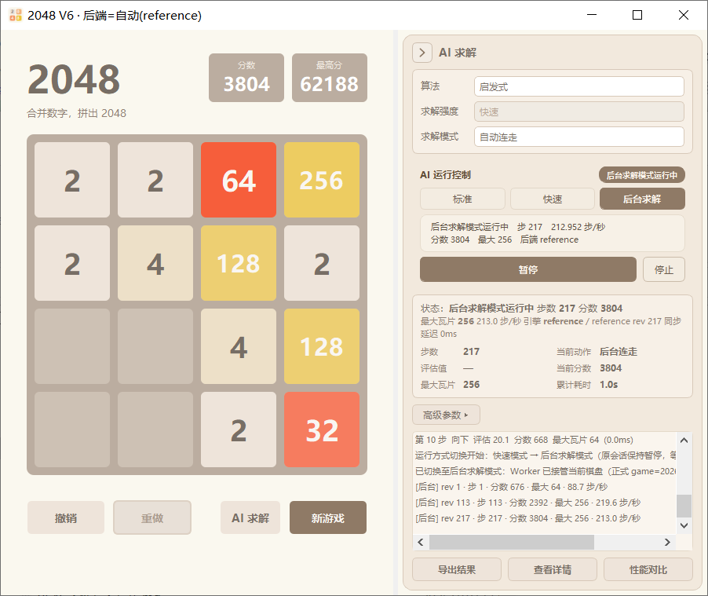
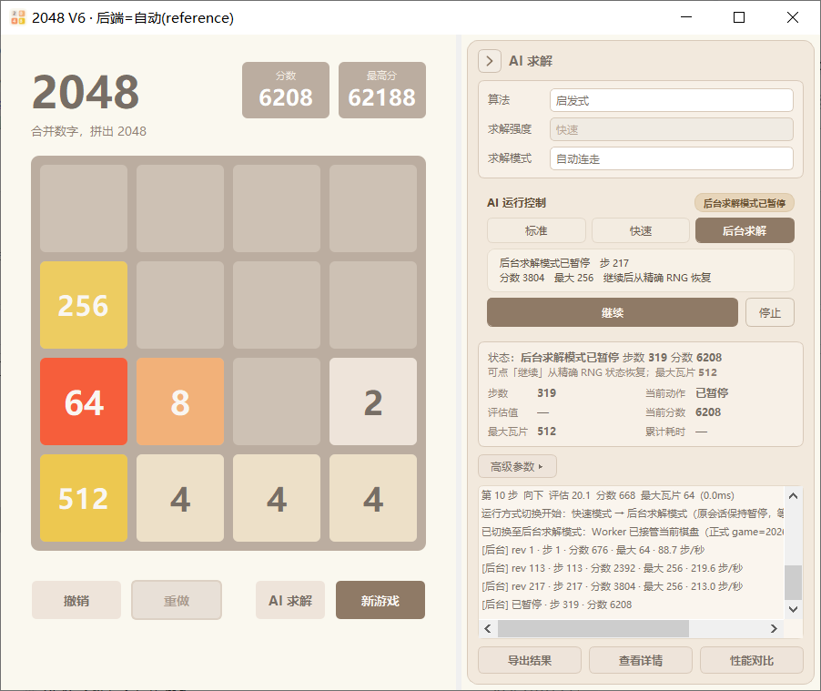

# 第6篇（中）· 使用 PyQt5 实现 2048 高性能计算版：无头后台求解与三档运行模式

第 6 篇（上）解决了"算得快且算得对"：四类计算后端、统一协议、显式回退与公平基准。这一篇换个问题：**如果一局求解要跑几十秒甚至几分钟，怎样让它不拖住界面，还能暂停、继续、关窗恢复？**

V6 的答案不是"再开一个线程"，而是把求解搬到一个**不导入 Qt 的独立进程**，并把"谁有权写这局游戏"变成可校验的所有权。本文是三层能力中的**执行层**：

| 篇目 | 主题 | 回答的问题 |
| --- | --- | --- |
| 第 6 篇（上） | 四类计算后端与公平基准 | 同样的算法，怎样算得更快且逐位一致？ |
| **第 6 篇（中）· 本文** | 无头后台求解与三档运行模式 | 怎样把长任务搬出 GUI，并能暂停、继续、恢复？ |
| 第 6 篇（下） | 统一运行控制与跨模式安全交接 | 三种执行模式并存时，怎样保证状态与数据只有一个真相？ |

---


## 1. 为什么把求解搬出 GUI

V5 的求解线程模型已经比"主线程直接算"进了一步：`SolverWorker` 跑在 QThread 里，界面仍可响应；任务有身份 `job_id`，旧结果会被丢弃。但它仍有三条硬边界：

1. **同进程**：Python 的 GIL 不会因为换了 QThread 就消失。搜索越密集，主线程拿到的时间片越少，动画与按钮仍会发涩。
2. **只能停止**：没有"暂停在安全点、之后再继续"的语义；停止意味着本段会话结束。
3. **生命周期绑在窗口上**：关掉窗口，线程与进度一起消失；崩溃后无法从"当前这局"精确恢复。

V6 把执行位置做成三档，其中后台档是一个**独立、无 Qt 的 Worker 进程**：

- GUI 只做三件事：写交接快照、低频接收进度、在终态一次性采纳；
- Worker 负责搜索、落子、生成方块与检查点；
- 两者之间不共享内存，只通过 stdin/stdout 的行式 JSON 通信。

这条边界的收益是：**长任务不占 GUI 的 GIL、可暂停/继续、可关窗恢复、可审计谁在写**。代价也很明确：所有状态必须能被序列化、校验与恢复，尤其是 RNG。

---


## 2. 三档运行方式：先定语义，再谈实现


*V6 展开态：左侧游戏台 + 右侧 AI 运行控制*

V6 的"运行方式"只决定**渲染、步间调度与执行位置**，不碰算法、求解强度与求解模式。这条边界写死在配置表里（`v6_speed`）：

```python
MODE_PARAMS = {
    'standard':   {'anim_off': False, 'step_delay_ms': 70, 'metrics_every': 1,
                   'particles_off': False, 'flow': True},
    'fast':       {'anim_off': True,  'step_delay_ms': 0,  'metrics_every': 8,
                   'particles_off': True,  'flow': True},
    'background': {'anim_off': True,  'step_delay_ms': 0,  'metrics_every': 8,
                   'particles_off': True,  'flow': False},
}
```

| 档位 | 走子动画 | 步间等待 | 合并粒子 | 方向流光 | 执行位置 |
| --- | --- | --- | --- | --- | --- |
| 标准 | 保留 | 70ms | 开 | 动态 | 本机 GUI |
| 快速 | 关闭 | 0 | 抑制 | 动态 | 本机 GUI |
| 后台求解 | 关闭 | 0 | 抑制 | 静态 | 独立 Worker 进程 |

两个容易混淆的命名先澄清：

- V5 下拉里的"运行方式"在 V6 中改名为**求解强度**（只影响搜索参数）；
- V5 的"模式"改名为**求解模式**（自动连走 / 单步建议）。

改名只发生在 V6 进程内（运行时改标签），V5 源码保持不变。这样"运行方式"这个词在 V6 里只剩一个含义：标准 / 快速 / 后台求解。

---


## 3. 无头核心：不导入任何 Qt

后台 Worker 的第一条约束是**不能导入 Qt**。这不是洁癖，而是可测试性与进程隔离的前提：一旦 `import PyQt5`，Worker 就继承 GUI 的线程模型、事件循环与平台依赖，无法在纯计算环境里跑，也无法保证"关掉窗口不影响计算"。

`headless.core` 只依赖标准库与纯 Python 求解器，核心是一个可校验的快照：

```python
def build_snapshot(board, score, best_score, rng_state_json, game_id, revision,
                   algorithm, strength, solver_mode='auto',
                   state_version=SNAPSHOT_SCHEMA, game_over=False):
    return {
        'schema': SNAPSHOT_SCHEMA,
        'state_version': int(state_version),
        'game_id': str(game_id),
        'revision': int(revision),
        'board': validate_board(board),
        'score': int(score),
        'best_score': int(best_score),
        'game_over': bool(game_over),
        'rng_state': rng_state_json,
        'algorithm': str(algorithm),
        'strength': str(strength),
        'solver_mode': str(solver_mode),
    }
```

其中最关键的是 `rng_state`：它不是 seed，而是 `random.getstate()` 的**完整状态**（版本、624 个状态字、gauss 缓存）。2048 的随机性来自"新方块的位置与 2/4 取值"，只存 seed 无法保证从暂停点逐位继续。

`validate_snapshot()` 与 `validate_board()` 把入口当边界处理：

- 棋盘必须 4×4、每格为 0 或 2 的整数次幂、拒绝布尔/负数/浮点/NaN；
- `revision` 不得为负，算法与强度必须属于已知集合；
- 快照必须能还原出 RNG 状态。

等价性不是靠"看起来一样"：`tests.test_v6_headless` 里的 `ModelEquivalenceTest` 用同一 RNG 状态让 `core.apply_move` 与官方模型逐步对弈，逐位比较棋盘、分数、生成方块位置与 RNG 消费。只有这层等价成立，"Worker 算出来的棋盘"才能被官方模型接受。

**一次后台任务的可观察生命周期**

```text
GUI 当前对局
  → 构建包含棋盘、分数、game_id 与完整 RNG 的快照
  → 启动无界面 Worker，等待确认所有权
  → Worker 计算并逐步写检查点
  → 按固定周期返回 progress（仅更新可见棋盘）
  → 用户请求暂停：等待安全步边界
  → FINAL(paused)：校验并采纳正式对局历史
  → 继续请求（协议中以再次 start 表达）：从暂停点启动下一段计算
  → 停止 / 自然终局：FINAL + 资源与所有权清理
```

这里的 `progress` 是用于显示的阶段性快照，`FINAL` 才承担正式状态提交；两者职责不同，不能让 GUI 在收到每条 `progress` 时重新落子。关于回传毫秒数，以本篇所引用版本中的常量为准。


## 4. 进程协议：一行一个 JSON

Worker 由 GUI 以子进程方式拉起，通信协议刻意保持最小（`headless.worker_main`）：

```
GUI -> Worker:
  {"cmd":"start","snapshot_path":"...","limits":{...},"backend":"cpp",
   "native_search":false,"staging":"...","ownership":"..."}
  {"cmd":"pause"}  {"cmd":"stop"}  {"cmd":"quit"}  {"cmd":"ping"}

Worker -> GUI:
  {"type":"ready","pid":...}
  {"type":"warming"} / {"type":"warmed"}
  {"type":"progress","revision":...,"board":[...],"score":...,...}
  {"type":"final","status":"paused|stopped|completed|game_over|error",...}
  {"type":"ack","cmd":"start"} / {"type":"exited","code":0}
```

三个实现细节值得单独说：

**为什么用 `readline()` 而不是 `for line in sys.stdin`。** 管道上的迭代会预读缓冲，导致命令延迟甚至阻塞；逐行 `readline()` 能避免这种“迭代器预读”带来的延迟。但它并不保证 `readline()` 本身不阻塞：没有数据时它仍会等待。真正的非阻塞语义来自双方“每条命令都有回执/终态”的协议设计，而不是单靠某个读函数。

**为什么必须 `CREATE_NO_WINDOW`。** 从无控制台的 GUI 进程启动 `python.exe`，Windows 默认会新建一个可见的空白控制台窗口。V6 在 `Popen` 时显式隐藏：

```python
kwargs['creationflags'] = subprocess.CREATE_NO_WINDOW
si = subprocess.STARTUPINFO()
si.dwFlags |= subprocess.STARTF_USESHOWWINDOW
si.wShowWindow = subprocess.SW_HIDE
kwargs['startupinfo'] = si
```

**为什么要 `warming / warmed`。** 首次导入 NumPy / pybind11 / Numba 可能耗时数十秒。Worker 在登记所有权后先发 `warming`，再发 `warmed`，GUI 才能区分"在预热"与"卡死"。

Worker 支持**多轮 start**：`start → 运行 → final(paused) → start(恢复) → ... → quit`。暂停不会杀死进程，恢复也不需要重新加载整个求解栈（除非进程已经退出，此时 GUI 用暂停快照重新拉起）。

---


## 5. 所有权：单一写者不是口头约定

只要存在"GUI 与 Worker 都可能写这局游戏"的可能，就必须有可校验的所有权。V6 用 `owner.json` 记录：

```json
{
  "pid": 16128,
  "session_id": "20261020_054305_040_bg",
  "revision": 0,
  "create_time": 1760000000.123,
  "image": "python.exe",
  "started_at": "2026-10-20 05:43:05",
  "heartbeat_at": "2026-10-20 05:43:05"
}
```

判定不是"PID 还在就算活着"，而要同时满足：

- 进程存在且处于 `STILL_ACTIVE`；
- `GetProcessTimes` 的创建时间与记录一致（防 PID 复用）；
- 可执行镜像名一致；
- 心跳在 `STALE_HEARTBEAT_S = 20s` 内；
- `session_id` 匹配。

状态只有四种：`absent / alive / stale / malformed`。回收过期所有权时还会做**二次校验**（TOCTOU 防护）：确认记录未被替换、仍非 alive，再原子写入 `released.json` 并删除 owner/心跳文件。

这套机制解决的是工程里最容易被忽略的故障：GUI 崩溃后残留 `owner.json`，下一次启动被误判为"已有后台在跑"；或者 PID 被系统复用，把无关进程当成 owner。前者导致功能不可用，后者会破坏单一写者。

---


## 6. 检查点：每步可恢复，而不是"最后存一次"

Worker 每提交一步都会写检查点（`headless.game_loop`）：

```python
checkpoint.save({
    'schema': SNAPSHOT_SCHEMA, 'status': 'running', 'steps': steps,
    'snapshot': text, 'game_id': snap['game_id'], 'revision': revision,
    'direction': direction, 'directions': list(directions),
    'spawn': res['spawn'], 'spawn_pos': res['spawn_pos'],
})
```

三个约束：

1. **原子写**：临时文件 → `fsync` → `os.replace`；成功后才算提交。
2. **容忍 Windows 瞬时锁**：目标文件被杀毒/备份/GUI 读取占用时，`os.replace` 会抛 `PermissionError`。检查点写入做有界重试（25 次 × 20ms），并把重试耗时单独计入 `checkpoint_retry_ms`，避免被误当作正常写入。重试耗尽后抛出 `IOError`，`run_session` 将其收敛为 `status=error` 的终态，而不是假装落盘成功。
3. **保留方向序列**：`directions` 让"恢复后的终态"能被官方模型回放，而不是只得到一个孤立棋盘。

暂停、停止、自然结束的区别也要写清楚：

| 终态 | Worker | 检查点 | GUI 后续 |
| --- | --- | --- | --- |
| `paused` | 常驻等待下一次 start | 保留可恢复快照 | 进入 `BG_PAUSED`，可继续 |
| `stopped` | 协作退出 | 保留 | 回到 `GUI_IDLE` |
| `completed / game_over` | 退出 | 保留 | 采纳终态并清空 Worker |

恢复时，GUI 必须清掉三个"上一段"的痕迹，否则会出现"点了继续但不再回传"：`_final_seen`（终态门）、`_session_cursor`（方向游标）、`_session_base_grid`（回放基准棋盘）。这三项在 `resume()` 里一起重置。

---


## 7. 500ms 回传：固定周期，单一来源


*本机快速/标准执行：自动连走与方向提示*

结果回传周期是**内部常量**，不是用户配置：

```python
# v6_background
REPORT_INTERVAL_MS = 500
```

> **版本口径（500ms vs 1000ms）**：早期项目计划里出现过“固定 1000ms”的表述；当前生产代码、偏好迁移版本（`report_prefs_version=3`）与本文均以 **500ms** 为准。本文不把 1000ms 当作现状，也不修改实现去迎合旧文档。

### 7.1 当前发布口径：500ms

| 来源 | 值 | 状态 | 说明 |
| --- | ---: | --- | --- |
| `v6_background.REPORT_INTERVAL_MS` | **500** | 当前源码 | 单一来源，GUI 不暴露间隔选择 |
| `config/ui_prefs.json` 的 `report_interval_ms` | **500** | 当前偏好 | `report_prefs_version=3` 迁移后写入 |
| 旧“定 N 步 / 定 N 毫秒”UI | 已移除 | 历史 | 避免把回传频率当成终止预算 |
| 早期设计目标 | 1000 | 已被取代 | 仅作为设计演进记录，不作为发布值 |

结论：**当前待发布版本是 500ms**。本文按 500ms 描述生命周期与展示频率；1000ms 只出现在“版本口径”说明中。没有为了统一文稿而改代码，也没有把 500ms 写成 1000ms。

V6 曾经提供过"定 N 步 / 定 N 毫秒"的回传选择，后来被移除。原因是它把三件事混在了一起：回传频率、终止预算、进度条语义。用户改小间隔并不会让求解更快，只会让 GUI 更忙；改大则看起来像"卡住了"。

现在的规则是：

- 回传只影响**展示频率**，不影响搜索与终止；
- 终止只由终局 / 用户暂停 / 用户停止 / 显式预算决定；
- 一次事件循环排空时，`progress` **只保留 revision 最大的一帧**，避免"一次涌入多帧、棋盘连续闪过好几段"；
- 渲染只读：`_render_snapshot()` 只刷新 `board_view` 与分数标签，**不 apply_move、不改 model.score**。

这样 GUI 的权威状态在整段后台运行期间保持不变，直到 `final` 到来。

---


## 8. FINAL 采纳：不是覆盖棋盘，而是回放历史

这是整个后台方案里最关键、也最容易做错的一步。

如果 `final` 只是把棋盘和分数覆盖到模型上，那么这一局会失去：正式 `history.csv`、撤销/重做栈、`game_state.json`、以及和正常对局一致的持久化语义。用户会得到"一个看起来对的棋盘，但历史断档"。

V6 的做法是**方向序列回放**：`final` 携带本段所有合法方向，GUI 从交接基准 RNG 开始，用官方模型逐步 `apply_move`：

```python
def replay_commit(model, directions, start_rng_state_json=None, cursor=0,
                  base_grid=None, defer_persistence=True, stats=None):
    if base_grid is not None and [row[:] for row in model.grid] != [list(r) for r in base_grid]:
        raise RuntimeError('模型棋盘在后台运行期间被改动，拒绝回放（保持单一写入者）')
    if start_rng_state_json is not None:
        random.setstate(core.rng_state_from_json(start_rng_state_json))
    delta = list(directions)[cursor:]
    if defer_persistence:
        with _DeferredModelIO(model):      # 回放期间不落盘
            for d in delta:
                model.apply_move(d)
    else:
        for d in delta:
            model.apply_move(d)
    return len(directions)
```

两个设计点：

**延迟落盘。** 正常对局每一步都会重写 `history.csv` 并 `save_game_state`（含 `fsync`）。据 `_DeferredModelIO` 的代码注释记录：如果在暂停时逐笔回放 536 步，就会产生约 1072 次 CSV 写与 1486 次 JSON 同步写，主线程实测被阻塞约 111 秒——这正是早期"点暂停后界面卡死"的根因。`_DeferredModelIO` 在回放期间抑制四类 IO（历史、存档、最高分、索引），回放结束后由 `persist_official(model)` 依次对历史、存档、最高分与索引做**四次原子写**。每个文件各自原子替换，但这四步仍不是跨文件事务：极端情况下可能出现历史已写入、索引尚未更新的中间态。

**校验后再提交。** 回放完成后，必须验证 `model.grid == snapshot.board` 且 `model.score == snapshot.score`。一致才提交正式历史；不一致则退回"只读采纳"并显式告警，绝不把不一致的状态静默写进正式存档。

这也解释了为什么"暂停"在后台档不是"立刻停"：它要等当前这一步搜索完成，拿到 `final`，回放校验通过，才算真正暂停。

---


## 9. 状态机：把"正在暂停"和"已暂停"分开



*后台求解运行中：真实 Worker 已接管，200+ 步*

后台控制器只有一张迁移表（`v6_background`）：

```python
_TRANSITIONS = {
    'GUI_IDLE':        {'HANDOFF_PREPARE'},
    'HANDOFF_PREPARE': {'BG_RUNNING', 'GUI_IDLE', 'BG_ERROR'},
    'BG_RUNNING':      {'BG_PAUSING', 'BG_STOPPING', 'BG_COMPLETED', 'BG_ERROR'},
    'BG_PAUSING':      {'BG_PAUSED', 'BG_ERROR'},
    'BG_PAUSED':       {'BG_RUNNING', 'BG_STOPPING', 'GUI_IDLE', 'BG_ERROR'},
    'BG_STOPPING':     {'GUI_IDLE', 'BG_ERROR'},
    'BG_COMPLETED':    {'GUI_IDLE'},
    'BG_ERROR':        {'GUI_IDLE'},
}
```

几个状态的含义：

- `HANDOFF_PREPARE`：已经受理启动，但 Worker **尚未确认接管所有权**；
- `BG_PAUSING`：已发出暂停请求，等待当前步返回 `final`；
- `BG_PAUSED`：`final(paused)` 已采纳并持久化，Worker 常驻等待继续；



*后台暂停：FINAL 已采纳并持久化*

- `BG_COMPLETED / BG_ERROR`：终态，随后回到 `GUI_IDLE`。

非法迁移会被拒绝并写入日志，而不是"尽力而为"。这样按钮文案、Worker 实际状态与数据状态才能保持一致。

一次完整后台会话的时间线：

| 阶段 | GUI 侧 | Worker 侧 | 关键产物/状态 |
| --- | --- | --- | --- |
| 启动 | 写交接快照，`Popen`，进入 `HANDOFF_PREPARE` | 启动、写 owner、心跳 | `*_handoff.json`、`owner.json` |
| 接管 | 轮询 owner，pid 匹配后进入 `BG_RUNNING` | 预热 `warming → warmed` | 所有权确认 |
| 运行 | 每 500ms 收一帧 progress，只读渲染 | 每步写检查点、更新心跳 | `*_checkpoint.json` |
| 暂停 | 进入 `BG_PAUSING`，等 FINAL | 步边界返回 `status=paused` | `*_resume.json`、`BG_PAUSED` |
| 继续 | 发 `start` 指向暂停快照 | 从精确 RNG 状态续跑 | 清 `_final_seen`/游标/基准盘面 |
| 停止 | 进入 `BG_STOPPING` | 返回 `status=stopped` 后退出 | 释放 owner，`GUI_IDLE` |
| 自然结束 | 采纳 `completed/game_over` | 返回 FINAL 后退出 | 回放正式历史，清理 Worker |

> 关于 `HANDOFF_PREPARE` 为什么不能直接跳到 `BG_RUNNING`，以及跨运行方式交接如何复用这张状态机，见下一篇。

---


## 10. 启动期恢复：GUI 重启之后

GUI 重启时，`recover_on_start()` 只做三种判断：

1. `owner_status == alive`：说明 Worker 仍在跑。GUI 重连（无管道时用控制文件通信），选项卡同步为"后台求解"，并启动 1.2s 心跳观察；
2. `stale / malformed`：安全释放所有权，读取最新检查点恢复棋盘；若检查点含方向序列，则从交接基准 RNG 回放，恢复正式历史；
3. `absent`：什么都不做。

这一步的价值在于"崩溃不是数据丢失"：只要检查点还在，下一次启动就能回到最后一次已提交的步，而不是回到开局。

---


## 11. 踩过的坑（工程复盘）

| 现象 | 根因 | 修复 |
| --- | --- | --- |
| 点暂停后界面卡死约 111s | 回放时逐笔写 CSV/JSON + fsync | `_DeferredModelIO` + 单次 `persist_official` |
| 继续之后不再回传 | 暂停已置 `_final_seen=True`，恢复后所有 progress 被当迟到帧 | `resume()` 清终态门并重置游标 |
| 第二次开始后台，前盘长时间空白 | 跨会话 revision 跟踪未重置 | `_reset_session_tracking()` |
| 启动后台后多出一个空白 python 窗口 | 子进程未隐藏控制台 | `CREATE_NO_WINDOW` + `STARTUPINFO` |
| 出现第二个空白 Qt 窗口 | 已脱离布局的 `BackgroundPanel` 被 `setVisible(True)` | 禁止显示占位面板 |
| "回传间隔"被当成终止预算 | 配置项语义混用 | 固定 500ms，移除 N 步/N 时间 UI |

这些问题的共同点是：**它们都不是算法问题，而是状态与生命周期问题**。后台求解真正的难点不在"怎么算"，而在"谁在写、写到哪、什么时候算写完"。

---


## 12. 验收与边界

与本篇相关的测试：

| 模块 | 用例 | 覆盖 |
| --- | --- | --- |
| `test_v6_headless` | 26（skip 2） | Qt-free、快照校验、RNG 往返、模型等价、Worker 端到端、暂停/继续/停止、每步检查点 |
| `test_v6_ownership` | 12（skip 1） | 身份校验、PID 复用、心跳超时、安全释放、TOCTOU |
| `test_v6_report_policy` | 11 | 固定 500ms、回传与终止分离、无 N 步/N 时间配置 |

真实 GUI E2E 中，后台段跑到 **217 步**后暂停，采纳后的官方棋盘/分数与 Worker 终态一致，暂停点全局 RNG 与 Worker **逐位一致**，最高分保持 62188 未回退。

边界也要写明：

- 后台档只支持"自动连走"；单步建议仍在本机执行；
- 后台运行期间，左侧棋盘只做只读快照刷新，不响应手动走子；
- 暂停是"安全步边界暂停"，不是立即中断搜索；长搜索步会让"正在暂停"多停留一会儿；
- 人工视觉验收（`VISUAL_PASS`）仍需人工核对，自动门禁只覆盖 `CAPTURE / STRUCTURE / TEXT`。

---


## 13. 小结

这一篇把"后台求解"拆成了四件事：

1. **执行位置**：无 Qt Worker 进程，stdin/stdout 行式 JSON；
2. **写权限**：owner.json + 心跳 + 进程身份 + 过期释放，保证单一写者；
3. **可恢复**：每步原子检查点 + 完整 RNG 状态 + 方向序列；
4. **可采纳**：FINAL 不是覆盖棋盘，而是回放官方历史，再对历史/存档/最高分/索引做四次按文件原子写。

做到这四点，"后台跑一局"才不是"再开一个线程"，而是一个可以被暂停、恢复、审计和交接的会话。

---


**上一篇**：[第 6 篇（上）· 使用 PyQt5 实现 2048 高性能计算版：四类计算后端与公平基准](第6篇（上）·%20使用%20PyQt5%20实现%202048%20高性能计算版：四类计算后端与公平基准.md)

**下一篇**：[第 6 篇（下）· 使用 PyQt5 实现 2048 高性能计算版：统一运行控制与跨模式安全交接](第6篇（下）·%20使用%20PyQt5%20实现%202048%20高性能计算版：统一运行控制与跨模式安全交接.md)，三种执行模式并存后，如何用一个状态机保证按钮、棋盘、RNG 与最高分只有一个真相。
