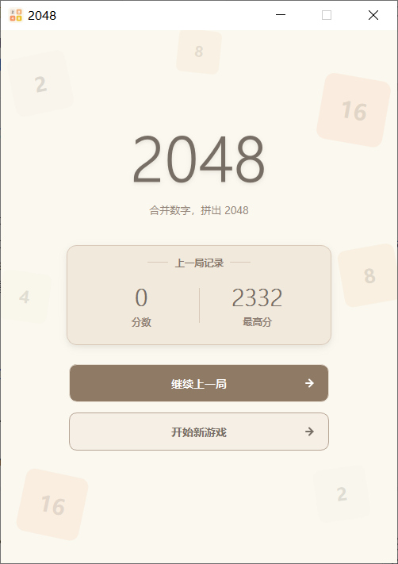
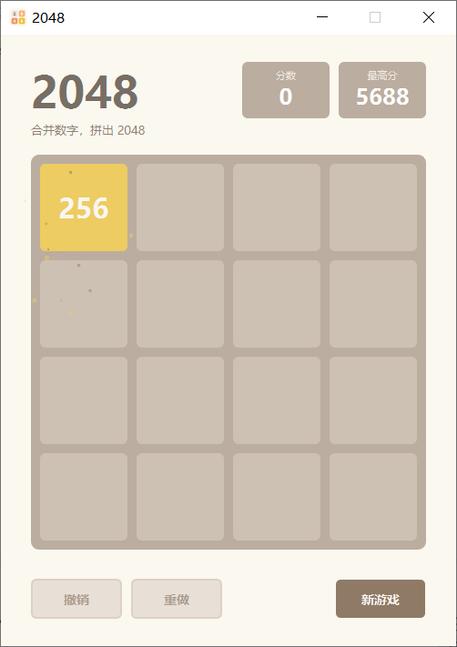
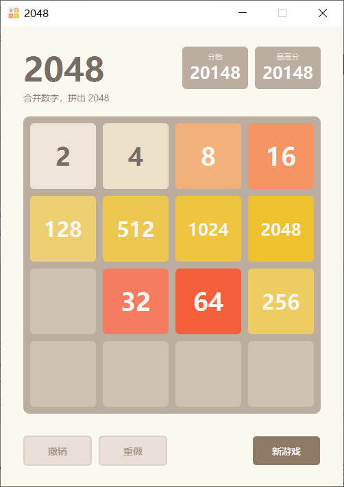

# 第4篇 · 使用 PyQt5 实现 2048：平滑动画与性能优化

第 3 篇用 PyQt5 将 2048 迁移到桌面端，但界面是"**整盘重绘、方块瞬移**"的：一次移动就是把新网格直接写入 16 个 `QLabel`，方块从 A 格"跳"到 B 格，中间没有过程。

动画的本质是**为"状态变化"补上时间轴**：先计算每个方块的起点与终点，再由定时器逐帧插值。它类似于舞台调度：背景布景搭建完成后不再变化，只有演员在移动；对应到代码，就是把棋盘拆分为"静态背景层（只画一次，缓存成 `QPixmap`）+ 动画层（每帧按过渡信息重绘方块）"。

实现上有两条常见路线：`QPropertyAnimation` 面向单个属性、写法简洁，但需为每块各建一个动画对象；**`QTimer` + 手动插值**更为直接，能精确控制每帧绘制的内容，并把刷新范围收敛到棋盘控件。在 4×4、16 个方块的规模下，可控性更有价值。

本文将从**过渡信息的生成、分层渲染、逐帧插值、输入节流、性能取舍**等方面，系统讲解移动动画与渲染优化的实现。

## 1 总思路：Model 不动，换掉 View

实现动画需先回答一个问题：**一次移动中，哪个方块从哪里来、到哪里去？**

- 依靠"对比移动前后的两个棋盘"反推并不可靠，数字会重复。例如一行 `[2, 2, 2, 2]` 向左合并后为 `[4, 4, 0, 0]`，无法从一个静态网格判断出"哪个 4 来自哪两个 2"。
- 正确做法是**在合并发生的那一刻记录过渡信息**。

于是分层这样安排：

| 层 | 类 | 变化 |
| --- | --- | --- |
| **Model** | `GameCore`（第 3 篇，**一行不改**） + `AnimatedGameCore`（子类） | 只额外记录每块的"起点 → 终点"与新生方块位置 |
| **View** | `BoardView`（`QWidget` + `QPainter` 自绘） | 从 16 个 `QLabel` 换成"静态背景层（缓存）+ 动画层（逐帧插值）" |
| **Controller** | `MainWindow` | 动画进行中忽略输入；动画结束后再做胜负提示 |

Model 直接复用第 3 篇：`from v3_pyqt_2048_with_history import GameCore`。也就是说，这一篇**没有改动任何一条合并规则、存档或撤销重做的逻辑**，再次印证了 MVC 分层的价值。


## 2 Model：只补"过渡信息"

`AnimatedGameCore` 继承 `GameCore`，把两件事记下来：`last_transitions`（每块的去向）和 `last_spawn`（新方块坐标）。

### 2.1 逐行合并时输出"去向"

```python
def _merge_line_tracked(self, line):
    """
    返回 (新行, ops)。
    ops: [(源下标, 目标下标, 该块当前显示的数值, 是否合并)]
    """
    size = len(line)
    items = [(v, p) for p, v in enumerate(line) if v != 0]   # (数值, 源下标)

    result = []          # (最终值, [源下标...], 是否合并, 滑动时显示的数值)
    i = 0
    while i < len(items):
        if i + 1 < len(items) and items[i][0] == items[i + 1][0]:
            v = items[i][0]
            self.score += v * 2
            result.append((v * 2, [items[i][1], items[i + 1][1]], True, v))
            i += 2
        else:
            result.append((items[i][0], [items[i][1]], False, items[i][0]))
            i += 1

    new_line = [r[0] for r in result] + [0] * (size - len(result))
    ops = []
    for dst_p, (_final, srcs, merged, tile_v) in enumerate(result):
        for sp in srcs:
            ops.append((sp, dst_p, tile_v, merged))
    return new_line, ops
```

> 关键细节：**合并时两块携带各自的原值**（例如两个 2）一起滑向同一格，落定后才显示合并结果 4。若把两块都当作 4 来绘制，滑行过程中就会出现"凭空多出一个 4"的错觉。

### 2.2 覆盖 `_slide`：行内下标 → 棋盘坐标

`_slide` 仍然沿用第 3 篇那套"上下先转置、左右按需翻转"的方向抽象，只是额外记录了过渡信息：

```python
def _slide(self, direction):
    size = self.grid_size
    self.last_transitions = []
    moved = False

    if direction in ('up', 'down'):
        self.grid = [list(row) for row in zip(*self.grid)]

    for i in range(size):
        original = self.grid[i]
        row = original[::-1] if direction in ('right', 'down') else original
        new_row, ops = self._merge_line_tracked(row)
        if direction in ('right', 'down'):
            new_row = new_row[::-1]
        if new_row != original:          # 与原行（而非翻转后的行）比较
            moved = True
        self.grid[i] = new_row

        for src_p, dst_p, value, merged in ops:
            # 行内下标 -> 棋盘坐标（注意翻转与转置）
            if direction in ('right', 'down'):
                src_p, dst_p = size - 1 - src_p, size - 1 - dst_p
            if direction in ('up', 'down'):
                src, dst = (src_p, i), (dst_p, i)
            else:
                src, dst = (i, src_p), (i, dst_p)
            self.last_transitions.append((src, dst, value, merged))

    if direction in ('up', 'down'):
        self.grid = [list(row) for row in zip(*self.grid)]
    return moved
```

再记录新生方块的位置，动画即可确定"哪个格子需要放大出现"：

```python
def add_new_tile(self):
    empty = [(i, j) for i in range(self.grid_size)
             for j in range(self.grid_size) if self.grid[i][j] == 0]
    if not empty:
        self.last_spawn = None
        return False
    i, j = random.choice(empty)
    self.grid[i][j] = 2 if random.random() < 0.9 else 4
    self.last_spawn = (i, j)
    return True
```

> **已遇到的问题**：`moved` 必须与翻转前的原行比较。早期版本与翻转后的 `row` 比较，导致"向右/向下"方向在实际上未移动时也返回 `True`，按下一次方向键就会多出一个新方块。后来用随机棋盘将 `AnimatedGameCore._slide` 与第 3 篇的 `GameCore._slide` 逐一对比，才定位到该偏差。


## 3 View：分层渲染 + 逐帧插值

`BoardView` 不再使用 `QLabel`，而是继承 `QWidget` 自行使用 `QPainter` 绘制。帧结构很简单：**先绘制背景，再绘制方块**。

### 3.1 静态背景层：只画一次，缓存成 pixmap

背景（棋盘底板 + 16 个空格）恒定不变，无需每帧重绘并重复圆角抗锯齿计算。构造时"烘焙"为一张 `QPixmap`：

```python
def _build_background(self):
    pm = QPixmap(BOARD_SIDE, BOARD_SIDE)
    pm.fill(Qt.transparent)
    p = QPainter(pm)
    p.setRenderHint(QPainter.Antialiasing, True)
    p.setPen(Qt.NoPen)
    p.setBrush(QColor(COLOR_BOARD))
    p.drawRoundedRect(QRectF(0, 0, BOARD_SIDE, BOARD_SIDE), BOARD_RADIUS, BOARD_RADIUS)
    p.setBrush(QColor(COLOR_EMPTY))
    for i in range(self.grid_size):
        for j in range(self.grid_size):
            p.drawRoundedRect(self._cell_rect(i, j), TILE_RADIUS, TILE_RADIUS)
    p.end()
    return pm
```

`paintEvent` 中一句 `p.drawPixmap(0, 0, self._background)` 即可绘制整块底板，其余按过渡信息绘制全部方块（含原地不动的方块）。

### 3.2 动画层：滑行 → 合并/新生

一次移动分两个阶段，用一个 16ms 目标 tick 的 `QTimer` 推进（名义 62.5Hz；这是调度间隔，不是实测帧率）：

- `move`：所有方块从起点插值滑到终点；
- `pop`：落定后，合并的格子做一次回弹，新生格子放大出现。

```python
def _tick(self):
    if self.anim is None:
        self.timer.stop()
        return
    self.anim["t"] += self.timer.interval() / 1000.0

    if self.anim["phase"] == "move":
        if self.anim["t"] >= MOVE_DURATION:
            if self.anim["mode"] == "reverse":   # 回退只有“滑回”一个阶段（见 §4）
                self._finish_animation()
                return
            self.anim["phase"] = "pop"
            self.anim["t"] = 0.0
            self._emit_merge_fragments()     # 合并落定：与弹性动画同步释放碎片
    else:
        if self.anim["t"] >= POP_DURATION:
            self._finish_animation()
            return
    self.update()

def _finish_animation(self):
    self.grid = self.anim["target"]
    self.anim = None
    self.timer.stop()
    self.update()
    self.animationFinished.emit()
```

> **时间口径的限制**：`_tick` 用 `t += timer.interval() / 1000.0` 累加，而不是读取 `perf_counter()` 的墙钟时间。它能保证在定时器按时触发时动画时长稳定，但主线程一旦被阻塞，定时器会丢 tick，累加值会比真实时间慢，表现为动画“变慢”或跳帧。16ms 间隔只是目标调度周期，**没有对实际帧率做测量**；若需要可证明的稳定帧率，应记录每帧墙钟时间并统计 p50/p95，而不是由 interval 推导。

滑行阶段按进度在起点/终点之间插值，缓动用 `ease_out_cubic`（起步快、收尾稳）：

```python
prog = ease_out_cubic(min(1.0, self.anim["t"] / MOVE_DURATION))
for value, sx, sy, tx, ty in self.anim["moving"]:
    x = sx + (tx - sx) * prog
    y = sy + (ty - sy) * prog
    self._draw_tile(p, value, x, y, 1.0)
```

pop 阶段只对两类格子做缩放：合并处做一次回弹，新生格从 0 放大：

```python
if (r, c) in pop_cells:
    scale = 1.0 + 0.16 * math.sin(math.pi * prog)   # 合并回弹
elif spawn is not None and (r, c) == spawn:
    scale = ease_out_back(prog)                     # 新生放大出现
```

`_draw_tile` 以格子中心为锚点缩放，字号也随 `scale` 一起放大，因此方块呈现"从中心弹出"的效果：

```python
def _draw_tile(self, p, value, x, y, scale):
    size = TILE_SIZE * scale
    cx, cy = x + TILE_SIZE / 2.0, y + TILE_SIZE / 2.0
    rect = QRectF(cx - size / 2.0, cy - size / 2.0, size, size)
    p.setPen(Qt.NoPen)
    p.setBrush(self._tile_color(value))
    p.drawRoundedRect(rect, TILE_RADIUS * scale, TILE_RADIUS * scale)
    # ... 居中绘制数字，字号 = 基准字号 * scale ...
```

在非动画状态下（新游戏 / 继续上一局），`render(grid)` 直接绘制当前网格即可。


## 4 Controller：输入节流与收尾

动画期间应禁止玩家继续操作，否则"动画尚未结束就再次移动"会导致状态错乱。因此 `on_move` 中设有两道检查：

```python
def on_move(self, direction):
    if self.model.game_over or self.board_view.is_animating():
        return                       # 动画进行中忽略输入
    if not self.model.apply_move(direction):
        return                       # 非法移动（撞墙）不产生动画

    self._render_score(self.score_label, "分数", self.model.score)
    self._render_score(self.best_label, "最高分", self.model.best_score)
    self._sync_history_buttons()         # 历史已变化：立即更新按钮外观（无动画耦合）
    self.board_view.animate_move(self.model.grid,
                                 self.model.last_transitions, self.model.last_spawn)
```

撤销和重做按钮**不会因动画开始而被禁用**：其启用状态仅跟随历史栈（`_sync_history_buttons()`，即 `setEnabled(model.can_undo())` / `setEnabled(model.can_redo())`）。动画期间的误操作由上述入口检查拦截，因此既保护了历史状态，又不会在连续快速滑动时出现"按钮反复变化"的闪烁。

"动画结束"用信号通知 Controller，再统一刷新按钮、弹胜负框：

```python
self.board_view.animationFinished.connect(self._on_animation_finished)

def _on_animation_finished(self):
    self.refresh()
    if self.model.game_over:
        self.show_game_over()
    elif self.model.won and not self.win_announced:
        self.win_announced = True
        self._celebrate()            # 首次达成 2048：金色庆祝粒子
        self.show_game_won()
```

撤销和重做同样带动画。关键在于：让 Model 在压栈时**同时保存这一步的过渡信息**，撤回时反向回放、重做时正向回放：

```python
# Model：一个回合压栈时，连过渡一起存
self.undo_stack.append({"snapshot": snapshot,
                        "transitions": transitions, "spawn": spawn})

# Model：撤回时把该步过渡原样返回给 Controller（重做同理）
def undo(self):
    if not self.undo_stack:
        return None
    entry = self.undo_stack.pop()
    self.redo_stack.append({"snapshot": self._snapshot(),
                            "transitions": entry["transitions"], "spawn": entry["spawn"]})
    self._restore(entry["snapshot"])
    self.save_game_state(); self.update_index()
    return {"kind": "undo", "transitions": entry["transitions"], "spawn": entry["spawn"]}
```

```python
# Controller：撤回用 animate_undo（反向滑行），重做用 animate_move（正向滑行）
def on_undo(self):
    if self.board_view.is_animating():
        return
    info = self.model.undo()
    if not info:
        return
    self.board_view.animate_undo(self.model.grid, info["transitions"], info["spawn"])
```

View 侧仅将插值方向反转：`animate_move` 从 `src` 滑到 `dst`，`animate_undo` 从 `dst` 滑回 `src`，同时让新生方块由 1 缩到 0 消失：

```python
if self.anim["mode"] == "reverse":
    x = tx + (sx - tx) * prog     # 从落点滑回起点
    y = ty + (sy - ty) * prog
else:
    x = sx + (tx - sx) * prog
    y = sy + (ty - sy) * prog
```


## 5 性能要点

1. **背景层缓存**：静态背景只在构造时绘制一次，每帧只做一次 `drawPixmap` 的位图拷贝，省去 16 个圆角矩形 + 抗锯齿的重复开销。
2. **只重绘棋盘控件**：动画只触发 `BoardView.update()`，分数卡与按钮不参与重绘，窗口也没有整窗重排。这里的粒度是“整个棋盘控件”，不是“逐瓦片脏矩形”。
3. **按目标 tick 推进**：`QTimer` 间隔 16ms（名义 62.5Hz），进度用 `t += interval` 累加；动画时长仅 0.12s / 0.14s，对操作手感影响很小。该写法在丢 tick 时会产生时间漂移，且当前没有实测帧率数据。
4. **两块合并时一同滑动，落定后一次给出结果**，避免中间态闪烁。
5. 沿用第 3 篇的高 DPI 适配（`AA_EnableHighDpiScaling` / `AA_UseHighDpiPixmaps`）与配色常量，两版使用同一套颜色与尺寸；逐像素一致性未做自动比对。

> 更激进的做法是只重绘"脏矩形"（移动方块覆盖到的区域），或使用 `QGraphicsView` / Qt Quick 交由 GPU 处理。当前实现并未做逐瓦片脏矩形裁剪；4×4 仅有 16 格，整块棋盘全量重绘已足够，因此这里优先保证"简单可读"。


## 6 运行与操作

```bash
pip install PyQt5
python v4_pyqt_2048_animated/v4_pyqt_2048_animated.py
```

- 方向键 / `WASD`：移动方块（带平滑动画）；
- `Ctrl+Z` / `Ctrl+Y`：撤销和重做（带反向 / 正向滑行动画）；
- 底部按钮：撤销、重做、新游戏；
- 启动页：继续上一局 / 开始新游戏（`Tab` 切换焦点，`回车` / `空格` 触发）。

> 动画版复用第 3 篇的 `GameCore`，但使用自己的 `v4_pyqt_2048_animated/game_history/` 存档目录，不与第 3 篇的对局混在一起。


## 7 效果

启动页：



棋盘动画之外还有一套**独立的粒子反馈**（`Particle` / `ParticlePreset` / `ParticleEngine` + 窗口级 `ParticleOverlay` 覆盖层，鼠标穿透）：合并落定时在目标格按"接触区 / 方块内部 / 四周边缘"三区域随机取样释放碎片，悬停启动页按钮时持续发射，首次达成 2048 时触发一次金色庆祝。它只做视觉反馈，与棋盘动画、游戏规则互不影响。

合并瞬间的粒子扩散：



落定后的游戏页：



> **CSDN 发布提示**：以上为仓库相对路径，发布前需上传并替换为真实 URL；逐图映射见 `csdn_2048_review/03_image_and_formula_audit.md`。`VISUAL_PASS` 需人工核对后授予，未核验记为 `UNVERIFIED`。


## 8 小结

这一篇没有改动游戏规则，只实现了"可观测的流畅度"：

1. **父类不改，子类补充过渡信息**：`GameCore` 原样复用，`AnimatedGameCore` 覆盖 `_slide` / `add_new_tile`，只记录“每个方块的起点与终点”。MVC 分层使“更换渲染方式”的成本极低。
2. **分层渲染**：静态背景层缓存成 `QPixmap`，动画层用 `QTimer` 逐帧插值，滑行 / 合并回弹 / 新生放大衔接连贯；撤回 / 重做对同一套过渡做“反向 / 正向回放”，同样平滑。
3. **性能取舍**：背景烘焙 + 整块棋盘重绘 + 16ms 目标 tick。在 4×4 的规模下，以最简单的方式获得足够流畅的效果；实际帧率未测量，丢 tick 时存在时间漂移。

这套“静态背景 + 动画层 + 整块棋盘重绘”适合元素少、需要在既定节奏下精确控制绘制内容的场景，也能迁移到类似的小型网格应用；元素成百上千或需要复杂层级与命中测试时，应该交给 `QGraphicsView / QGraphicsScene`。

**上一篇**：[第 3 篇 · 使用 PyQt5 实现 2048 桌面版游戏：MVC 架构与撤销和重做](../../blog/第3篇%20·%20使用%20PyQt5%20实现%202048%20桌面版游戏：MVC%20架构与撤销和重做.md)

**下一篇**：[第 5 篇（上）· 使用 PyQt5 实现 2048 算法求解版：五类搜索算法内核](../../blog/第5篇（上）·%20使用%20PyQt5%20实现%202048%20算法求解版：五类搜索算法内核.md)，换一条线让 2048 会算：可解释的评估函数与启发式 / 贪心模拟 / Expectimax / MCTS / 强化学习五类策略，并用确定性测试证明它们真的对。
