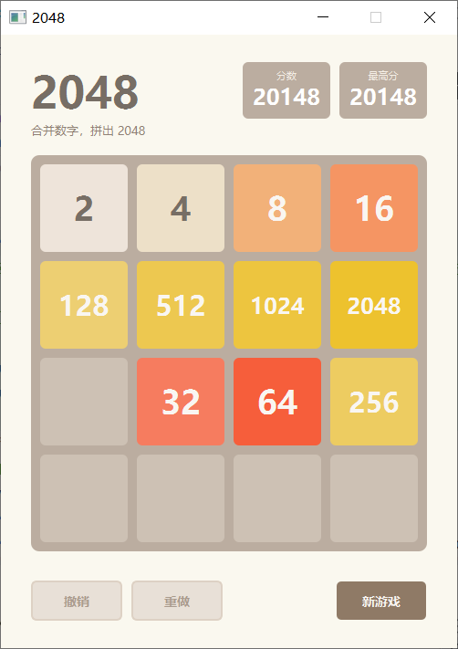
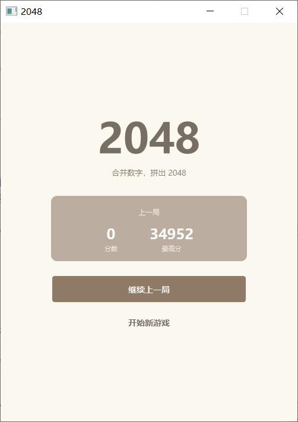

# 第3篇 · 使用 PyQt5 实现 2048 桌面版游戏：MVC 架构与撤销和重做

前两篇为纯 Python 实现：第 1 篇的数学模型、第 2 篇的带历史记录的控制台版。控制台版适合验证逻辑，但交互体验并不好：每执行一步都要 `cls` 清屏、光标闪烁，且只能使用键盘。

这一篇将其迁移到桌面端：用 **PyQt5** 实现图形界面。同样是"把游戏显示出来"，写法上存在一个根本分岔：逻辑与渲染是耦合在一起，还是分为三层。耦合在一起最为简单，但测试一次合并需先创建一个窗口，修改一次配色也要查阅业务代码；分为 MVC 之后，Model 只处理棋盘、View 只处理像素、Controller 只做事件分发，三者互不干扰。

另一项工程实践是 **撤销和重做**。它有两种典型实现：命令模式（记录每一步操作并反向执行）与状态快照（直接保存棋盘深拷贝）。前者内存占用较小，但需为每种操作编写反向逻辑；后者实现简单且可靠，代价是内存。本项目棋盘仅为 4×4，快照成本可忽略，因此选用状态快照栈。

本文将从**MVC 分层、棋盘渲染、键盘控制、状态快照式撤销和重做、与历史记录打通、视觉规范与高 DPI 适配**等方面，系统讲解 PyQt5 桌面版 2048 的实现。

## 1 为什么需要 MVC

在控制台版中，`_move`、`display_grid`、`get_key` 都集中在同一个类中。一旦换为 GUI，若继续沿用这种写法，就会出现典型问题：**逻辑与渲染耦合**，测试一次合并是否正确需先创建一个窗口，修改一次配色则需查阅大量业务代码。

因此按 **MVC（Model–View–Controller）** 分层：

| 层 | 类 | 职责 |
| --- | --- | --- |
| **Model** | `GameCore` | 棋盘状态、合并规则、得分、历史持久化、撤销和重做（**不含任何界面代码**） |
| **View** | `TileLabel` / `BoardView` | 只负责把 Model 的网格渲染成方块，**不处理任何业务逻辑** |
| **Controller** | `MainWindow` | 捕获键盘/按钮事件，调用 Model，再通知 View 刷新 |

分层的直接收益是：`GameCore` 不依赖 PyQt，可以像第 1、2 篇那样单独导入与测试；界面若更换为 Tkinter、Web 或命令行，核心逻辑均无需改动。


## 2 Model：与原版无异的游戏核心

`GameCore` 承载了前两篇的全部逻辑：棋盘、随机方块、移动合并、胜负判断，并在第 2 篇的基础上继续做历史记录持久化。

### 2.1 复用规则与方向归约

合并规则（压缩非零、相邻相同合并、右侧补零、每个方块最多合并一次）与第 1 篇完全一致，这里不再重复代码。GUI 版只在此基础上保留两项内容：

- **方向抽象**：上下先转置、左右按需翻转行，四个方向复用同一套逐行逻辑；
- **历史持久化**：沿用第 2 篇的 `save_game_state` / `update_index`；`record_move` 按 GUI 版需要改成「步数 / 操作类型 / 当前分数 / 网格状态」四列，每次成功移动写两行（方向与补块）。

```python
def _slide(self, direction):
    moved = False
    if direction in ('up', 'down'):
        self.grid = [list(row) for row in zip(*self.grid)]  # 转置

    for i in range(self.grid_size):
        row = self.grid[i][::-1] if direction in ('right', 'down') else self.grid[i]
        new_row, has_moved = self._merge_line(row)
        if direction in ('right', 'down'):
            new_row.reverse()
        self.grid[i] = new_row
        moved = moved or has_moved

    if direction in ('up', 'down'):
        self.grid = [list(row) for row in zip(*self.grid)]  # 还原
    return moved
```


## 3 View：用 QGridLayout + QLabel 绘制棋盘

PyQt 中绘制棋盘有两条常见路线：`QGraphicsView/QGraphicsScene`，或自定义 `QWidget` + `paintEvent`（`QPainter`）。本系列先采用更简单、更易读的方案：**`QGridLayout` 布局 16 个 `QLabel`**。它足以表达静态棋盘，也为第 4 篇的动画改造留出清晰边界。

### 3.1 关键点

- **方块是"格子"**：每个 `TileLabel` 是一格，用固定尺寸的 `QLabel` + 样式表绘制圆角背景与文字；
- **颜色映射**：不同数值对应 2048 官方配色，空格用统一的底板色；
- **View 只渲染**：`BoardView.render(grid)` 接收一个二维网格，逐格刷新，不做任何判断。

### 3.2 代码实现（方块渲染）

```python
class TileLabel(QLabel):
    """单个方块（View 的最小元素）"""

    # 经典 2048 配色（空格底色单独用 COLOR_EMPTY）
    COLORS = {
        2: (238, 228, 218), 4: (237, 224, 200),
        8: (242, 177, 121), 16: (245, 149, 99),
        32: (246, 124, 95), 64: (246, 94, 59),
        128: (237, 207, 114), 256: (237, 204, 97),
        512: (237, 200, 80), 1024: (237, 197, 63),
        2048: (237, 194, 46),
    }
    # 4096 起的深琥珀色阶：与 2048 拉开明度差，同时保证白字可读
    HIGH_COLORS = {
        4096: (237, 176, 32), 8192: (227, 159, 22), 16384: (214, 143, 15),
    }
    TEXT_DARK = "#776e65"
    TEXT_LIGHT = "#f9f6f2"

    def __init__(self, value=0, parent=None):
        super().__init__(parent)
        self.setAlignment(Qt.AlignCenter)
        self.setFixedSize(TILE_SIZE, TILE_SIZE)   # 固定尺寸，保证严格正方形
        self.set_value(value)

    def set_value(self, value):
        """根据数值刷新圆角背景、字色与字号"""
        if value == 0:
            bg = QColor(COLOR_EMPTY)
        elif value > 2048:
            bg = QColor(*self.HIGH_COLORS.get(value, (198, 128, 12)))
        else:
            bg = QColor(*self.COLORS.get(value, (60, 58, 50)))

        color = self.TEXT_DARK if value <= 4 else self.TEXT_LIGHT
        # 字号随位数自适应：2–64 常规 36px，逐级递减，保证大数值不溢出
        if value == 0:
            size = 1
        elif value < 100:
            size = 36
        elif value < 1000:
            size = 30
        elif value < 10000:
            size = 24
        else:
            size = 17

        self.setStyleSheet(
            f"QLabel {{ background-color: {bg.name()}; color: {color};"
            f" border-radius: {TILE_RADIUS}px; font-size: {size}px; font-weight: bold; }}")
        self.setText("" if value == 0 else str(value))
```

棋盘视图管理一个 4×4 的 `TileLabel` 矩阵：

```python
class BoardView(QWidget):
    def __init__(self, grid_size=4, parent=None):
        super().__init__(parent)
        self.grid_size = grid_size
        self.setAttribute(Qt.WA_StyledBackground, True)
        self.setStyleSheet(
            f"background-color: {COLOR_BOARD}; border-radius: {BOARD_RADIUS}px;")
        side = BOARD_PADDING * 2 + TILE_SIZE * grid_size + TILE_GAP * (grid_size - 1)
        self.setFixedSize(side, side)               # grid_size=4 时为 434 × 434

        layout = QGridLayout(self)
        layout.setSpacing(TILE_GAP)
        layout.setContentsMargins(BOARD_PADDING, BOARD_PADDING,
                                  BOARD_PADDING, BOARD_PADDING)

        self.tiles = []
        for i in range(grid_size):
            row = []
            for j in range(grid_size):
                tile = TileLabel()
                layout.addWidget(tile, i, j)
                row.append(tile)
            self.tiles.append(row)

    def render(self, grid):
        """按当前网格刷新所有方块"""
        for i in range(self.grid_size):
            for j in range(self.grid_size):
                self.tiles[i][j].set_value(grid[i][j])
```

> **注意事项**：用 `QPalette` 改背景无法设置圆角，还必须调用 `setAutoFillBackground(True)` 才生效；改用 `setStyleSheet` 设置 `background-color` + `border-radius` 更为简便。方块用 `setFixedSize` 固定尺寸，是保证"16 格严格等大、棋盘正方形"的稳妥方式。

### 3.3 界面效果



*V3 游戏页：QGridLayout + QLabel 棋盘与底部撤销/重做按钮*

```txt
┌───────────────────────────────────────┐
│  2048                分数      最高分   │
│                       128       4096   │
├───────────────────────────────────────┤
│  ┌────┐ ┌────┐ ┌────┐ ┌────┐           │
│  │ 2  │ │ 4  │ │    │ │    │           │
│  └────┘ └────┘ └────┘ └────┘           │
│  ┌────┐ ┌────┐ ┌────┐ ┌────┐           │
│  │ 8  │ │ 16 │ │    │ │ 2  │           │
│  └────┘ └────┘ └────┘ └────┘           │
│           ...                          │
├───────────────────────────────────────┤
│     撤销         重做            新游戏      │
└───────────────────────────────────────┘
```


## 4 Controller：键盘事件与按钮

Controller 是 `MainWindow`。它在 `keyPressEvent` 中把按键映射为"意图"，再驱动 Model、刷新 View。

### 4.1 关键点

- **方向键 / WASD**：四个方向移动；
- **Ctrl+Z / Ctrl+Y**：撤销和重做；
- **在窗口层捕获按键**：本项目选择由主窗口持有焦点，避免出现"点击按钮后方向键失效"；这不是唯一可行方案，也可以在子控件层做事件过滤或统一路由（第 5 篇采用后一种）。

### 4.2 键盘事件

```python
def keyPressEvent(self, event):
    key = event.key()
    ctrl = bool(event.modifiers() & Qt.ControlModifier)

    if ctrl and key == Qt.Key_Z:
        self.on_undo()
        return
    if ctrl and key == Qt.Key_Y:
        self.on_redo()
        return

    direction = {
        Qt.Key_Up: 'up', Qt.Key_W: 'up',
        Qt.Key_Down: 'down', Qt.Key_S: 'down',
        Qt.Key_Left: 'left', Qt.Key_A: 'left',
        Qt.Key_Right: 'right', Qt.Key_D: 'right',
    }.get(key)

    if direction is None:
        super().keyPressEvent(event)
        return

    self.on_move(direction)
```

> **关键注意点**：`QPushButton` 默认可获取焦点。一旦某个按钮获得焦点，方向键会被 Qt 的焦点导航拦截，无法传递到窗口的 `keyPressEvent`（现象即"字母键 WASD 有效、方向键无效"）。解决办法是让按钮不获取焦点，并让主窗口自身持有焦点：
>
> ```python
> button.setFocusPolicy(Qt.NoFocus)   # 创建按钮时
> self.setFocusPolicy(Qt.StrongFocus) # 窗口本身
> ```

### 4.3 状态刷新

移动、撤销、重做最终都收敛到"改 Model → 刷新 View"这一条链路：

```python
def on_move(self, direction):
    if self.model.game_over:
        return
    if not self.model.apply_move(direction):
        return

    self.refresh()
    if self.model.game_over:
        self.show_game_over()
    elif self.model.won and not self.win_announced:
        self.win_announced = True     # 只弹一次"恭喜胜利"
        self.show_game_won()

def _sync_history_buttons(self):
    """撤销和重做按钮的视觉状态只跟随历史栈（与第 4 版同名同职责）"""
    self.undo_button.setEnabled(self.model.can_undo())
    self.redo_button.setEnabled(self.model.can_redo())

def refresh(self):
    """把 Model 的最新状态同步到 View 与分数/按钮状态"""
    self.board_view.render(self.model.grid)
    self._render_score(self.score_label, "分数", self.model.score)
    self._render_score(self.best_label, "最高分", self.model.best_score)
    self._sync_history_buttons()
```

`refresh()` 负责维持 MVC 一致性：**任何一次状态变化都只通过它更新界面**，避免界面出现"一半新一半旧"的中间态。按钮的启用状态被单独抽取为 `_sync_history_buttons()`，仅由历史栈决定（第 4 版同名同职责，便于两版一致维护）。

一次方向键按下的完整调用链：

| 顺序 | 调用 | 所在层 | 职责 |
| ---: | --- | --- | --- |
| 1 | `keyPressEvent(Key_Left)` | Controller | 把按键解析为意图 `direction='left'` |
| 2 | `on_move('left')` | Controller | 检查 `game_over`，拦截非法移动 |
| 3 | `model.apply_move('left')` | Model | 滑行/合并、计分、写历史、生成新块、判胜负 |
| 4 | `refresh()` | Controller | 触发一次统一刷新 |
| 5 | `board_view.render(grid)` | View | 把 16 个格子的值写入 `QLabel` |
| 6 | `_render_score(...)` / `_sync_history_buttons()` | View/Controller | 更新分数与撤销/重做按钮 |
| 7 | `show_game_over()` / `show_game_won()` | Controller | 终局提示（仅一次） |

这条链路体现了 MVC 的边界：View 只接收网格并渲染，从不反向调用 Model；Controller 负责把输入翻译成 Model 调用，再统一驱动 View 刷新。


## 5 撤销和重做：基于状态快照栈

博客大纲中提出"用历史记录栈实现 undo/redo"。实现方式有多种：记录每一步的 `(动作, 随机种子)` 再回放，或直接保存**状态快照**。此处选择后者，实现简单且可靠。

### 5.1 关键点

- 每次**合法移动前**，先把当前 `(grid, score, game_over, won, current_move, history_count)` 深拷贝压入 `undo_stack`；
- `undo()`：弹出 `undo_stack` 顶部恢复到棋盘，同时把当前状态压入 `redo_stack`；
- `redo()`：反向操作；
- 发生新移动时清空 `redo_stack`（经典的"分支被覆盖"语义）。

### 5.2 代码实现

```python
def apply_move(self, direction):
    """执行一次移动：记录快照 -> 合并 -> 写历史 -> 生成新方块 -> 判断胜负"""
    snapshot = self._snapshot()
    if not self._slide(direction):
        return False                     # 非法移动，不产生快照

    self.undo_stack.append(snapshot)
    self.redo_stack.clear()

    self._sync_best_score()              # 分数刷新纪录时同步最高分
    self.record_move(DIRECTION_NAMES[direction])
    self.add_new_tile()
    self.record_move("添加新方块")

    self.check_win()
    self.check_game_over()
    return True

def _snapshot(self):
    """当前状态快照（深拷贝，避免后续修改污染历史）"""
    return {
        "grid": deepcopy(self.grid),
        "score": self.score,
        "game_over": self.game_over,
        "won": self.won,
        "current_move": self.current_move,
        "history_count": self.history_count,   # 当前生效的历史行数，undo/redo 时据此回退 history.csv
    }

def undo(self):
    if not self.undo_stack:
        return False
    self.redo_stack.append(self._snapshot())
    self._restore(self.undo_stack.pop())
    self._sync_best_score()
    self.save_game_state()      # 撤销后同步持久化
    self.update_index()
    return True

def redo(self):
    if not self.redo_stack:
        return False
    self.undo_stack.append(self._snapshot())
    self._restore(self.redo_stack.pop())
    self._sync_best_score()
    self.save_game_state()
    self.update_index()
    return True
```

> **四个细节**：
> 1. `_snapshot` 必须使用 `deepcopy`：棋盘是嵌套列表，浅拷贝会让撤销栈与当前棋盘共享同一块内存，导致撤销失效。
> 2. **非法移动不生成快照**（`_slide` 返回 `False` 时直接返回），否则连续按下数次无效方向键会挤掉有效历史。
> 3. 快照中额外保存 `current_move` 与 `history_count`：`_restore()` 会据此重写 `history.csv`，使撤销和重做后的历史文件与棋盘状态保持一致（撤销后再执行新的一步时，会丢弃被撤销掉的那些"未来行"）。
> 4. 快照**不包含 RNG 状态**。撤销恢复的是棋盘、分数与历史行；恢复之后的新方块仍由当前全局随机数状态生成，因此“撤销后再走同一方向”不保证与第一次走子产生相同的随机方块。若需要逐位复现，必须像第 6 篇那样显式保存 `random.getstate()`。

`best_score` 在撤销/重做路径上只升不降：`_sync_best_score()` 只做 `max` 更新，`_restore()` 也不会把最高分改小，因此撤销不会被用来“刷低”历史纪录。


## 6 与历史记录功能打通

### 6.1 启动页设计



*V3 启动页：继续上一局 / 开始新游戏*

Model 完整保留了第 2 篇的持久化能力，因此 GUI 版自然支持"继续上一局"。为避免每次启动都弹出确认框，采用一个 **启动页**（`QStackedWidget` 的第 0 页）承载该选择：

- `startup()` 读取 `index.json`：有未完成的对局就停在启动页（展示上一局的分数），否则直接进入游戏页；
- 启动页用「继续上一局」与「开始新游戏」两个按钮完成选择，取代「弹 `QMessageBox` 询问是否续玩」的做法（游戏结束 / 达成 2048 的提示仍使用 `QMessageBox`）；
- 每走一步写 `history.csv` 与 `game_state.json`，通过 `is_completed`（`game_over or won`）判断对局状态。

这样，第 2 篇积累的 `game_history/` 数据在 GUI 版中继续积累，为后续的训练数据或离线分析准备样本。


## 7 界面视觉规范与高 DPI 适配

MVC 打通之后，对界面进行了一轮**纯视觉**优化，只调整布局、配色、字号、圆角、间距与控件状态，不改动任何游戏逻辑、存档、分数计算与键盘规则。

### 7.1 把样式收敛成常量

颜色与尺寸集中定义在文件顶部，按钮 QSS 用 f-string 复用这些常量，避免硬编码分散在各处：

```python
COLOR_BG = "#faf8ef";  COLOR_TEXT = "#776e65";  COLOR_SUBTITLE = "#8f8175"
COLOR_BOARD = "#bbada0";  COLOR_EMPTY = "#cdc1b4"
COLOR_CARD_LABEL = "#f5efe6";  COLOR_CARD_VALUE = "#ffffff"

TILE_SIZE, TILE_GAP, BOARD_PADDING = 96, 10, 10
TILE_RADIUS, BOARD_RADIUS = 6, 9
BOARD_SIDE = BOARD_PADDING * 2 + TILE_SIZE * 4 + TILE_GAP * 3   # 434
```

### 7.2 两个页面的布局与尺寸

- **启动页**：`标题(70px) → 副标题(13px) → 摘要卡(330×110) → 主按钮(330×48) → 文字按钮(330×44)`，整体同轴居中；摘要卡内是「上一局 + 大数字 + 下方标签（分数 / 最高分）」。
- **游戏页**：标题 48px，两张 96×62 的统计卡与标题顶边对齐；棋盘恒为 434×434（`padding`/`gap` 各 10、格圆角 6、棋盘圆角 9）；底部「撤销和重做」居左、「新游戏」居右，三键统一 100×44，且左右边缘与棋盘对齐。

按钮按「主 / 次 / 文字」三套 QSS 拉开层级，每套都带 `hover / pressed / focus / disabled` 四态；`border` 恒为 2px（默认透明），这样状态切换时不会发生尺寸跳动。

### 7.3 键盘可达：又踩了一次"方向键失效"

启动页的两个按钮需要键盘可达：`Tab` 聚焦、`回车 / 空格` 触发。此处再次遇到焦点问题：`QPushButton` 默认可获取焦点，**一旦按钮获得焦点，方向键会被 Qt 的焦点导航拦截**，无法传递到窗口的 `keyPressEvent`。因此策略是：

- **启动页按钮**：可聚焦（`StrongFocus`），并额外支持回车触发；
- **游戏页按钮**：显式 `NoFocus`，保证游戏中的方向键始终直达窗口。

```css
/* 启动页按钮带可见 focus 态 */
QPushButton:focus { border-color: #8f7a66; }
```

```python
class EnterButton(QPushButton):
    """可聚焦按钮；额外支持回车触发（QPushButton 原生只响应空格）"""
    def keyPressEvent(self, event):
        if event.key() in (Qt.Key_Return, Qt.Key_Enter):
            self.click()
            event.accept()
            return
        super().keyPressEvent(event)
```

### 7.4 高 DPI 适配

在创建 `QApplication` **之前**开启缩放，让逻辑像素随系统缩放整体放大，避免 125% / 150% 下的错位与截断：

```python
QApplication.setAttribute(Qt.AA_EnableHighDpiScaling, True)
QApplication.setAttribute(Qt.AA_UseHighDpiPixmaps, True)
```

随后可在 100% / 125% / 150% 三档缩放下检查窗口尺寸、棋盘正方形与控件边界。需要说明：当前仓库保留了 V4 的 DPI 对照截图，但 **V3 没有单独的 DPI 截图或自动化断言**，因此本节的“三档视觉无裁切”只能作为适配建议，V3 的实际渲染效果标记为 `UNVERIFIED`；可复用的证据见第 4 篇。

## 8 运行说明

### 8.1 环境依赖

```bash
pip install PyQt5
```

### 8.2 运行与操作

```bash
python -m v3_pyqt_2048.v3_pyqt_2048_with_history
```

- 方向键 / `WASD`：移动方块；
- `Ctrl+Z` / `Ctrl+Y`：撤销和重做；
- 底部按钮：撤销、重做、新游戏；
- 启动页：继续上一局 / 开始新游戏（`Tab` 切换焦点，`回车` / `空格` 触发）。


## 9 小结

这一篇把 2048 从控制台迁移到桌面端，重点不在"让方块好看"，而在三项工程实践：

1. **MVC 分层**：`GameCore`（Model）不依赖任何 UI，可独立测试；`BoardView`（View）只渲染；`MainWindow`（Controller）只做事件分发与状态同步。三层之间通过 `refresh()` 单向收敛。
2. **状态快照式撤销和重做**：`undo_stack` / `redo_stack` 保存 `deepcopy` 的状态快照，语义清晰、实现简单。
3. **界面规范化**：把颜色 / 尺寸 / 圆角收敛成常量，启动页与游戏页统一视觉，并补齐了高 DPI 适配与键盘焦点可达。

当前实现每次移动都是"整盘重绘"，动画表现为瞬移。**下一篇**将针对性能与观感做优化：把棋盘拆分为"静态背景层 + 动画层"，用定时器对每个方块的起止位置做插值，实现平滑的移动与合并动画。

这套 MVC + 快照式撤销和重做适合规则复杂、需要独立测试与替换渲染的桌面应用；若棋盘或数据体积很大，快照成本会随时间线性增长，届时需改用命令模式。第 4 篇的动画版正是直接复用 `GameCore`、仅替换 View。

---

**上一篇**：[第 2 篇 · 如何实现带历史记录功能的控制台2048游戏](../../../blog/第2篇%20·%20如何实现带历史记录功能的控制台2048游戏.md)

**下一篇**：[第 4 篇 · 使用 PyQt5 实现 2048：平滑动画与性能优化](../../../blog/第4篇%20·%20使用%20PyQt5%20实现%202048：平滑动画与性能优化.md)
